# Valley Days

A cozy pixel exploration game set in Yosemite, built with **Godot 4.7** (GDScript). You meet real people from the park's history, hear their stories, and earn the climbing gear for harder routes. The park is an **open world**: every area, from the Valley floor to Glacier Point, Half Dome and Tuolumne, is open to roam from the first day (see [Open world](#open-world)).

## Running it

```bash
sudo pacman -S godot        # one-time install
godot project.godot         # opens the editor; press F5 to play
```

## Controls

| Action | Keyboard / mouse | Gamepad |
|---|---|---|
| Move | WASD / arrow keys | Left stick / D-pad |
| Run | Hold Shift | Hold B or RT |
| Talk, read, pick up, use | E, Space, X, C, or click | A or X |
| Give a gift (facing someone) | G | LB |
| Fish (facing water, with a fly rod): cast, stop the meter (back cast, then forward cast) / reel in (hold) / give up | E / E, E / hold E / Esc | A / A, A / hold A / B |
| Park and area map | M (Tab or mouse wheel switches tabs) | Back (LB / RB switch tabs) |
| Journal (the Register, friends, the calendar, the field log, guidebook, perks) | J | Y |
| Quests | Q | Y, then LB / RB |
| Press Book (the plants you've pressed, and where the rest grow) | P | Y, then LB / RB |
| Wildlife (every bird, mammal, butterfly and fish in the field log, a picture each) | N | Y, then LB / RB |
| Logbook (achievements, summits, climbs sent, fish caught) | L | Y, then LB / RB |
| Backpack (gear, food, forage) | B | Y, then LB / RB |
| Pause menu (save, settings, every control) | Esc | Start |
| Back out of a menu | Esc | B |
| Menus: choose / confirm | Up/Down / E or Enter | Stick or D-pad / A |
| Settings: change a value | Left/Right (or E) | Stick or D-pad left/right (or A) |
| Dialogue: show the whole page / next | E (first press / second press) | A |
| Climbing: climb up, up-left, up-right | W / A / D (or arrows) | Stick up / left / right |
| Climbing: place a cam or clip / eat at a ledge, shake out on a jug, or chalk up / retreat | Space or C / E / Esc | X / A / B |
| Climbing: aid a hard move, or jug a fixed rope | Shift + arrow | Y + stick |
| Slackline: lean back (hold the side away from the tip) / trick / step off | Left / Right / E / Esc | Stick left / right / A / B |
| Camera (once Ansel Adams lends you his): raise it or put it away | F | RB |
| Camera: move the frame / shutter / lens / film / album | WASD or arrows (Shift faster) / E / R or mouse wheel / T / Tab | Stick (RT faster) / A / LB / X / Y |
| Album: choose / look at a print / take one out / turn to Ansel's list | Arrows / E / Delete / Tab | Stick / A / X / LB or RB |
| Binoculars: look about / zoom / step back | Arrows (Shift faster) or drag with the mouse / E or mouse wheel / Esc | Stick / A / B |
| Report a problem (writes a report file to send) | F8, or the pause menu | Start, then Report a problem |
| *Debug:* skip 1 hour / sleep now / unlock and go to Glacier Point | F2 / F3 / F4 | |

A prompt above the player's head shows what the interact button will do (a drawn E key, then "Read: Camp 4"), and it switches to the pad's buttons when you use a gamepad. Every menu's hint line (pause menu, journal, conversations, maps, title, credits, the day's page) follows the same switch. Keys are drawn as little pixel buttons rather than names in brackets: cream keycaps for the keyboard (arrow keys as arrows), and for a pad the colored A, B, X and Y discs, shoulder pills and a D-pad with the arms in use lit (`scripts/ui/button_hints.gd`).

**The title screen** comes up first, over a pixel painting of the Valley (El Capitan, Half Dome, Bridalveil Fall, which shimmers; `assets/ui/title_background.png`): Continue and Load Game (when there's a save), New Game, Settings, Credits and Quit. There are three save slots, each its own game: Continue carries on the one saved most recently, Load Game lists them (the date, the year, where you were, and when you saved) to pick one, and New Game picks a slot to start in (the first game goes straight into slot 1). Starting over in a used slot asks first, and the old game stays on disk until your first save or night's sleep replaces it, so quitting before then loses nothing. Slot 1 is `user://save.json`, so a save from before slots is slot 1; slots 2 and 3 are `save_2.json` and `save_3.json` (`SaveManager.slot`, `slot_info()`, `latest_slot()`). Credits has two pages: the credits (the map data, elevation, font and engine), which scroll by themselves, and Licenses, the full license texts the game has to carry (Godot's and its libraries', read from the engine, and the font's). When the screen opens, the picture fades up, the logo drops in and the menu fades in under it (any key finishes that at once), and small pixel clouds drift over the painting while now and then a pair of ravens glides across, flapping a few beats and then sailing (`scripts/ui/title_sky.gd`). The pause menu's **Quit to title** (it asks first, like Quit to desktop) fades out, puts every autoload back to a new game's state (`NewGame.reset_all()` in `scripts/story/new_game.gd`, so nothing carries over into the next game you load or start), and brings the title screen back.

**Making your own character.** New Game goes by way of "Who's arriving?" (`scripts/ui/character_creator.gd`), once a slot is picked: a row for your name and one for each part of your look (skin, hair and its color, beard, glasses, hat and its color, shirt and its color, legs and their color, pack), then Surprise me (a look and a name out of the hat) and Start, with your portrait and your figure, walking on the spot and turning round, beside the list. Up/Down choose a row and Left/Right change it; E (A) on Name types one in, and Left/Right there deal names out, so a gamepad can name you too. Esc goes back to the title with nothing changed. The pause menu's **Your look** opens the same screen in a game, on the look you have (so a game saved before this can choose one too); Done puts it on at once and Esc leaves you as you were. The look is `PlayerLook` (`scripts/player/player_look.gd`): a choice for each of `PARTS`, whose first options are the look the game shipped with. From it the game paints your walking sheet and your four-mood portrait the way the cast's were painted: the painters that `tools/npcgen` runs ahead of time for the cast now live in the game (`scripts/player/figure_painter.gd`, `scripts/story/portrait_painter.gd`), and `Palette32` (`scripts/player/palette32.gd`) does the 32px pass `tools/art32` does (Scale2x, the palette, a one-pixel outline per frame), so your character comes out in the same style and the same 46 colors as everyone else; the shipped look uses the shipped pictures as they are. The climbing, slackline and rescue screens' climber takes your skin, shirt, legs, hair and hat (`ClimbSprites._wear`), and your own lines in a conversation carry your name and face. Your name and look save with each game, the save slots say whose game each is, and the pause menu's card has your name. `SHOT_DIR=/tmp/shots xvfb-run -a godot --path . res://tools/shots/creator_shot.tscn` photographs the screen and the character in the world, in a conversation, on the pause menu and on the wall (`docs/creator_look.png`, `docs/creator_world.png`, `docs/creator_climb.png`).

**The end credits** roll once the story ends, after the looking-glass in the Guardian's cave: the screen fades to the title painting, dimmed for dusk, with the title music, and the credits drift up over it: the game's name, everyone in the Register (except anyone whose part is still waiting on tribal review), the valley's people today, then who made the game and the map, elevation, font and engine credits, and "Thank you for playing." Hold E (A) to roll faster, or Esc (B) to skip; then it fades back to the cave, where the Guardian's Year begins (`scripts/ui/end_credits.gd`).

The code is `scripts/ui/title_screen.gd`, `scripts/ui/credits.gd` and `scripts/ui/end_credits.gd`; `SHOT_DIR=/tmp/shots xvfb-run -a godot --path . res://tools/shots/title_shot.tscn` photographs them, the opening, the pause menu's Quit to title and the end credits too (`docs/ui_title.png`, `docs/ui_credits.png`, `docs/ui_end_credits.png`).

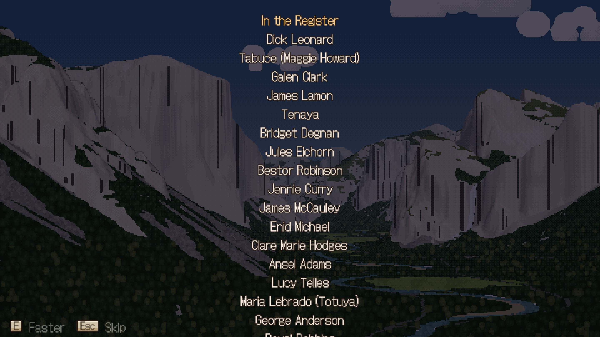

**Settings** are on the pause menu (Esc, then Settings) and on the title screen, and are kept in `user://settings.cfg`, apart from your save: text speed (Slow, Normal, Fast, Instant), full screen (Off, Fill or Pixel perfect: the picture grows in any step it needs, so Fill covers a 2560x1440 monitor or a Steam Deck edge to edge, with thin bands only on a screen of another shape, like the Deck's 16:10; Pixel perfect keeps every pixel the same size by growing only in whole steps, 2x or 3x, and leaves a border where the screen isn't a whole multiple of 960x540, which was the only choice before, so a 1440p monitor showed the 1080p picture in a black frame and a Deck used about half its screen; `Settings.stretch`, and `tools/shots/screen_fill_shot.tscn` photographs the whole screen to compare), window size (whole steps of 960x540, up to what fits your screen; a window you drag to another size is filled too), whether your next main-story step shows under the clock, button prompts (Auto, or always keyboard or always gamepad), signposts at the screen's edge (on or off; see *Signposts* under [Exploring](#exploring-places-to-discover)), the trip map (on, or off for the old fade to black; see [Open world](#open-world)), the two assist options below, the font (DotGothic16, a pixel font that matches the art, with its Latin letters set proportionally by `tools/fonts/proportional.py`, by default, or smooth Noto Sans), graphics (Auto, the default, High or Low: High runs the Forward+ renderer and draws at the window's size; Low, for older computers, draws the picture at 960x540 and scales it up, a quarter of the pixels at 1920x1080, and runs the simpler Compatibility renderer, which takes effect the next time the game starts, through the override file `user://graphics.cfg` that `project.godot` reads at start-up; Auto is High until `GraphicsWatch` (`scripts/world/graphics_watch.gd`) finds the computer slow, either at once, when there is no Vulkan or no graphics card, or when, for 8 seconds of play, the typical frame takes over 25 ms or more than one frame in five does (a 60 Hz screen's steady stutter from a graphics chip that can't keep up, like an older laptop's, where the typical frame still looks quick), then it switches to Low, says so, and remembers it; picking Auto again in Settings looks afresh. Low also halves the weather's rain, snow and petals), four volumes (the whole game, music, sound effects, and ambience, in steps of 10%), and Controls. **Controls** (also on the pause menu's main page) lists every control's key and gamepad button in two columns; pick one and press a new key to change it. A key another control had swaps over, Esc keeps the old key, and Esc, Enter, Tab and the arrows stay with the menus. Each action keeps its other keys (the arrows, C, X) and its gamepad buttons, and every hint in the game (`HUD.prompt`, `MenuInput.button`, through `Settings.key_text`) names the key you chose. Reset keys puts them all back. Changed keys are saved under `[keys]` in `settings.cfg`. The page shows thirteen rows at a time and scrolls with the cursor; the card beside the list says when there are more above or below. The code is `scripts/ui/settings.gd`; `tools/shots/saves_shot.tscn` photographs the save slots and the Controls page.

**Assist options.** Every activity is a timing test, so Settings has two ways to make them easier, for anyone who finds them too quick or can't tap fast. **Activity timing** is Standard, Relaxed or Gentle. Relaxed and Gentle slow the moving marker to 75% and 55% of its speed (`Settings.pace()`) and make the green 1.3 and 1.6 times as wide (`Settings.room()`): the climbing cruxes (which also get that much more time on the ones with a time limit), both casts and the fish you follow on the reel, the Half Dome cables, the trail crew's rock bar, and the slackline, which sways and walks slower. **Hold to tap** is for the climbing cruxes that want quick taps (Up, or Left and Right in turn): hold the key and it taps four times a second, either side counts, and the card says "Hold Up!". Nothing else changes: the rewards, perfects and stories are the same at every setting. Both are saved under `[assist]` in `settings.cfg`, and `tools/shots/assist_shot.tscn` photographs the settings and a crux at Standard and Gentle.

**Rumble, and pausing when you look away.** A controller rumbles on the moments you'd feel: a fall, a crux stuck perfectly or slipped, a piece clipped, the top, a fish taking the fly and coming to hand, a gust or a bucking line on the slackline, a heart won with a gift, and a quest done. Each is short and soft (`Rumble.CUES` in `scripts/ui/rumble.gd`: weak motor, strong motor, seconds), it only goes to the gamepad you last pressed something on, never while you're on the keyboard, and **Vibration** in Settings turns it off. Switch to another window and the game pauses (`LookAway`, `scripts/ui/look_away.gd`): out walking that opens the pause menu, and in the middle of anything else (a climb, a conversation, the slackline) the whole game holds still under a "Paused" card until you press a key or a button back at the window. **Pause when away** turns that off. Both are saved under `[input]` in `settings.cfg`.

**Report a problem.** For playtesters: press **F8** anywhere in a game, or pick **Report a problem** in the pause menu (the way in on a controller). The game holds still under a card, you type what happened (or nothing) and press Enter, and it writes one zip to the `reports` folder beside the saves, then names the file and can open the folder. Nothing is sent anywhere; the tester mails or uploads the file. The zip holds `screenshot.png` (the game as it was when you pressed the key, without the card or the pause menu), `report.txt` (the note; the area, spot, date and time; the save slot, the main goal and the quests under way; the system, processor, graphics card and renderer; the controller; and the settings), `save.json` (the slot's saved game) and `godot.log` (the session's log, where script errors show). `ProblemReport` in `scripts/ui/problem_report.gd`; World adds one. `tools/shots/report_shot.tscn` photographs the card.

Controls are set in **Project > Project Settings > Input Map**.

**Water only where there is water.** The water's reflections (`WaterSurface`) read the whole screen, so they are drawn only over the parts of the view near painted water, and not at all when none is in view. `python3 tools/perf/water_cells.py` finds the water in each region's painted ground, in 32-pixel cells, and writes `data/park/water_cells.json`; run it again after repainting a ground (a ground missing from it is drawn over the whole view, as before).

**The renderer.** The game runs on Godot's Forward+ renderer, which brings real 2D lights, shadows and glow (the lit-diorama work builds on it). `tools/shots/renderer_compare.sh` takes a screenshot tour of the park (`tools/shots/renderer_tour.tscn`: fourteen areas in the morning, at sunset and at night) under the Compatibility renderer and under Forward+, and compares them picture by picture (`tools/shots/compare_shots.gd`); the Renderer workflow (`.github/workflows/renderer.yml`) runs it on every pull request with software drivers and uploads the pictures and their differences.

**Real light (High graphics).** Every outdoor area is lit by real 2D light on the art's own relief. `python3 tools/normals/normals.py --outdoors` paints a normal map for each sprite those areas use (`assets/normals/`, mirroring `assets/sprites/`) by reading the painted shading back as height and rounding each shape's edge; glows, windows and shadows get none. `LitSprites` (`scripts/world/lit_sprites.gd`) puts them on the sprites through `assets/shaders/lit.gdshaderinc`. `SunLight` follows the `Sun` across the sky, so the morning sun catches the east sides of roofs, trunks and rocks and the evening sun the west (it isn't a `DirectionalLight2D`, which Godot runs over every canvas item whatever its light mask, a light pass on the whole picture; it hands the sun to the lit shaders as the global uniforms `sun_toward` and `sun_light` and lifts the canvas modulate by the same amount the light used to add to everything else, so the picture is unchanged), and the lamps (`NightLight`) light the sides of things facing them. After dark, `AirGlow` gives the lights real glow in the night air in place of the halo sprites. Low graphics keeps the painted look, with the halos.

Rooms are lit too (`--indoors` paints their maps): by day `SunLight` is the window light falling from the back of the room, and as the day outside fades `RoomLight` dims the room to a warm low light while its lamps, stoves and hearths (`LampLights.LIGHTS`) come up and light the floor and furniture round them, glowing in the air; the Ahwahnee's Great Lounge is lit by its two hearths. The rooms' windows follow the clock too (`RoomWindows`, `scripts/world/room_windows.gd`): the pictures are painted at noon, so it takes the painted sun off the floor as the day goes, lays the low sun in long, warm and leaning across the room at either end of the day, lets a faint moonbeam in on clear nights near full moon, and turns the glass to the hour's sky (gold and pink at dusk, deep blue with stars at night, grey under cloud). Where each room's windows and shafts are is in `data/park/room_windows.json`, written by `tools/hubs/interiors32/room_windows.py` from the room painters; `tools/shots/room_windows_shot.tscn` photographs rooms through the day. On the climbing screen, `ClimbLight` (`scripts/climb/art/climb_light.gd`) draws the wall on its own canvas item through `assets/shaders/lit_luma.gdshader`, which reads the relief from the painted rock as it draws, so the sun rakes across the face from its side of the sky and after dark the climber's headlamp throws a real pool of light on the stone. The Lighting workflow (`.github/workflows/lighting.yml`) photographs every outdoor area at dawn, noon, dusk and night, a few rooms by day and at night, and the climbing wall through the day, unlit and lit side by side, on every pull request.

## The core loop

Start at the Mountain Shop in Curry Village. The clerk, Marty Kessler, trades you a climbing guidebook for food (after you fetch the new printing from the Registration porch), then fits you with your first kit: climbing shoes, a chalk bag, a harness, and five quickdraws. Marty sends you to Wren Alvarez, a new hire looking for a partner, and the two of you climb **Firefall Slab**, a bolted route on the Glacier Point Apron, for your first tick. The guidebook lists every route, its grade, and the gear it needs, and you tick a route off when you top it out. The main story is that tick list: each main quest ends on a climb. Talk to people around the valley. Their quests reward you with climbing gear, recipes, and skills, and the climbers at Camp 4 trade more gear for food. Each climbing route needs certain gear before you can start it. Climbs lead to new parts of the park: the Glacier Point Apron, for example, opens Glacier Point.

Climbing runs on food. Each morning, wild forage appears around your camp, depending on the season and habitat. Fresh greens and berries give quick energy but spoil in days, so throw them in the cooking pot at any campfire: like Breath of the Wild, whatever you put in makes a dish worth more than the raw food, that keeps longer, and sometimes helps on the wall (see Cooking in the pot below). In fall, gather black oak acorns and store them in a chuckah (a granary) where they never spoil. Then grind them at the bedrock mortar, leach them at the basin, and cook them into mush or long-lasting acorn cakes at the campfire. The main screen stays clear: everything else is in a book with four tabs. Press J for the Journal (the Register, the guidebook's tick list, and perks), Q for your Quests, P for the Press Book, and B for the Backpack, which shows your gear, food, and forage as a grid of slots. Tab flips between them.

**The press book** is the other half of the story. Enid Michael, at the Museum's wildflower garden in Yosemite Village, hands you an old plant press, and from then on you can walk up to any of the park's 133 plants and press a sprig (a plant you haven't pressed yet glints, and a rare one glints gold). Each grows where and when it really does, the food plants of your forage among them: redbud and buckeye down at El Portal, sequoia in the Mariposa Grove, Jeffrey pine on Sentinel Dome, white heather at Tuolumne, wildflowers only in their season. Plants are common, uncommon, rare or very rare: a common plant grows in three patches in each place it grows, an uncommon one in two, and a rare or very rare one in a single patch, often in one season and one place. You take a sprig and leave the plant; the protected ones (the snow plant, the orchids, the park's own endemics like Congdon's lewisia and the Yosemite bog orchid) you only sketch, and poison oak you sketch from a careful step away. The Press Book tab shows every plant as a slot with its rarity: the ones you have, with where you found them, and the rest as shadows that say where and when to look, with a tally of your rare finds. Naturalists and rangers ask for plants the way climbers ask for ticks, and the old press's labels ("Collected for the Guardian of Yosemite") are a mystery that runs to the end of the game. The code is `scripts/story/herbarium.gd` (the plants and the book), `scripts/world/plant_spawner.gd` (where they grow) and `scripts/objects/plant_specimen.gd`.

As you play, the valley teaches you **perks**: small, permanent bonuses earned from people and experience, never bought. Foraging 25 finds earns *Enid's Eye* (one more find each morning), learning to belay from Dick Leonard earns *Leonard's Belay* (more rest at each ledge), two weeks of mornings earns *Muir's Stride* (a quicker walk), and so on. The Journal lists all ten and how to earn the rest. They're in `scripts/story/perks.gd`, and [docs/DESIGN.md](docs/DESIGN.md#perks) has the table.

Sleep in the tent to end the day, which also saves the game. First comes the day's page: the date, then what the day brought, counted out one by one (see [Game feel](#game-feel)). You can also save any time from the pause menu (Esc, then Save game, then a slot; saving into another slot moves the game there, after asking if that slot holds another game): it keeps where you're standing, the time of day, and everything you're carrying, and Continue on the title screen picks up right there. If you're still up at 2 AM you pass out, and the game moves to the next day anyway. Once you have a wilderness permit you can also sleep out at the backcountry camp in Little Yosemite Valley (see *The first night out and Half Dome*).

## The first day

A new game teaches itself as you go, one small step at a time, with no text walls. A little card under the clock names the next thing to try with its button drawn in ("[WASD] Walk around camp", "[E] Talk to Galen Clark"), and a gold arrow points the way to what it's about: it bobs over a campfire, a tent or a fishing hole when it's on screen, and sits at the screen's edge pointing toward it when it isn't (a person's own quest bubble marks them, so the arrow only points from off screen). Do the thing and the line turns green with a soft chime, and the next one slides in.

The lessons wait for their moment rather than a schedule: walk, talk to Clark, gather three things to eat, look in the backpack, check your quests, run, then out the south gate to Curry Village and a look at the map. When evening comes it's supper at the campfire (if you have something raw for the pot) and then bed in your tent; once Wren is waiting at Firefall Slab it's the climb, and once Greg's rod is in your pack it's a cast. Anything you've already done by yourself is marked off without being shown, and the climbing and fishing screens teach their own buttons once you're on them. The buttons follow the device you're using. **Tips** in the pause menu's Settings turns the card off, and saves from before it existed load with it finished.

The code is `scripts/story/first_day.gd` (World adds one; it saves which lessons are done), and `tests/first_day_test.tscn` walks through it.

## Game feel

The small touches that make the Valley feel alive, in the spirit of Stardew Valley. [docs/POLISH.md](docs/POLISH.md) goes through Stardew's hallmarks one by one: what this game does for each, where it lives, how it's checked, and what isn't done. The tests are in `tests/polish_test.tscn`, and `SHOT_DIR=/tmp/shots xvfb-run -a godot --path . res://tools/shots/polish_shot.tscn` photographs each one.

- **Item cards.** Whatever you pick up, cook, buy, or are given slides in on a card at the top left (clear of the description message at the bottom left): its picture, its name, and how many. A second strawberry while the card is up counts it ("Wild Strawberry x2") with a little bump instead of stacking another card. New gear gets a brighter chime. Forage and story items hop up off the ground and fly into your pack. The cards drop below the place name while it shows and hide under the book (`scripts/ui/item_toasts.gd`, `scripts/world/pickup_pop.gd`).
- **Portraits and voices.** Everyone who talks has a portrait in a frame at the right of the conversation box, in one of four moods (neutral, happy, sad, surprised) that each line picks, by name (`"mood": "happy"`) or from its words (`Portraits.mood_for`), painted by `tools/npcgen/portraits.gd` from the same look data as their walking sprite (`docs/cast_portraits.png` shows the whole cast). Their words type out with soft blips at a pitch of their own (`scripts/story/portraits.gd`), the box rises in with a swish, and choosing and confirming click like the other menus.
- **Friends and gifts.** Each person has up to five hearts, earned by talking each day, finishing their quests, and a gift once a week: face them and press G (LB on a gamepad), then pick something from your pack. Everyone likes good food, and each person loves a couple of things from their story (John Muir's dry bread crusts and tea, Enid Michael's wild greens); nothing ever loses you a heart. Hearts show in the Journal's Friends section, rise over the person as they grow, and are listed on the day's page (`scripts/story/friendship.gd`, `gift_giving.gd`).
- **Everyday talk.** When someone has no quest for you and no news of the story, they talk about the day: a line for each season, for rain and for snow, for the morning and the evening, for where they're standing (Bridget Degnan cooling off in Cook's Meadow after a day at the oven, Dick Leonard at the Camp 4 fire, Greg on the riverbank at dawn, Enid Michael in the Museum garden or up on Sentinel Dome), and more as they get to know you (at 2 hearts and at 4). Their usual lines stay in the mix, a wet day mostly gets talk about the rain, and nobody says the same thing twice running. Word gets about, too: for a couple of days after a first ascent, a rescue, a first or trophy fish, or a bear, bobcat, peregrine or great gray owl, the people who'd care bring it up, once each (whoever gave you the quest has already heard). A gift someone loves gets thanks in their own words (`scripts/story/small_talk.gd`; the news is kept by `Friendship`).
- **Heart scenes.** At 3 hearts and again at 5, each person has something to tell you, once: a story from their life, a question for you (what you say is up to you, and they answer it), and a small gift. A pink heart in their bubble says one is waiting, and the Journal's Friends page says who has something to tell you; they tell it the next time you talk with nothing else going on. After the 5-heart scene they save you something every week, handed over when you next talk. For the historical people the scenes keep to what's on the record of their lives and work, as their other lines do; the invented staff's are freer (`scripts/story/heart_scenes.gd`). The Native characters keep the lines the tribes have reviewed: new everyday lines and heart scenes for them wait for the tribes' next review (`SmallTalk.AWAITING_REVIEW`).
- **Daily routines.** Visitors head home in the evening, each at their own hour between 8 and 10 PM, come back out at 7 AM, and about half stay in when it rains, so the Valley empties at night. People with quests stay out: you can always find them, at their spot through the middle of the day (`NPC.is_out`).
- **Timetables.** In Curry Village and Yosemite Village the townsfolk keep a day of their own, like Stardew's villagers: the cook goes to the Pavilion at 7:40, the lifeguard to the pool, the postmaster to the post office and on to the store and Degnan's, and everyone walks home at night and goes in. A stop is a time and a spot (`timetable = ["9:00 plaza", ...]` on an NPC in the story overlay); they walk there round buildings and props on a walk grid (`scripts/world/walk_grid.gd`) and stroll about it until the next.
- **The cast keeps a day too.** In the two towns, people with quests have their own errands morning and evening and are at the spot the Journal names from about 9 to 4, lunch aside: Ansel Adams walks out to Cook's Meadow for the morning and evening light, Salathé fetches his bread at Degnan's, Clare Hodges patrols Camp 4 and the falls trail, Jennie Curry lunches at the Pavilion. Evenings draw a crowd: Leonard, Salathé and Hodges round the Camp 4 fire, Jennie Curry, Jules Eichorn and the camp at the amphitheater. Native characters keep to their places; their days are for the tribal review to shape. Overnight they stand at their spot and doze (`timetable` on the NPC, as for visitors).
- **People going somewhere.** Six invented visitors walk between the Valley's areas on a day of their own. Two climbers leave Camp 4 at 6:20 with the rope and the haul bag, walk Northside Drive and across Leidig Meadow to the foot of the Nose, spend the day there and are back at the Camp 4 fire for supper; a patrol ranger walks the river road out to Curry Village and back; a kid from Housekeeping Camp is sent to the Village store and the post office; a hiker from Upper Pines makes Mirror Lake by breakfast; and a guest from the Ahwahnee walks to Best's Studio for a photograph and back for tea. Where each one is comes from the clock alone (standing at a stop, or part way along the walk to the next at a steady pace), so it holds after a nap or a drive and nothing is saved. Whoever is in the area you're in, or the one laid beside it at a seam, walks there, round buildings and props, and over the seam into the next area with no fade; stand in their road and they stop a moment, then go on by, and they hurry a little to make up time after you've stopped them to talk. Talk to them and they say where they're off to, or what they're doing there. The climbers sort gear in camp on wet days, the kid, the hiker and the guest stay in, and the ranger goes out in any weather. Their days are `Travelers.PLANS` in `scripts/world/travelers.gd` (World adds one), the walker is `scripts/world/traveler.gd`, and every walk is measured on the maps into `data/park/walks.json` by `godot --headless --path . res://tools/travelers/measure_walks.tscn`, which prints each one's day: run it again after changing a plan or a map. `tests/travelers_test.tscn` checks every walk is measured and their days, then follows the climbers over a seam in the real game; `tools/shots/travelers_shot.tscn` photographs them.
- **Faces over heads.** People show what they feel in a little bubble as they talk, as Stardew's villagers do: **!** when surprised, a note when glad, a heart for thanks, a drop when it's hard to say, **?** at a question, "..." while they think (`scripts/story/emote.gd`; `DialogueBox.say` tells whoever is speaking, `NPC.on_line` and `Vendor.on_line` pick the bubble from the line's mood). A friend (a heart or more) waves when you walk up, once a day; people blink and glance about while they stand; and late at night the cast dozes on their feet, eyes shut, "Zzz".
- **People move like people.** Everyone's sprite sheet (`tools/npcgen`) has a column for each pose: standing, two steps, a blink, two running strides, crouching, arms up, reaching out, carrying someone (standing and two steps) and talking (`CharacterSheet` in `scripts/player/character_sheet.gd` reads them, and falls back to the first three columns on a sheet that hasn't got them). Walking is a four-frame cycle (a step, passing, the other step, passing); running has its own longer, leaning strides and kicks up a spray of dust behind you. Stand about and you blink, look round now and then, and after a while stretch (with a yawn late at night). You crouch to pick up forage, a story item or a plant for the press; on the bank your rod goes back over your shoulder on the back cast, out over the water on the forward cast, and the line lies on the water and runs taut (the rod bowing) while you reel, with the arms up to show the fish off; you hunch under whoever you carry on a rescue; you lie down to sleep and stretch on waking. People talk with their mouths while their line is up (shopkeepers too), wave a friend in with an arm up, and kick up dust and leave prints in the snow as they walk (`Footfall`, quietly). A rescue's lost hiker waves both arms. Bears and deer walk on four frames too, bears root about with their noses and deer chew with an ear flicked back and flick their tails up while they watch you (`tools/npcgen/bear_art.gd`, `deer_art.gd`). `docs/character_poses.png` shows the poses; `tools/shots/anim_shot.tscn` takes screenshots of them in the game.

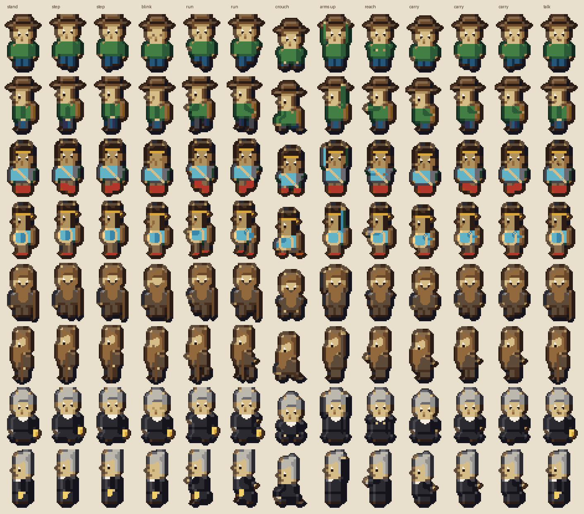
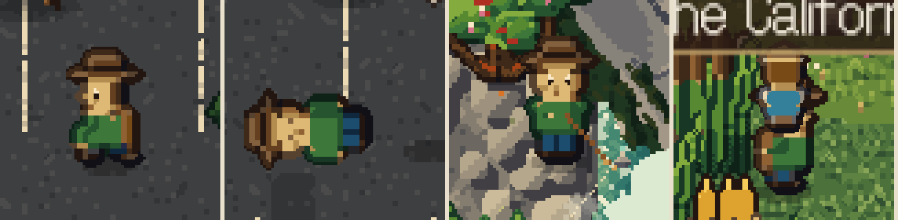
- **The story's moments.** When one of the Guardian sightings comes true, the next time you're free the screen letterboxes and shows it as its witness saw it: Lamon looking up from his orchard at a speck on the Apron at sunrise, the Apron from Camp Curry, Nutcracker in the afternoon, the wreck at El Portal, the figure in Ansel Adams's print (in black and white), a headlamp on the Nose at night, a climber by Muir's stakes on the Lyell ice. The view rises slowly, painted by the climbing screen's sky and skyline painters; the witness's face and words (the sighting's own, so nothing new is said for anyone) type out below, over a music sting. Each plays once; confirm or cancel skips it (`scripts/story/story_moments.gd`, `story_vista.gd`; `SHOT_DIR=/tmp/shots xvfb-run -a godot --path . res://tools/shots/moments_shot.tscn` photographs them).
- **The wild ground.** Outside the towns the forest floor isn't bare: drifts of needles and cones under the lodgepoles, twigs, ferns and seedlings under the Wawona pines, leaf litter and dry grass in the El Portal foothills, polished slabs and lichen on the granite, now and then a log or a stump, and at every campsite somebody's gear, no two alike (a cooler, folding chairs, a lantern, a water jug, a stove, boots, a clothesline); Camp 4's sites have crash pads, rope coils and haul bags. `tools/hubs/wild_clutter_art.gd` draws them, `tools/hubs/dress_wilds.gd` lays them out (seeded, never on a road, trail or lot, never crowding a spot, door or sign, and nothing solid where you couldn't walk round it) in `scenes/regions/dressing/wild/`, and `Region` adds each area's layout when it loads, so no builder rebuild loses it. The flat things turn with the seasons like the painted ground. Rebuild with `tools/hubs/rebuild_wild_dressing.sh` (after any builder that moves things about).
- **Towns that look lived in.** Crates, milk cans, trash cans, picnic tables, flower beds, an ice chest, firewood, a mailbox and worn lawn fill both towns' plazas and shop fronts (`tools/hubs/town_clutter_art.gd` draws them, `tools/hubs/dress_towns.gd` places them in `scenes/regions/dressing/`), and the parked cars stand up in 3/4 view.
- **Quest bubbles.** Someone with something for you wears a bobbing speech bubble: an orange **!** for a new quest (or a quest that sent you to them) and a blue **?** when talking to them finishes one (`QuestLog.marker_for`, `scripts/story/quest_marker.gd`). Shopkeepers with quests have one too, and people give a small hop when you start talking.
- **The clock's sky.** Beside the time, a little window of sky: the sun climbs over Half Dome and sets, the moon and stars follow at night, the sky turns from dawn to gold to dusk, and the day's clouds, rain or snow show in it (`scripts/ui/clock_dial.gd`).
- **Music.** Short pieces that follow the day: one for first light, a morning and an afternoon piece for each season, one for the evening, one for the night, and the title theme. They play the way Stardew's do: a piece now and then, with the birds and wind on their own in between. Music rests in the rain and on the wall, comes in softer indoors, and fades when the hour or the season calls for another piece. See [Sound](#sound).
- **The day's page.** When you sleep, a page comes up over the black before morning: what you found and were given (with pictures), new gear, first ascents, finished quests, perks, recipes, and dishes cooked, or "A quiet day in the Valley" (`scripts/story/day_log.gd`, `scripts/ui/day_summary.gd`).
- **Birds and butterflies.** Steller's jays, juncos, robins and California quail hop and peck about on open ground and flutter off as you come near, with acorn woodpeckers down among the Valley's oaks and Clark's nutcrackers up in the high country; butterflies drift over on fair spring and summer days (`scripts/world/critters.gd`, sprites from `tools/npcgen/critter_art.gd` and `tools/npcgen/wildlife_art.gd`).
- **Squirrels.** Each kind where it lives: western gray squirrels in the Valley's oaks and pines, California ground squirrels on open ground in the Valley, at Glacier Point and Wawona, Douglas squirrels (chickarees) in the conifers up high and at Wawona, and golden-mantled ground squirrels among the high granite. The ground squirrels sleep through the winter. A squirrel sits up to nibble, looks about, scampers a little way, and dashes off when you come close (`scripts/world/critters.gd`).
- **Peregrine falcons.** Under the big walls (El Capitan, the Cathedral Rocks, Glacier Point, Half Dome and the rest), one now and then comes sailing over high, circles, folds its wings and stoops on a swift below, with a puff of feathers at the strike, then climbs away. Its shadow runs along the meadow far below. They're about most in spring, when they're feeding young. On a big wall (400 feet and up) you may see one stoop past from the climbing screen too (`scripts/world/falcons.gd`, `ClimbMinigame._update_falcon`).
- **Great gray owls.** At Crane Flat, Wawona and the Big Oak Flat Road's meadows, most at dawn and dusk, a great gray owl comes gliding low and silent, drops onto a vole, and sits in the grass turning that huge round face to listen. Walk up slowly and it only turns its face your way before it drifts off (`scripts/world/owls.gd`, `scripts/world/great_gray_owl.gd`).
- **A bobcat, if you're lucky.** Rare, and seen most in the meadows at dawn and dusk and in winter: one slinks through the grass, crouches to stalk a vole and pounces. Come close and it freezes and stares at you, ear tufts up, then slips away (`scripts/world/bobcats.gd`, `scripts/world/bobcat.gd`). The squirrels, the new birds, the falcon, the owl and the bobcat are painted by `tools/npcgen/wildlife_art.gd` (`WildlifeSheet` knows where each is); `SHOT_DIR=/tmp/shots xvfb-run -a godot --path . res://tools/shots/wildlife_shot.tscn` takes pictures of them, and `SHOT_ROUTE=the_nose SHOT_SPECIAL=falcon` the climbing screen's falcon.

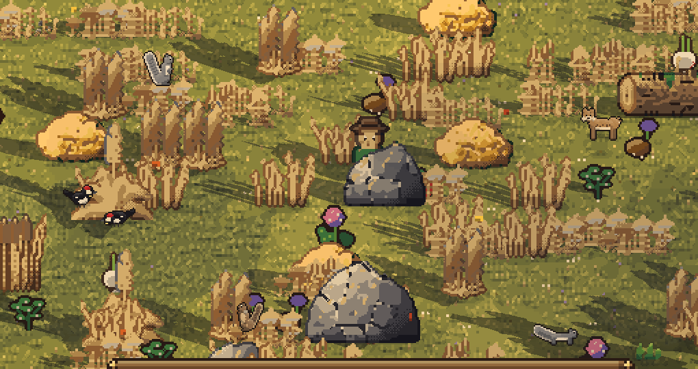

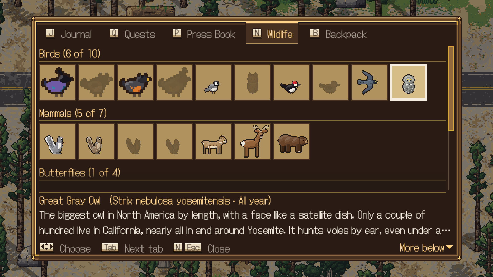
- **Bears wander by.** Walk about outdoors and now and then a black bear ambles in from the edge of the view, stops to nose at the ground, and goes off the other side. Like most of Yosemite's black bears it's usually brown or cinnamon, sometimes blond, only now and then black, and in spring and summer a mother may have a cub or two at her heels. They come round most in fall, when they're fattening up for winter, and at dawn and dusk (more so by a campground with bear boxes), hardly ever in winter, and not in the dark of night. Come too close and the bear lifts its head to look at you (and you're reminded to give it 50 yards), then moves off away from you, at a lope if you run at it. A good look puts it in the field log. They never hurt you (`scripts/world/bears.gd`, `scripts/world/bear.gd`, sprites from `tools/npcgen/bear_art.gd`).
- **Mule deer graze across.** More often than the bears, and all year (many come down to the Valley for the winter), a doe or two or three graze their way across the view, most at dawn and dusk. In summer a doe may have a spotted fawn or two; from summer into winter a buck may come by alone, his forked antlers in velvet in summer. Their coats are reddish in spring and summer and gray from fall. Come close and they lift their heads and stare, big ears up, then go off in the stiff-legged bounds mule deer are known for, fawns and all. They're in the field log too, with the reminder that deer hurt more visitors than bears do (`scripts/world/deer.gd`, `scripts/world/mule_deer.gd`, sprites from `tools/npcgen/deer_art.gd`). Bears and deer share their wandering in `scripts/world/wanderers.gd` and `scripts/world/wanderer.gd`; `SHOT_DIR=/tmp/shots xvfb-run -a godot --path . res://tools/shots/bear_shot.tscn` takes the pictures below.
- **Plants rustle.** Ferns, bracken, shrubs and flowers sway and rustle when you brush past them (`scripts/world/rustle.gd`).
- **Wind.** The valley moves. Every tree and plant sways, rooted at its foot and leaning from the top (a tall pine's crown by up to ten pixels, a fern by three; snags, stumps and fallen logs stand still, and the giant sequoias hardly stir), and every ten seconds or so a gust crosses the view: a band of grass blades catching the light runs over the meadows, and each tree bends as the band reaches its foot. It blows harder under cloud and hardest in rain and snow. The sway is drawn by the sprite's shader a row at a time in whole pixels (`assets/shaders/sway.gdshaderinc`, the gust itself in `wind.gdshaderinc`, the grass in `seasonal_ground.gdshader`), so nothing moves in the scene and shadows, collisions and the rustle are as they were. `Wind` (`scripts/world/wind.gd`) says which art sways and how far and keeps the `wind_strength` shader global up to date. It works on High and Low alike. **Wind** in Settings turns it off for anyone the movement bothers. `tools/shots/wind_shot.tscn` films it with Godot's movie writer.
- **The ground and the people feel the weather.** In the rain the paving, dirt and sand darken, puddles gather on bare ground (never on grass) holding a dull grey sky, and rings spread on the puddles and the river as the drops land; the morning after a rainy day the ground is still wet at dawn and the puddles shrink away by late morning (`Seasons.wetness()`, drawn by `seasonal_ground.gdshader`, fed by `SeasonalDressing.apply_wet()`). With snow lying, the player, the people about and the deer and bears leave tracks behind them, two boots side by side, that fill back in over a minute (sooner while it snows) and start fresh in each area (`Footprints`, `scripts/world/footprints.gd`, drawn with a multiply blend so they show as blue dents on the snow and vanish on the ploughed asphalt). And in the cold (all winter, and on spring and fall mornings before the sun is well up: `Seasons.cold()`) everyone's breath shows as a small white puff every few seconds, quicker while walking, but not by a campfire (`Breath`, `scripts/world/breath.gd`). All three work the same on High and Low. `tools/shots/weather_fx_shot.tscn` walks the player a lap and photographs it.
- **Pictures in the shops and at the fire.** Every trade and every dish in a choice list shows its picture (`DialogueBox.choose` takes an icon per option).
- **Every food has a picture.** The acorn chain and the campfire dishes are drawn by `tools/ui/food_icons.gd` in the forage icons' style.
- **The camera looks ahead.** As you walk, the view eases a little ahead of you (36 pixels across, 20 up or down), so you see where you're going, and settles back over you when you stop, talk, or open a screen. It swings round more slowly than you turn, so changing direction glides. Under a cliff the tilt up at the wall wins over leading up or down, rooms don't lead, and doors and spawns start it afresh (`LandmarkFraming.lead`).
- **Screens open with the wipe.** The climbing wall, the slackline, the Half Dome cables, rock work and a rescue lower used to pop up in one frame. Each now opens out of the same pixel diamonds the game wipes between places with, and the valley opens up the same way when you leave. The wipe is a cover drawn on top, so it never holds anything up (`scripts/ui/screen_wipe.gd`).
- **Transitions that never skip or cut.** Every change of scene (the wipe between places, the door opening onto a room, the trip map's veil, the wipe over the minigame screens) runs on one clock and one curve, a sine that eases in and out, with set times: 0.45 s to cover and 0.55 s to uncover, 0.5 s for a door, 0.35 s and 0.5 s for the trip map, 0.4 s for a screen (`scripts/ui/transition.gd`, `Transition`). Laying a new place out takes a long frame or two, and the wipes used to start on it, so most of a door or a fade could pass in one or two frames and the place seemed to jump in. Now the cover (the black, the picture of the room you left, the map) stays up until the new place draws evenly again (three quick frames in a row, at most 0.6 s), and no frame moves a wipe on by more than a thirtieth of a second, so a hitch slows it for a frame instead of skipping it. The trip map goes fully dark for the moment the place changes beneath it, so the old place never cuts to the new through the veil, and the HUD fades out and back with it instead of vanishing. `tests/transition_test.tscn` checks it; `tools/perf/fade_profile.tscn` goes through a door, a fade, a trip and a drive and prints each frame's time and how far the cover had got (a door now opens over about 16 frames on a slow software renderer, where it took 4).
- **Bursts for the moments that count.** A find that flies into your pack lands in a twinkle of gold, a trout comes out of the water in a spray of drops, and finishing a quest sends warm motes rising round you. Finds lying on the ground catch the light every few seconds, so a berry reads as something to pick up (`scripts/world/sparkle.gd`, `scripts/world/glint.gd`). Low graphics draws half the motes and no glints.
- **Skids.** Pull up from a run and your feet throw a puff of dust out either side (spray in the rain, powder in the snow, nothing off frozen winter ground or indoors), on top of the dust, prints and breath every step already made (`Footfall._skid`).
- **Buttons that press.** The line you choose in a menu (the title screen, the pause menu, a setting, a conversation's choices) flashes bright and settles, and its arrow pokes in a pixel and back, so a choice lands like a button going down and not only as a sound (`MenuInput.press`).

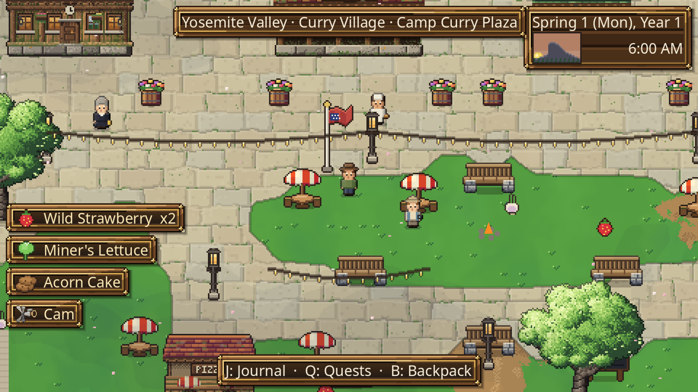
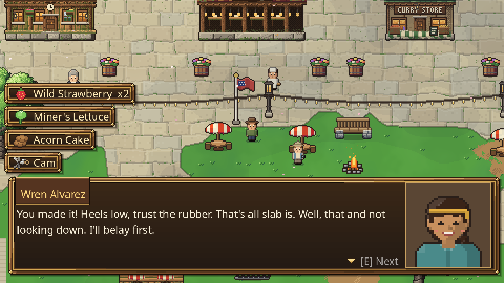
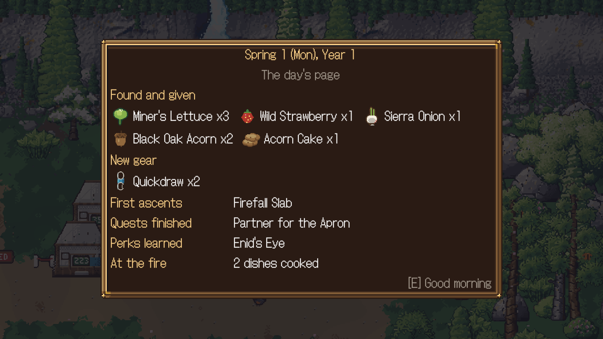
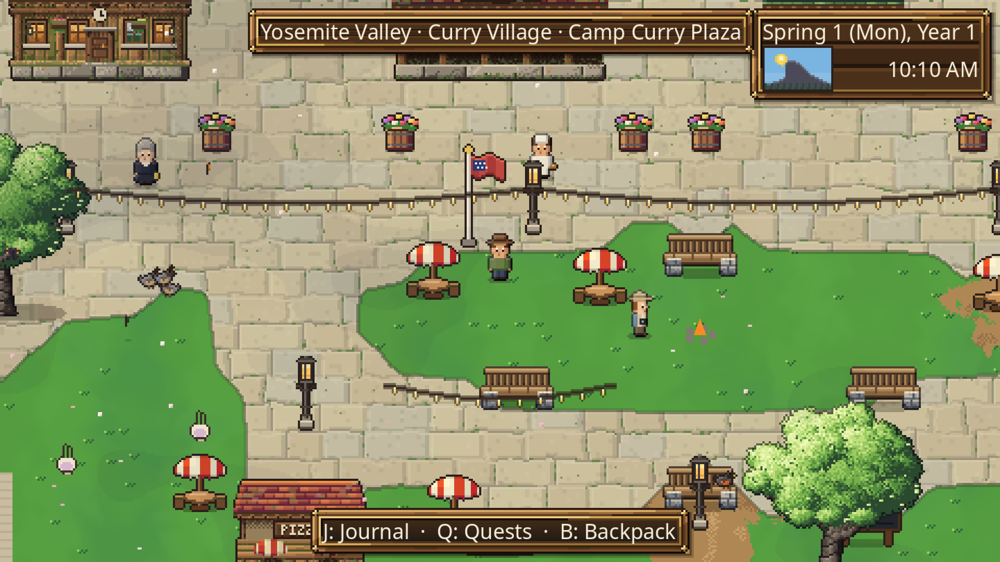
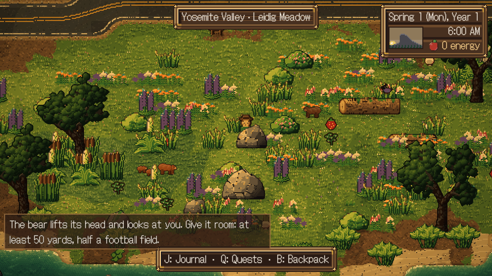
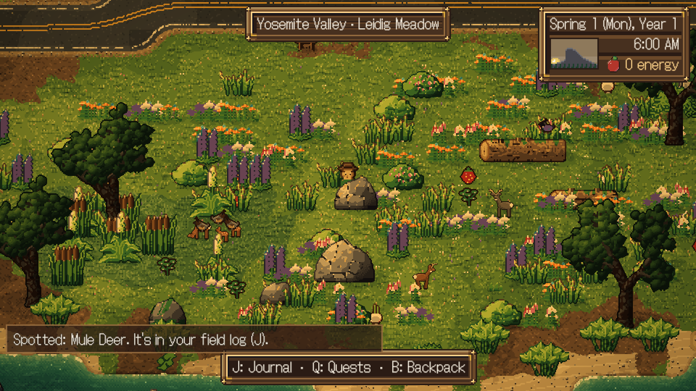
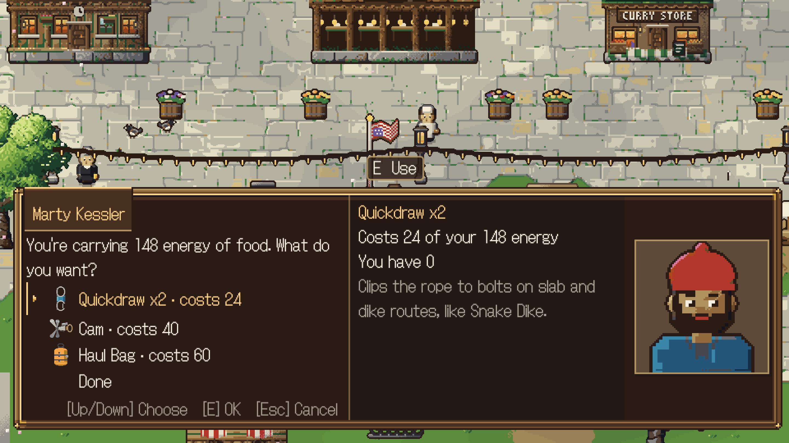
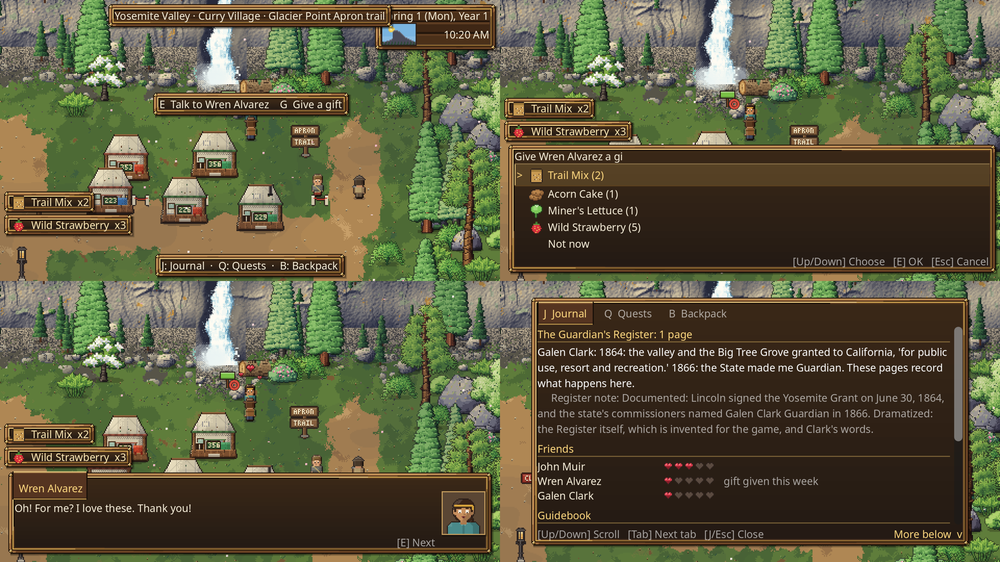
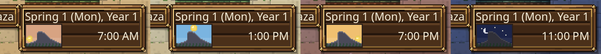

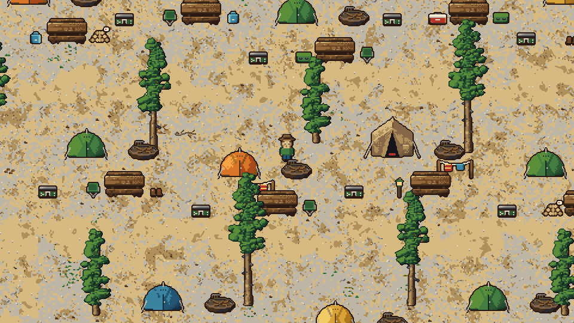
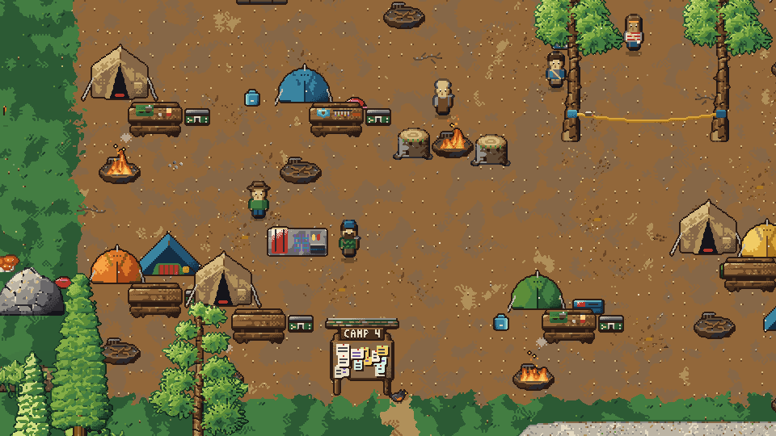
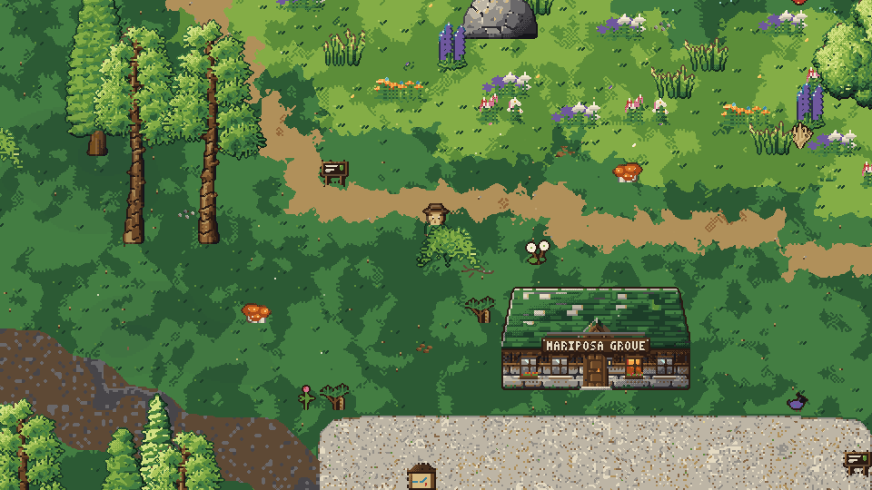
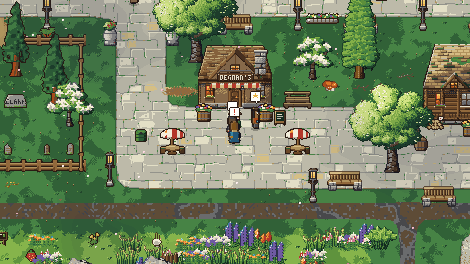
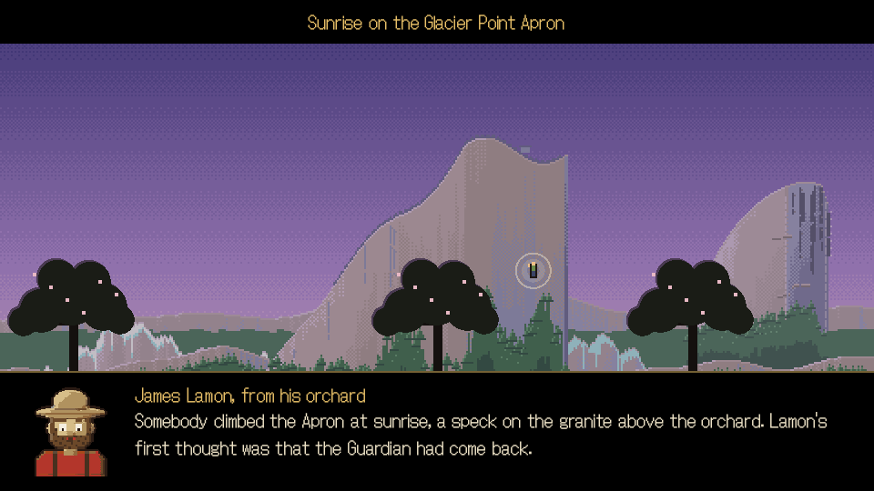
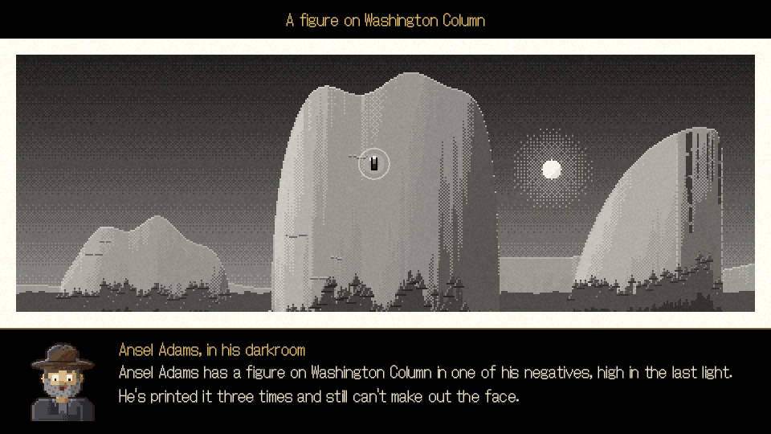
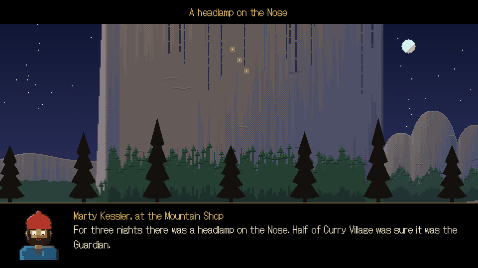

## Valley life: the board, the field log, fishing and festivals

Things to do between climbs, borrowed from the cozy games and fitted to the park.

- **The Camp 4 bulletin board.** Like Stardew Valley's Help Wanted board, it pins up a note or two each morning from people you've talked with, asking for something in season: wild strawberries for Bridget Degnan's tarts, yerba buena for John Muir's tea, chanterelles for the Ahwahnee's kitchen. Read the board to take them (up to three at once). A note for something that grows only in the high country waits until you can travel to Tuolumne. They go in your Quests with how many you have and how long you've got (a note stays good three days), and you hand the things over just by talking to whoever wrote it, for trail food and a fifth of a heart. Only the Valley's settlers, climbers and staff post; the Native cast don't until their lines have had the tribal review (`scripts/story/board_requests.gd`, `scripts/objects/bulletin_board.gd`).
- **The field log and the Wildlife journal.** Like Alba's or Animal Crossing's critterpedia, a log of the animals you've met, on its own tab of the book (N): every bird, mammal, butterfly and fish as a picture in a slot, grouped and counted, a shadow until you find it. Choose one to read its Latin name, its seasons, where you first logged it and a line of natural history; a shadow says when and where to look. In it: the birds and butterflies that come and go around you (walk, don't run, close enough for a good look before they're off), the four squirrels, a mountain chickadee and a great horned owl you only hear (stand still outdoors a few seconds and listen, by day or after dark), the peregrine falcon over the big walls, the great gray owl of the high meadows, the mule deer, the black bear (or its tracks after a night out) and the rare bobcat, and the fish you catch. The Journal page keeps the count by group. New ones go on the day's page (`scripts/story/field_log.gd`, the Wildlife tab in `scripts/story/journal.gd`).
- **Fishing.** Greg, Curry Village's fishing guide (an invented character, like Wren), is all over the camp: on the Merced bank below Stoneman Meadow at dawn and again in the evening, at the store for coffee, the Pavilion at lunch, the Mountain Shop talking flies with Marty, the pool, the evening program, and around the plaza through the middle of the day. He's lost his fly box on the bank by the river; bring it back (his side story *Tight Lines*) and he gives you his old cane rod and shows you how to cast, then asks to see a brown trout and gives you an Elk Hair Caddis for it. Face a river, creek or lake with the rod and press use to cast. The cast is two stops on a timing meter, like a crux on the climbing screen: a marker sweeps a bar and you stop it in the green, first for the **back cast** and then, once the line has unrolled behind you, for the quicker **forward cast**. The green's bright middle is a perfect stop. Miss the back cast and the fly hangs up in the willows behind you; miss the forward cast and the line slaps down and spooks the pool. Otherwise the two stops decide whether anything rises: **two perfect casts always bring a fish up**, quickly, and set the hook hard so the line starts well along; a perfect and a good one bring one up about 70% of the time, two good ones about 40%. If a fish takes the fly you play it in on a bar beside you, as in Stardew Valley: hold use to lift your green band, let go and it sinks, and keep the fish in it until the line fills. The fish are the park's own and follow its rules: rainbow trout in the Merced (native, and catch and release in the Valley, so they go back), brown trout (stocked from Europe; yours to keep), Sacramento suckers (native bottom feeders, spring to fall; let go), and brook trout at Tuolumne (stocked in high-country waters that had no fish; keep them). Each catch has a length in inches, and a fish near the top of its size is a trophy. Kept fish go in the cooking pot like any savory food. A cast takes 15 minutes (`scripts/fishing/fishing.gd`, `fishing_minigame.gd`).
- **Holes and rapids.** Where the fly lands decides what takes it (`FishingWater`, `scripts/fishing/fishing_water.gd`), and the Fish prompt names the water. The Merced widens into seven deep **holes**: Leidig Hole, El Capitan Hole, Housekeeping Hole, Stoneman Hole (below Stoneman Meadow, where Greg fishes at dawn and dusk), Sentinel Hole by Yosemite Village, El Portal Hole and South Fork Hole at Wawona. They're dark in the middle, rings spread where something sips a bug, and they hold the big brown trout and the Sacramento suckers; fish run larger there (a brown up to 24 inches). The **rapids** at Happy Isles, in the Merced canyon at El Portal and below the Big Oak Flat Road junction are white water over boulders: rainbow water, never a sucker, and anything hooked in the current fights harder. The rest of the river is a plain run with a bit of everything. `tools/fishing/river_pools.py` cut the holes out of the bank (the ground picture, the tiles and the clutter), and refuses one that would swallow a tree, a road or a spot.
- **Flies.** After *Tight Lines*, talk to Greg to trade for better flies; the best one you own is tied on (`Fishing.FLIES`). The **Elk Hair Caddis** (his reward) widens the green a little and the rainbows love it; the **Parachute Adams** (36 in trade) widens it more and brings more fish up to a fair cast; the **Woolly Bugger** (a swap for 2 brown trout) sets the hook harder and brings up browns twice as often; and his own favorite, the **Royal Wulff** (a swap for 2 brook trout from Tuolumne), is the best of all. A fly never saves a missed stop. Greg's trades are `data/shops/greg_flies.tres`; any NPC can trade this way with a `shop` (NPC.shop), and a ShopOffer can ask for items (`trade`) instead of a price in trade value.
- **Festivals.** One a season, each from the park's real history, listed in the Journal's Valley calendar with a countdown: Enid Michael's **Wildflower Walk** (Spring 12, at her garden; she led wildflower walks as a ranger-naturalist from 1921), **the Fourth at Camp Curry** (Summer 4, supper and then the Firefall), **the Yosemite Facelift** (Fall 20, the climbers' fall cleanup since 2004: litter turns up around the Valley, and Wren trades you for five pieces) and **the Bracebridge Dinner** (Winter 24, the Ahwahnee's Christmas pageant since 1927, which Ansel Adams staged). On the day a morning note says what's on, a first talk with anyone counts double, and the host has something for you while it's on, once a year. Native gatherings wait for the tribal review (`scripts/story/festivals.gd`).
- **Achievements and the logbook.** The Journal's Logbook tab (L) keeps your records. Its 30 achievements are just for the record (unlike perks, none changes how the game plays), in six groups: summits (Half Dome, both ways up it, El Capitan, all five), climbing (first tick, a clean lead, Midnight Lightning, a night on the wall, 5.10 and 5.12, 20 sends, the whole guidebook), fishing (a first fish, a trophy, a 22-inch brown, 25 fish, every kind), wildlife (5 animals, every bird, the whole field log), valley life (a night out, slackline gold, 20 pressed plants, 10 rescues, a friend at full hearts) and photography (a first photograph, a three-star print, 8 pictures from Ansel's list, the whole list). Each new one shows on the HUD. Under them is the collection log: the **summits** you've stood on with their heights and the day, every route you've **sent** with how many times, your fewest falls, your fastest time and the day of the first, and every **fish** you've landed with how many, the biggest and the trophies. A save from before the logbook fills it in from your ticks, Half Dome and the field log (`scripts/story/achievements.gd`; `SHOT_DIR=/tmp/shots xvfb-run -a godot --path . res://tools/shots/logbook_shot.tscn` takes the pictures below).

- **Happenings around the park.** Small things going on out in the park that no quest sends you to, so a day is yours to plan: a painter at Tunnel View waiting for a storm to clear, a hiker on Glacier Point who walked up the Four Mile Trail for sunrise with no breakfast, an old fisherman at Happy Isles who lost his fly box, a man in El Capitan Meadow who can't find the climbers, a ranger keeping people back from the bucks in Ahwahnee Meadow at dusk, the Novaks saving a spot on the Curry lawn for the Firefall, a photographer under Lower Yosemite Fall for the moonbow. There are 17 over 15 areas, from El Portal and Wawona to Tuolumne, each tied to its hours, seasons, weather (a clear day, snow, or the day a storm clears) and sometimes the sky (the moonbow, the Firefall, Horsetail Fall). Each morning up to four are out, one an area, and most days two at the same hours, so you can't be everywhere; the Journal's **Heard around the park** names two with where and when (and a word comes on screen in the morning), and the rest are there for whoever wanders by. A speech mark floats over whoever's waiting. There are four kinds: stay and watch a moment with someone (time passes), give them something from your pack (any of a few things: store food, berries, a wild plant), find something they lost nearby (it turns up once they've told you about it, with a glint), or answer their question. Each gives a small reward of real items, and the Logbook keeps which you've seen, area by area. Missed, it costs nothing and comes round another day. Not on the first morning, and not in an area where a rescue is on. The people are invented visitors in visitor clothes, not historical figures; none is from the Native cast. They're `Happenings.HAPPENINGS` in `scripts/story/happenings.gd` (an autoload; rewards are all in that one table), stood in the area by `scripts/world/happening_field.gd` (World adds one) as `HappeningFigure`s and `HappeningThing`s. `tests/happenings_test.tscn` checks every one is filled in and stands on open ground, the days they come up, each kind played from talking, and saving; `SHOT_DIR=/tmp/shots xvfb-run -a godot --path . res://tools/shots/happenings_shot.tscn` takes the pictures below.

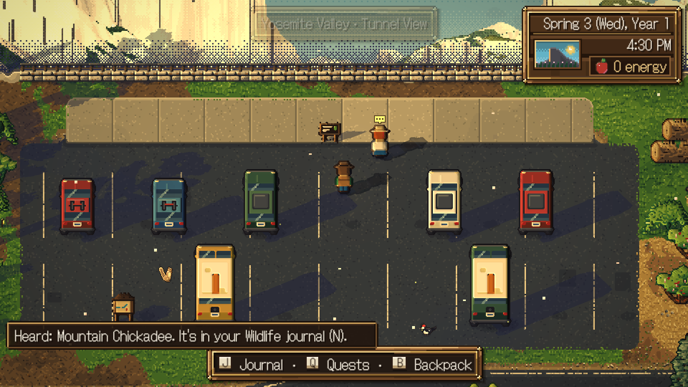
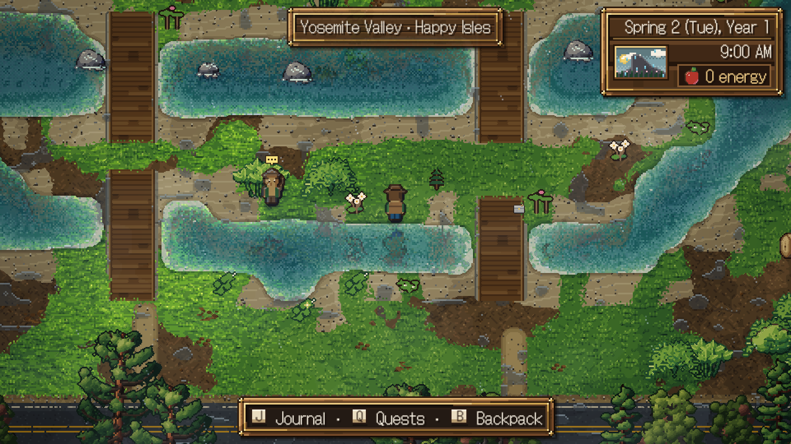
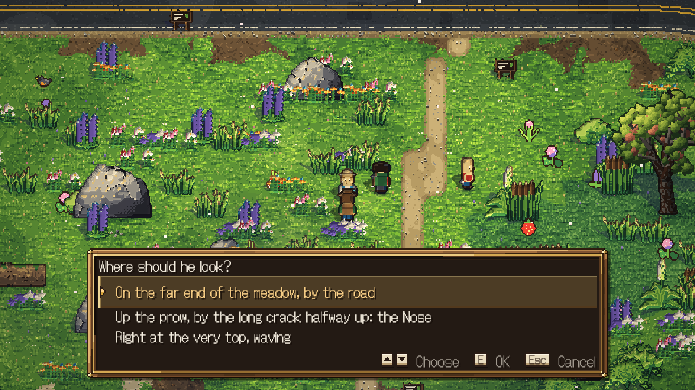
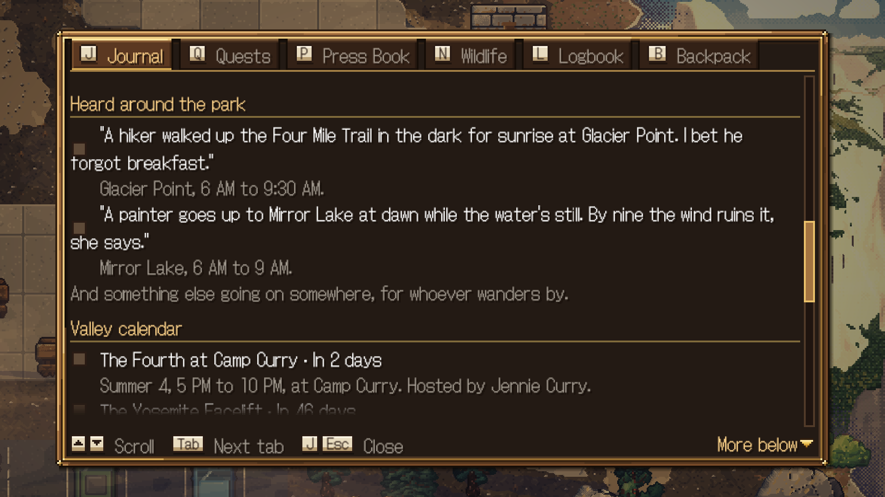
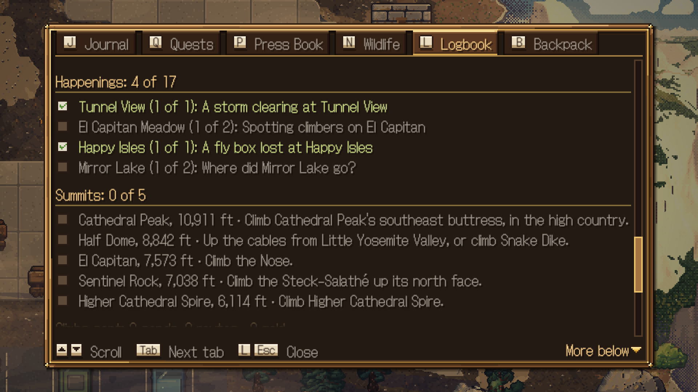

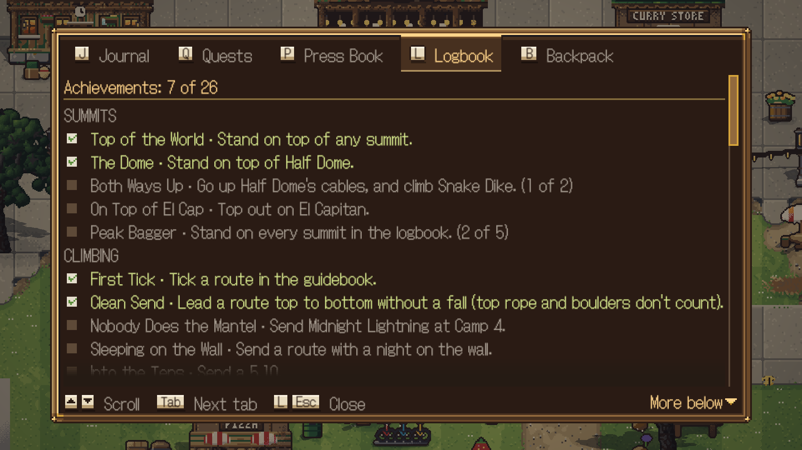
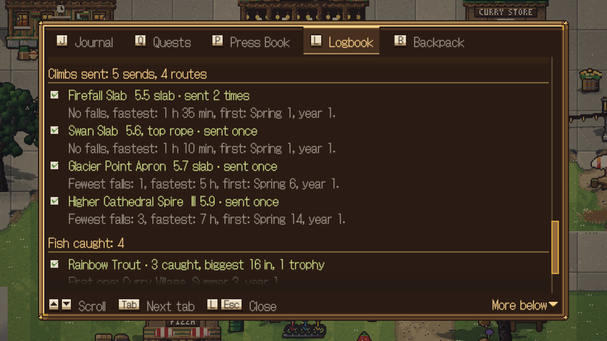

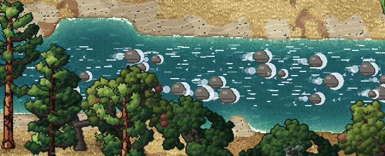
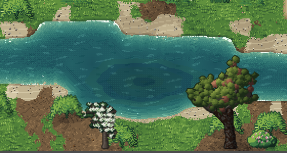
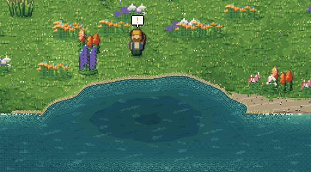
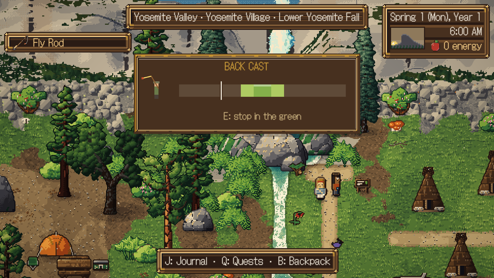
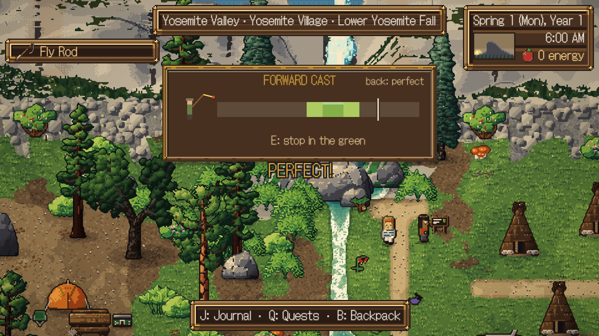
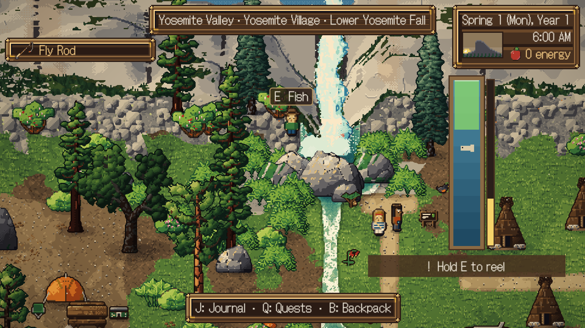
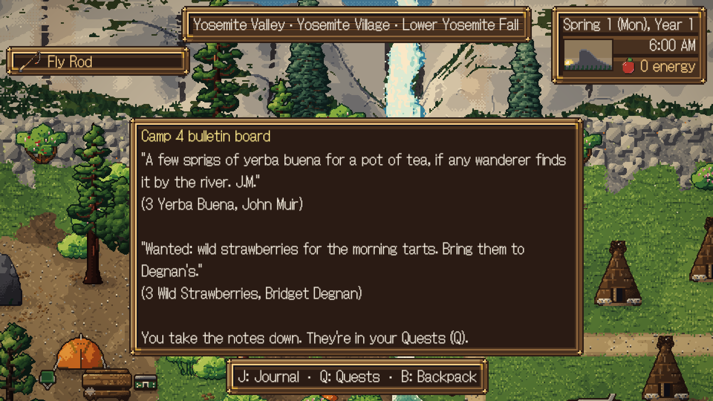
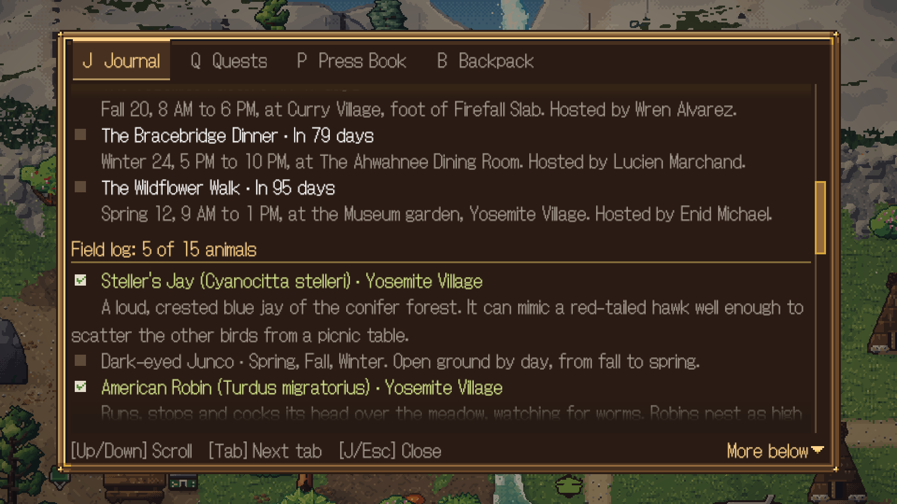

`SHOT_DIR=/tmp/shots xvfb-run -a godot --path . res://tools/shots/valley_life_shot.tscn` takes these. The fly rod's icon and the trout and litter pictures are drawn by `godot --headless --path . -s res://tools/ui/valley_life_icons.gd`; Greg's flies and fly box by `tools/ui/fishing_icons.gd`. The hole and rapids pictures come from `tools/shots/area_shot.tscn`.

## Photography: Ansel's camera, the album and the shot list

Ansel Adams, at Best's Studio in Yosemite Village, lends you the first camera he ever owned: the Kodak Box Brownie his parents gave him for the family's first trip to the Valley in 1916. Talk to him any time after Galen Clark has given you the Register (his side story *The Box Brownie*), and from then on the park is something you can take home.

- **The viewfinder.** F (RB on a pad) raises the camera: the screen darkens round a frame, three to two like a print, and the walking keys move the frame over the view instead of moving you. Whatever stands inside it is named under the frame as you aim (a landmark, a deer, John Muir, a snow plant, the Firefall), with a gold note when the picture would be a new one for Ansel's list. The world doesn't stop while you look: the deer walks on and the light goes. Esc or F puts the camera away.
- **The picture is real.** The shutter (E) draws one frame with the HUD, the viewfinder and the quest bubbles hidden, cuts out what the frame held, and keeps it as a 360 by 240 print: the hour's light, the season's snow, the weather, the bear that happened to walk through. Prints are PNG files beside the save (`user://photos/`), so they're yours to keep outside the game too.
- **Film and lenses.** T changes the film: **color**, **black and white** (toned like a red-filtered negative, so blue skies print dark and granite bright, the way Adams's do) or **sepia**. The Brownie's one lens sees about what your eye does. Finish Ansel's *A Portfolio* and he gives you two more (R, or LB, or the mouse wheel changes lens): a **wide** one that takes four times the view, for when the cliff won't fit, and a **long** one that takes a quarter of it at twice the size, for anything with legs or wings. A deer on film is a deer in your field log, so the long lens is also a way to log the shy ones without walking up on them.
- **Stars.** Every print gets one to three stars, the way Ansel would look at it. One for any picture. A second for light worth waiting for: the first or last hour and a quarter of sun, the alpenglow after it sets, a night within a day of the full moon, or snow or rain coming down. A third for a subject worth the wait: a bear, a bobcat, a great gray owl or a peregrine; something that only happens now and then (the Firefall, the moonbow, Horsetail Fall alight); or two kinds of main subject in one frame: a deer or a person with a landmark behind. (A jay in the corner of a wide view doesn't count.)
- **The album.** Tab (Y on a pad) with the camera raised opens the album: your prints as a sheet of small ones, and the chosen print at its real size with what's written on its back (its title, where and when it was made, the light, the lens and film, its stars). E looks at a print by itself at twice the size; Delete takes one out, asking first. It holds 48.
- **Ansel's list.** The album's second page is a list of 25 pictures Ansel would want to see "if I were starting over", in four groups, ticked as you make them: **the park** (Half Dome, the face of Half Dome from the Diving Board, El Capitan, Yosemite Falls, Bridalveil Fall, the Cathedral Rocks, the Three Brothers, Sentinel Rock, the Royal Arches, Mirror Lake, the Grizzly Giant, Cathedral Peak), **wildlife** (a deer, a bear, a bird, a squirrel, a butterfly, a falcon or an owl), **light and season** (a landmark in the last light, at first light and by moonlight, a winter storm from Tunnel View, the Firefall, a plant from the press book) and **people** (a portrait). Each line says where to stand until it's done, and then carries a note. One photograph can answer several lines, and the list keeps what it's seen even if you take the print out.
- **Ansel's stories.** *The Box Brownie* (take one photograph and show him), *A Portfolio* (any 8 from the list, for the two lenses; in 1927 his own first portfolio had eighteen prints) and *The Back Wall* (18 from the list, for the wall of the studio that isn't his). The last two are unhurried, like the press book's quests: they never keep him from offering *Monolith* or his other stories. Four achievements go with them (First Exposure, Worth the Wait, A Portfolio, The Whole Valley on Paper), the Journal's first page counts the list, and the day's page counts the day's photographs.

How it works: the autoload `Photos` (`scripts/story/photos.gd`) holds the album, the list (`SHOT_LIST`) and the rules: `observe(rect, stand)` says what a frame holds, `answers(entry, view)` whether that fills a line, `title_for` and `stars_for` what the print is called and worth, and `develop(view, image)` puts it in the album. It doesn't know what an animal or a waterfall is: anything in the `photo_subjects` group answers `photo_subjects()` with what it's showing and where (`Critters`, the `Wanderers` (deer, bears, bobcats, owls), `Falcons`, `NPC`, `PlantSpecimen`, `Firefall`, `Moonbow`, `HorsetailFall`), and a region's `Place` markers name its landmarks, the ones on the cliff paintings included. At the two overlooks (Tunnel View and Glacier Point) the far view is a painting that hangs nearly still on the screen as you walk (`assets/shaders/vista.gdshader`), so `Photos.VISTAS` gives each landmark's pixel in the painting and its place in the world is worked back from the camera, and only where the rim lets the painting show. `CameraView` (`scripts/ui/camera_view.gd`) is the viewfinder and the shutter (`print_from` cuts the print out of the window's picture, whatever size the window is), and `PhotoAlbum` (`scripts/ui/photo_album.gd`) the album; World adds one of each. A quest asks for pictures with a `photographed` step (`{"type": "photographed", "count": 8}`, or `"shots": [...]` for particular lines). Prints no album shows any more (taken and then lost by quitting unsaved) are swept away on the next load; one a save in another slot still shows is kept.

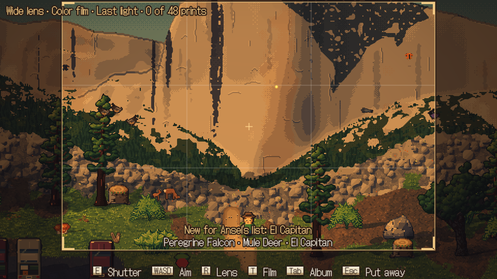
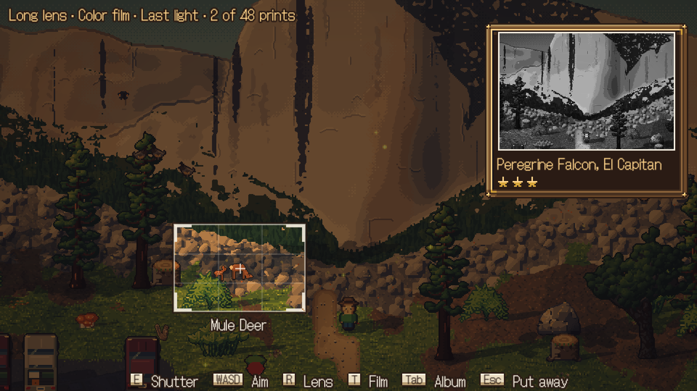
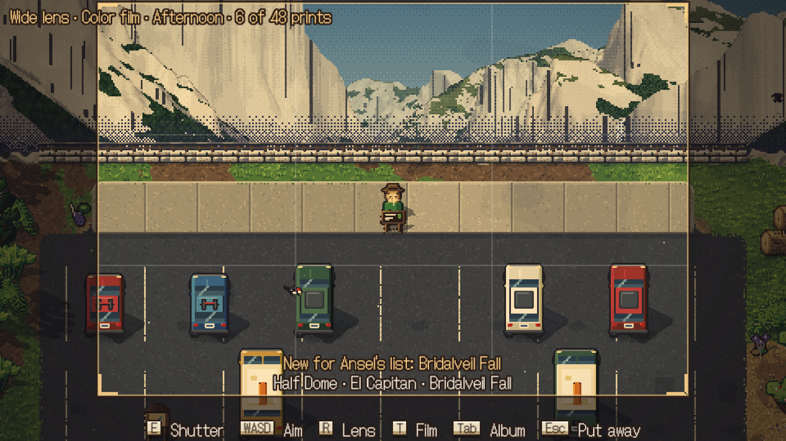
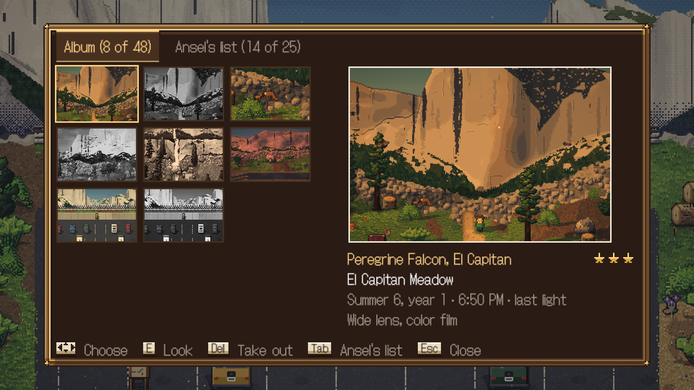
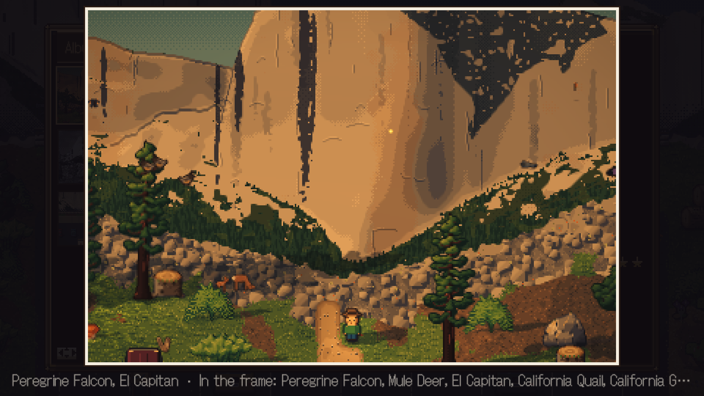
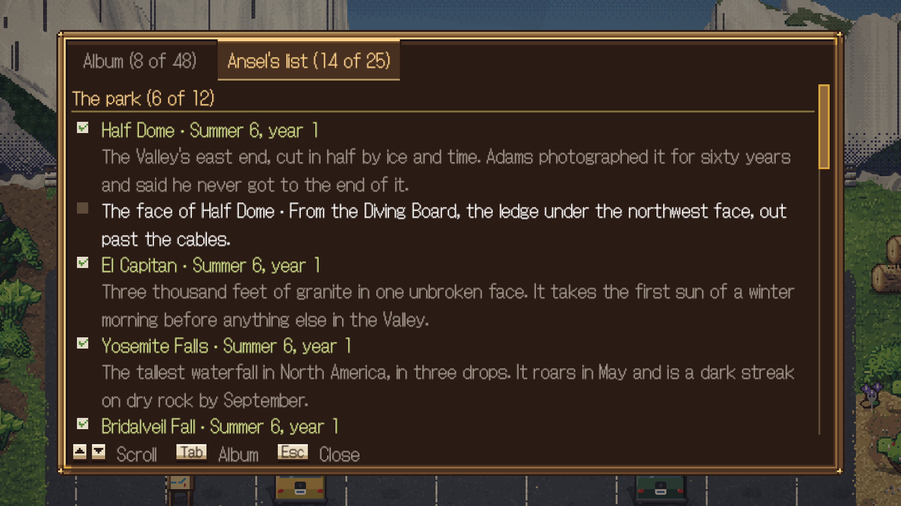

Prints as the camera makes them (shown at twice their size), on color, black and white, and sepia film:

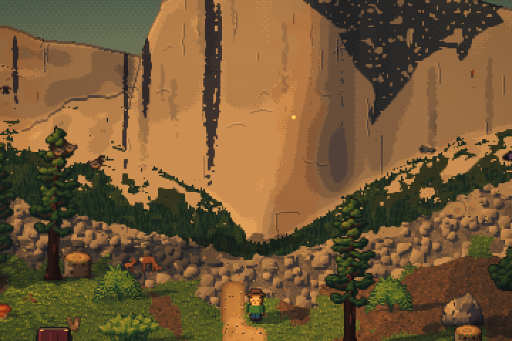
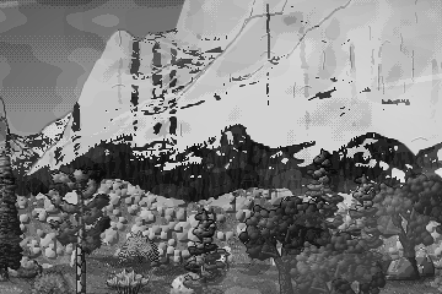
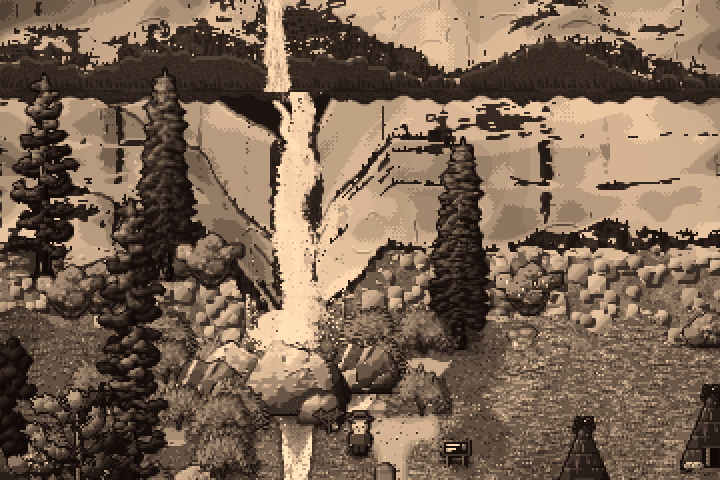

`SHOT_DIR=/tmp/shots xvfb-run -a godot --path . res://tools/shots/photo_shot.tscn` takes these. The camera's and the lenses' icons are drawn by `godot --headless --path . -s res://tools/ui/camera_icons.gd`.

## Search and rescue from Camp 4

Camp 4 climbers have helped with park rescues since the 1970s, and the rescue site is still in the campground: Yosemite's search and rescue volunteers live through the season in canvas tent cabins at the back of Camp 4, on call for the park, and wear the team's yellow shirts in the field. Here it's one more way to spend a day, using what the game has already taught you: reading the ground, climbing, carrying, and knowing the trails. Everyone gets found. Nobody dies.

- **The site.** At the back of Camp 4, beside Columbia Boulder, three canvas tent cabins stand on plank platforms, each with a wood stove's pipe through the roof (smoking) and lamplight in the canvas after dark, beside the rescue cache: a board-and-batten shed with a radio mast, ropes coiled on pegs and helmets on the shelf. There's an orange Stokes litter on sawhorses with its wheel for trail carries, the team's yellow shirts drying on a line, and a routed SAR sign. The rescuers there all wear the yellow shirt: **Jo Tolliver**, who keeps the radio, **Mateo Reyes**, who keeps the cache, and two volunteers about the cabins (all invented, like Wren and Greg). Art: `tools/hubs/sar_site_art.gd` (preview with `preview_sar_site_art.gd`); the site is placed in the Yosemite Village story overlay.
- **Joining.** Once you can belay (*The Rock Climbing Section*), Jo asks you to volunteer when you come by the site (*Volunteer for Search and Rescue*), and sends you to Mateo at the cache for your yellow shirt and some pilot bread. Jo's first quest, *First Call*, is your first rescue: a nine-year-old chased a deer off the Cook's Meadow boardwalk.
- **Calls.** After that, some mornings the radio calls (about half of them): talk to Jo and the call is yours, until 4 PM. Calls come by season and weather, and the ones on a climb only once you've ticked that route and only when the rock is dry. There are eight: the boy in Cook's Meadow, a hiker overdue on the Four Mile Trail, a turned ankle at Mirror Lake, a soaked camper at Happy Isles (winter and spring), a snowshoer going in circles in El Capitan Meadow (winter), and parties stuck on Swan Slab, the Glacier Point Apron and Royal Arches. A call you haven't finished by **9 PM** goes to the night team, who find everyone by headlamp; you just don't get the credit. The call underway is a card in the Quests tab, and on the rescue site's sign.
- **Tracking.** A search starts where the person was last seen. Their boot prints lead off across the ground, toe first the way they went, but you can only read them close around you, so you follow them print by print. They're dark in dust and mud and blue-grey in snow.
- **Food and carrying.** Some people need something to eat before they can move: share food worth 6 to 10 energy from your pack. Others need carrying: they ride on your back and you walk at 60% speed until you hand them over to Jo, across areas and on the shuttle if you like.
- **Lowering.** On a climbing call, walk to the route's start and climb it on the climbing screen to reach the stuck party (a fall leaves the call open to try again, and a rescue climb keeps you at the foot, not the top). Then you **lower** them, on a screen painted like the climbing screen: the route's own granite for the hour with the valley beyond, you braced at the anchor feeding rope through the brake, and them sitting in their harness on the rope as the view follows them down past the flakes to the ground, the speed and brake gauges standing at the right. Hold use to let the rope run through the brake, let go to brake. Three flakes stick out of the face: ease them past each one slowly or they bump into it and you have to stop. Run the rope fast for too long and the brake gets hot and locks until it cools. A lower always reaches the ground; it's just smoother or bumpier, and Esc hands the rope to the team.
- **After.** Jo logs each rescue and gives you trail mix and a little friendship. The next morning a thank-you note from the person you helped is pinned on the Camp 4 bulletin board, with a small gift tucked behind it. The Journal keeps a **Rescue log** of everyone you've helped, rescues go on the day's page, and five rescues teach you the **Long Carry** perk (you walk faster while carrying someone).

The calls, their text and the rules are `scripts/story/rescues.gd` (autoload `Rescues`); the prints, the person and the rider on your back are `scripts/story/rescue_field.gd` and `rescue_subject.gd`; the lower is `scripts/climb/rescue_lower.gd`. The people you rescue are invented visitors, not historical figures.

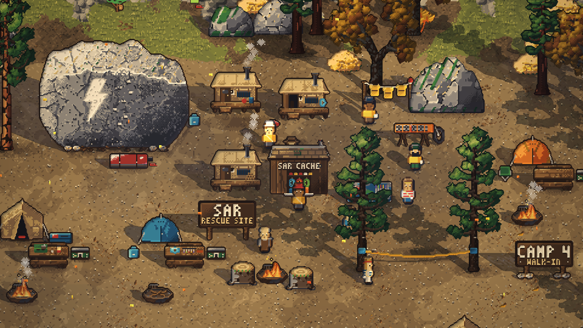
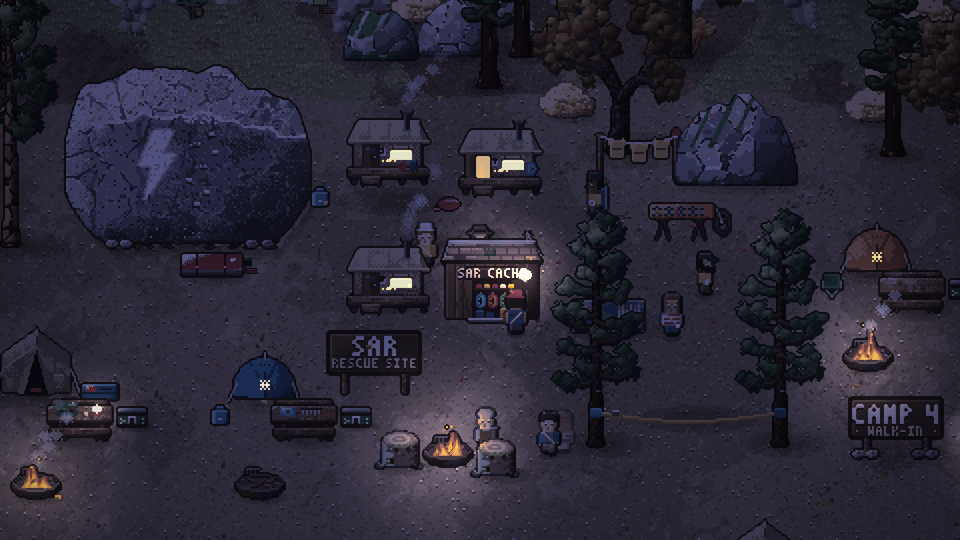
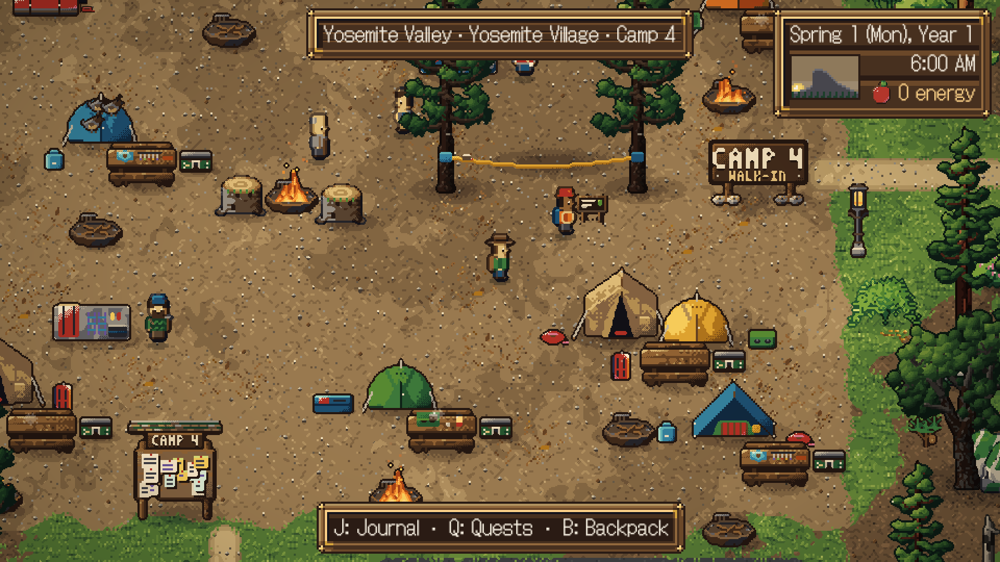
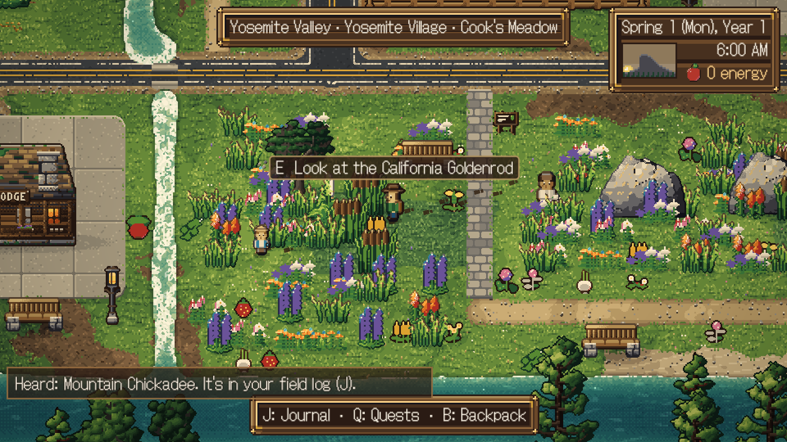

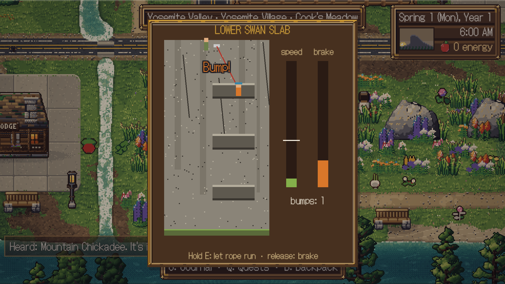

`SHOT_DIR=/tmp/shots xvfb-run -a godot --path . res://tools/shots/rescue_shot.tscn` takes these.

## The map of Yosemite

The park map is built from real data: elevation comes from the USGS 3D Elevation Program, and rivers, roads, trails, meadows, buildings, and place names come from OpenStreetMap. The places you walk are hand-made, laid out like the real ones, and trees change with elevation: oaks and gray pine at El Portal, ponderosa and incense cedar in the Valley, red fir at Glacier Point, lodgepole in Tuolumne, and giant sequoias in the Mariposa Grove.

The game has five **hubs**, each its own map:

| Hub | Elevation | Reached by |
|---|---|---|
| **Yosemite Valley** (main hub) | 4,000 ft | Start. Your camp is the Lamon Homestead, through the gate by Curry Village. The Valley is many small hand-made areas joined by trail scenes (see below). |
| **El Portal** | 2,000 ft | El Portal Road (Hwy 140), 30 min. Or walk Northside Drive west to the Big Oak Flat Road junction and keep straight on (15 min from there). |
| **Wawona** | 4,000 ft | Wawona Road (Hwy 41), 1 hr |
| **Glacier Point** | 7,214 ft | Glacier Point Road, 1 hr. Open from the start (open world); with `Park.open_world` off, locked until the player climbs the Glacier Point Apron, and the road is open about May to November. |
| **Tuolumne Meadows** | 8,600 ft | Big Oak Flat and Tioga roads, 1.5 hr. Open from the start (open world); with `Park.open_world` off, locked until you climb the Nose for Warren Harding, and the road is open about June to November. Or turn right at the Big Oak Flat Road junction, up Highway 120 to Crane Flat (20 min), and take the Tioga Road east from there: 55 min to Tenaya Lake and Olmsted Point, a stop of its own, then walk on along the lake into Tuolumne: the two lie side by side at the road. |

To travel, use a map kiosk at a parking area or walk off the edge of a hub on a road. Pick a destination on the park map. A few roads drive straight on without the map, where the way you turn is the choice: at the Big Oak Flat Road junction straight on is El Portal, and the Tioga Road out of Crane Flat goes on toward Tuolumne (`RegionExit.drive_to`, with the minutes and miles left from there; its closures and locks hold as on the map), stopping first at Tenaya Lake (`RegionExit.stop_region`). A road some way to the next scene, like Big Oak Flat Road up to Crane Flat, moves the clock on by its `minutes`. Drive times come from the real road distances and match the park's published estimates. Travel advances the clock, and you can't set out if you'd arrive after 1 AM. Press **M** anywhere to see the park map, or press **Tab** for a detailed map of the area you're in. Interpretive signs mark real landmarks; interact to read them. If you pass out away from home, a ranger drives you back to camp.

Road closures are in `Park.SEASONAL` (`scripts/autoload/park.gd`). Hub locks come from `starts_locked` on each hub's `.tres` in `data/park/hubs/`. Call `Park.unlock_hub("glacier_point")` to open one.

### Open world

Every area is open from the first day (`Park.open_world`, on by default). Glacier Point and Tuolumne Meadows can be reached before their climbs, the roads and trails that close for snow (`Park.SEASONAL`) stay open all year, the gap in the talus lets you into the Guardian's cave before Clark sends you, and the Half Dome cables don't ask for a permit. The climbs still mark their hubs unlocked, so the story beats that follow them play as before. What isn't a lock on an area still holds: shop hours, the 1 AM cutoff, rain on the cables, the gear a climb needs, and the permit for sleeping at the backcountry camp. Set `Park.open_world = false` for the original gated progression; the tests that check it (`travel_test`, `cast_test`, `curry_village_test`, `half_dome_test`, `press_test`, `guardian_camp_test`) do. `tests/open_world_test.tscn` checks every region can be reached from the homestead in spring and winter and rides the Valley shuttle round its whole loop.

**Weather and snow by height.** The park shares one storm a day (`Weather.on_day`, the Valley floor's weather), but `Climate` (`scripts/world/climate.gd`) knows how high every area is, from El Portal at 2,000 feet to Cathedral Lakes at 9,500, and `Weather.today()` is the storm as it falls where you stand. A spring or late-fall rain in the Valley is snow on Tuolumne and Tenaya, a winter snow in the Valley is only rain down the canyon at El Portal, and on many summer afternoons the thunderstorm the climbs' forecast warns of (`WallWeather.alpine_storm_hour`) rumbles over the high country from Glacier Point up and rains on Tuolumne for most of an hour (`Weather.shower()`, `Weather.rain_now()`), then the ground dries. Up in the mountains the snow lies deeper, comes earlier and melts out later (`Climate.mountain_snow`, through `Seasons.snow_cover`): Little Yosemite is bare by mid-spring, Glacier Point late in spring (about when its road opens), Tuolumne at the start of summer (when the Tioga Road does), so even a new game's first spring has Tuolumne under snow. Mountain mornings and nights are cold enough to see your breath in summer, the Half Dome cables close for snow and thunderheads on the dome's own weather (`Weather.at`), travelers check the weather where their day is, and the morning message says when the Valley's rain is snow up high. The Valley floor's weather and snow are exactly what they always were.

**Trips on the map, not a black screen.** A trip that takes clock time (a drive, a long trail like the Mist Trail or the Four Mile Trail, a shuttle ride) no longer fades to black: the world dims, the painted park map opens in a wooden frame, and a marker runs the real road or trail while a clock under the map turns from the time you set out to the time you arrive, with the miles (or the hours on foot) counting up beside it. The places it passes light up and are named under the map ("Passing Olmsted Point"), so a drive teaches you where things are. Drives follow the stretch of a park road both ends lie on (`Park.routes`, from OpenStreetMap), never one more than 2.5 times the straight way; trails on foot are dotted, and ones that bend well away from a straight line (the Mist and Panorama Trails by Vernal and Nevada Falls, the Half Dome trail) follow their bends (`Journey.TRAIL_BENDS`). The map shows as much of the park as the trip needs, blown up in whole pixels (up to 4x). The next place is laid out under the map while it plays, so the map lifts straight off it; any key skips the rest. The clock still moves on once, by the whole trip, so closures, the too-late check and the "You drove N miles" message are as before. The code is `scripts/ui/journey.gd` (`Journey`), run by `World._journey` from `go_to_region` (with `minutes`) and `travel`; callers pass a `trip` ({title, miles, on_foot}). Settings has **Trip map** (on by default) to go back to the fade, and it never shows headless (tests set `World.journeys_headless`). `tests/journey_test.tscn` checks it; `tools/shots/journey_shot.tscn` photographs a drive, a trail and a shuttle ride partway.

**Trailheads: earned fast travel.** Twenty-four trailheads, campgrounds and parking areas across the park (`data/park/trailheads.json`: Happy Isles, Mirror Lake, Upper Pines, Four Mile, El Capitan Meadow, Bridalveil, Tunnel View, Little Yosemite Valley, Glacier Point and Sentinel Dome, Taft Point, Wawona and the Mariposa Grove, El Portal, Crane Flat, Hetch Hetchy, Olmsted Point, Tenaya Lake, the Tuolumne visitor center and Dog Lake, Cathedral Lakes, and your cabin) are found by walking up to them, however you got there ("Trailhead found: Upper Pines Campground (5 of 24)"). Those at a map kiosk are the kiosk; the rest get a wooden trailhead signpost (`TrailheadSign`, `assets/sprites/trailhead_sign.png` from `tools/travel/draw_trailhead_sign.py`), put down beside a spot in the area when it is in the world, so no area scene changes for them. At any one you've found, interact to plan a trip to any other: each choice shows how long it takes, the miles, the time you'd arrive and the roads it takes, your cabin first and then nearest first. A kiosk's planner also offers the park map, as before. The trip is the quickest open way there, so the clock moves on by real minutes and a trip that would end past the curfew is refused; the trip map plays it. You can't start one from just anywhere: the walk is still the game, and trips only skip ground you've covered. A save from before trailheads gets the ones in areas it has already seen. The code is `scripts/story/trailheads.gd` (`Trailheads` autoload: `all()`, `is_known`, `trip_to`, `travel_to`, `plan_trip`, signal `registered`); `tools/travel/place_trailheads.tscn` fills in each point's spot, landing spawn and longitude/latitude after a point is added or an area's spots move. `tests/trailheads_test.tscn` checks it; `tools/shots/trailheads_shot.tscn` photographs a sign, the planner and a trip.

**The travel graph.** `TravelNet` (`scripts/story/travel_net.gd`) is every way between areas as one graph, read as text straight from the area scenes and their story, door and dressing overlays (no scene is loaded, nothing to rebuild): walking over a seam (6 minutes, or the area's `walk_minutes` for a long road or trail walked end to end), doors and gates, trails with minutes (`RegionDoor`), roads with minutes and drives on (`RegionExit`), drives from a kiosk along `Park.routes`, and the Valley shuttle. Closures, locks and perks apply when a route is asked for. `TravelNet.route(from, to)` gives the quickest open way ({minutes, miles, steps, via}); fast travel prices trips with it, and `tests/trailheads_test.tscn` checks that every outdoor area can be reached from your cabin and has a way home. Hetch Hetchy is now a drive west from Crane Flat, where Evergreen Road leaves Big Oak Flat Road by the entrance (35 min, 16 mi), rather than a gate in the middle of the meadow.

**Arriving settled.** However you get somewhere new (a door, a gate, a faded trip, the trip map, waking up at home, loading a save), the view is already where it will stay on the first frame you see: it doesn't slide in from the place you left while the door opens or the screen lifts. `World._settle_view` puts the drawn player straight on the player (`SmoothMotion.settle`, with no glide left over from the old spot; a move of more than 64 px in one tick never glides either), frames the cliff tilt for where you stand with no walking lead or carried lag (`LandmarkFraming.settle`), and catches the camera's smoothing up and moves the view there that same frame (`reset_smoothing` then `force_update_scroll`). It runs at the end of `_enter_region`, after `_unstick_player` nudges you out of something solid (with the seam and limits picked again for the new spot), after waking up, and after a save loads. Through a door or along a way, you arrive facing on into the new place, away from the way back beside you (within 160 px), instead of into the wall by the door. Before this, a door's wipe showed the view sliding up to 550 px and a faded trip up to 1,480 px on a 60 Hz screen. `tests/arrival_test.tscn` checks each kind of arrival with one physics tick a frame, as on a real screen; `xvfb-run -a godot --path . res://tools/perf/arrival_probe.tscn` goes through every door, gate and walk-through exit in the park and a few trips and prints how far the view moved after each one showed (`ARRIVAL_ONLY=<region>`, `ARRIVAL_LIMIT=<n>`).

**Moving the player from code** (for example at the end of a climb): `get_tree().call_group("world", "go_to_region", "glacier_point", "apron_top")`. Every hub has an `arrival` spot. There are more in each region's `Markers` (or a generated map's `Map/Spawns`), such as `apron_trailhead` in Curry Village, `camp_4` in Yosemite Village and `the_nose` in El Capitan Meadow.

**Adding things to a hub:** open `scenes/regions/<hub>.tscn`. Put NPCs and objects in **Entities**, and named Marker2D spots in **Markers**, which take priority over generated spawns with the same name. Don't edit inside the **Map** child. It's generated and gets overwritten.

**Regenerating the maps** (after changing a hub's bounds, scale, or content):

```bash
godot --headless --path . res://tools/mapgen/mapgen.tscn -- art park regions
```

- Hub bounds, scale, and walkable elevation band are in `data/park/hubs/*.tres`.
- Signs, place names, kiosks, spawn points, and where roads lead are in `tools/mapgen/hub_content.gd`.
- **Land patches** (`"land_patches"` in `hub_content.gd`, applied by `tools/mapgen/land_patches.gd`) correct the land cover by hand in lon/lat polygons: `clear` drops the OpenStreetMap buildings there and plants dense forest, `unpave` also takes up the roads, lots and walks there that don't lead through (or to a spawn, shuttle stop, kiosk or door), `slabs` paints the cliff as smooth granite slabs with walkable slab at its foot, and `talus` lays a band of talus along the cliff foot. The Valley's entry (the foot of the Glacier Point Apron) is kept for reference only: the Valley is hand-made now and mapgen skips it, and the Apron's foot is part of Curry Village. Mapgen applies them; to apply them to a generated map already in the project without regenerating it (which needs the downloads and undoes hand edits), run `tools/mapgen/patch_land.sh <hub>` on the committed map (Pillow and numpy; about five minutes). It patches the scene, repaints the ground and pastes just the patched part into the 32px picture.
- After an `art park` run, `python3 tools/mapgen/pixel_map.py` turns the park map's smooth relief into pixel art (a small palette of shade ramps with ordered dithering; nothing moves).
- Downloads are cached in `tools/mapgen/cache/`, which is git-ignored. The first run needs an internet connection.
- To add a new area, such as a summit for a climb, add a `HubData` (use `road_access = false` for climb-only areas) and an entry in `hub_content.gd`, then regenerate.

**The Valley map** is the map the player navigates. Pressing **M** anywhere in the Valley (including the Village and the homestead) opens an illustrated, Stardew-style picture of the whole Valley, seen from the south with the real terrain height. Arrow keys move between the 23 labeled places and show a note about each; **Tab** switches to the park map. Kiosks and road exits still open the park map first, for driving. Valley shuttle stops open this map too: choose a stop and press **E** to ride there (free, 15 minutes). Markers show map kiosks, climbs you have the gear for (gold) or not yet (gray), and you.

The picture, `assets/map/areas/yosemite_valley.png`, and its data, `yosemite_valley_view.json` (labels, kiosks, route starts, and the projection) plus `yosemite_valley_relief.png` (ground height, so `ParkMap` can place the player on the picture), are made by a Node script from the cached elevation and OpenStreetMap data:

```bash
cd tools/mapgen/oblique && node gen.js   # needs node and ImageMagick (magick)
```

Labels and their hand-placed positions are in `tools/mapgen/oblique/points.js`. The `art` step of mapgen skips any hub that has a `<hub>_view.json`, so it never overwrites this picture. A hub without one keeps the flat relief map.

### The Valley shuttle

Shuttle stops follow the real Valleywide shuttle (the NPS shuttle map, which numbers its stops 1 to 19): Yosemite Village (1 and 2; Degnan's and the Museum, 4 and 5, share it), The Ahwahnee (3), Lower Yosemite Fall (6), Camp 4 (7, Yosemite Valley Lodge and Camp 4), El Capitan Picnic Area (8), El Capitan Meadow (9), Cathedral Beach (10), Four Mile Trailhead (11), Housekeeping Camp (12), Curry Village (14, and 19 the other way), Upper Pines Campground (15), Happy Isles (16), Mirror Lake (17) and Lower Pines Campground (18), plus the game's own stop at the Lamon Homestead for your camp. Interact with a stop to pick another on the Valley map; every ride takes 15 minutes, and the shuttle runs until 1 AM (the real one runs 7 AM to 10 PM). The list is `ShuttleStop.STOPS`; each stop also needs its sign and spawn in the area's builder and a point with `stop` in `tools/mapgen/oblique/points.js` (copied into `assets/map/areas/yosemite_valley_view.json`).

### Exploring: places to discover

Inspired by open-world games where seeing something far off is the reason to walk there, every named place outdoors (each area, and the spots named inside it, like Sentinel Beach, Swinging Bridge or the Yosemite Medical Clinic) is undiscovered until you first walk into it. The first time, a card with a little folded map slides in, "Discovered: Sentinel Beach (12/92)", with the story sting. On the Valley's area map a place you haven't found is a blank "???" sign (peaks, falls and your camp always show, and while you're choosing a shuttle stop every stop is named, since stops are posted). From a high lookout (Tunnel View, Glacier Point or up on Half Dome's shoulder) the whole Valley lies spread out below, and every place's name goes on the map, still yours to walk to. The Journal's Logbook counts what you've found area by area, and two achievements count them: *Wanderer* (25 places) and *Every Corner* (all of them). Discoveries save with the game; an older save loads with none found. The code is `Discoveries` (`scripts/story/discoveries.gd`, an autoload; World calls `Discoveries.visit` as you walk). The list of places is `data/park/places.json`, written by `godot --headless --path . res://tools/discovery/list_places.tscn` from the region scenes and their story overlays: run it again after adding or renaming a `Place`, and `tests/open_world_test.tscn` checks it's up to date.

**The open-world map.** The Park map (**M**, then **Tab**) starts as a parchment brochure, the shape of the land faintly printed and the rest hatched, and fills in as you explore (`MapFog`, `scripts/story/map_fog.gd`): walking outdoors clears about 450 m around you, each new area clears around its middle, a drive or a long trail clears a ribbon along the road, and a high lookout (Tunnel View, Glacier Point, Taft Point, Half Dome) clears 6.5 km all round, the way a tower does in an open-world game. Vistas can clear more with `MapFog.reveal(lonlat, radius_m)`. What's seen is one byte per pixel of the park map (about 330 m), saved packed; a save from before the fog is cleared around the areas it had already discovered. Looking around (not choosing a trip), a cursor moves freely over the map (arrows or the stick, faster when held) and settles on what's near: the hubs, a dot for every area you've walked into, your stamps, the story's flags (now on the very area, not just its hub) and trailheads you've found. The note beside it says what it is and how much of the park you've explored. **E** tracks what's under it, **Space** puts down one of five stamps (star, campsite, fishing spot, wildflowers, climb; 24 at most) or takes one up, and **Shift** (or the mouse wheel) zooms in twice as close. Hidden finds are never on it: a stamp of your own is how you mark one. Whatever you track gets a gold pin sign on screen (`Tracker`, `scripts/ui/tracker.gd`): in the same area it points straight at the spot with the distance, and bobs over it once it's in view; in another area it points at the way out that leads nearest ("via Ledge Trail"), since the areas are joined by trails and roads, not laid edge to edge. Reaching a tracked area stops tracking it. It follows the **Signposts** setting. The first time you reach an outdoor area its name comes up across the screen with its part of the park under it (`ArrivalTitle`, `HUD.show_arrival`), and the small place banner steps aside; Settings has **Region titles** to turn it off. Areas' positions and exits come from `data/park/regions.json`, written by `tools/map/list_regions.tscn` (run it again after adding an area or an exit). `tests/map_fog_test.tscn` and `tests/arrival_title_test.tscn` check them; `tools/shots/map_world_shot.tscn` photographs the map, a stamp picker, the pin sign and a title card.

**Signposts.** Outdoors anywhere in the park, little signs at the screen's edge point the way to what's out of sight (`Wayfinding`, `scripts/ui/wayfinding.gd`, added by the HUD): Half Dome, El Capitan, Yosemite Falls and Glacier Point, and outside the Valley (where the rim hides them from the floor) Clouds Rest, Tenaya Peak, Cathedral Peak and Lembert Dome, while they're between 1.5 and 12 km off, so Tenaya Lake points to Clouds Rest and the Tuolumne peaks (up to three at once, the nearest first, and none for a landmark towering right over the area you're in, like El Capitan over its meadow), and a gold **?** toward an area off this one's edge you haven't walked into yet, or a named place nearby you haven't found that's off screen (two at most). Where you stand on the Earth comes from each area's `geo_anchor` at the middle of its map, about 0.46 m a pixel (measured from the distances between neighboring areas). They hide indoors, under menus and conversations, and while the place name, a card or a message is up, and slide round the screen's edge as you walk. Settings has **Signposts** (on by default) to turn them off. `tests/wayfinding_test.tscn` checks them.

**Across the river.** Most Valley areas are painted the same way: the cliff, the road, a meadow or woods, then the Merced with a strip of sand and woods past it. That far bank used to be walkable only in El Capitan Meadow (over El Capitan Bridge); now four more crossings open it up and turn the Valley floor from one corridor into loops. A plank footbridge crosses at Housekeeping Camp (to *Housekeeping Beach*) and at Upper Pines (*Clark's Bridge*, to the *Pines Gravel Bar*), and lines of granite stepping stones wade the shallows below Leidig Meadow (to *Devil's Elbow*, which also joins the El Capitan Bridge bank across the seam) and at Sentinel Beach (to *Sentinel Shallows*, a bank that runs on west past Bridalveil Fall). Each far bank has a named spot and a hidden find for whoever bothers to cross: a caddis fly in a snag, two cans of King Cobra cooling in the shallows, a forgotten beach bag, a lunch on a warm rock. `tools/seams/river_crossings.py` lays them: it turns each crossing's tiles to bridge or creek and takes out the blockers, then paints a footbridge with `tools/art32/ground32/paint.py` (copying in only the crossing, so fishing holes stay) or the stepping stones itself; run `tools/normals/normals.py` on the changed grounds after. `tests/valley_floor_test.tscn` checks each crossing is laid, walkable end to end from the area's arrival, and leads to its named spot and find.

**Hidden finds.** Off the roads and trails, things turn up: a cam walked deep into a crack at the foot of El Capitan (climbers call stuck gear *booty*: finders keepers), three cans of King Cobra buried under the needles behind the Camp 4 boulders, a quickdraw left on a bolt below Half Dome's slabs, an old piton below the Royal Arches, a railroad spike on the old Yosemite Valley Railroad grade at El Portal, a glass telephone insulator under the Wawona pines. There are 22 (and four more across the river, see above), each taken once. A find lies half hidden in the grass, a little darker than the ground and tilted as if dropped, and now and then gives a slow, cool blue twinkle, unlike a forage find's quick gold glint; nothing on the map or the signposts points at one. Some only show at the right time: the six-pack in summer and fall, the ski wax at Crane Flat once the snow melts out in spring, a ring of king boletes off the Big Oak Flat Road in fall, a lost headlamp still shining in the brush at Mirror Lake only at night. Taking one shows its little story and what you get. Most give trail food or a few cans of King Cobra; some give a curio collectors and climbers will trade for (a rusty piton, a railroad spike, a tin of ski wax, a glass insulator, a lost headlamp: new items in `data/story_items/`, icons by `tools/discovery/curio_icons.py`); a few give gear (two cams, two quickdraws, two flies). The Logbook's *Hidden finds* section lists the areas you've found one in, with how many of theirs you have, and passes on up to three rumors about finds in areas you've already walked into ("Somebody bailed off the bottom of El Cap and couldn't get their cam back out..."), which say roughly where and when to look, never the spot. Two achievements count them: *Finders Keepers* (the first) and *Off the Beaten Path* (all of them). The code is `Finds` (`scripts/story/finds.gd`, an autoload that saves which finds you have) and `FindSpot` (`scripts/objects/find_spot.gd`), laid out in each area by `StoryContent.attach`, so no region scene changes. The list is `data/park/finds.json` (id, region, pos, title, text, rumor, reward, and optional `seasons` and `hours`). `godot --headless --path . res://tools/discovery/find_spots.tscn` suggests open spots off the path in every outdoor area; with `FIND_PLACE=1` it picks a spot for each find without a `pos`, matching its `spot` (`near` rock, water, woods or meadow, and a `place` to lie in), away from the map's edges, the arrival, anything else you can use, and other finds, and not under a tree or bush drawn in front of it. `xvfb-run -a godot --path . res://tools/shots/finds_shot.tscn` photographs each find where it lies. `tests/finds_test.tscn` checks the list, that every find can be walked to from its area's arrival and lies off the road and trail tiles, taking, seasons and hours, rumors, saving and the achievements; `tests/exit_access_test.tscn` checks each can be walked up to and picked up.

**Vistas.** Eleven high lookouts across the park work like the towers of a big open-world game: Tunnel View, Glacier Point, Sentinel Dome and Taft Point, Half Dome's summit (reached up the cables), Olmsted Point, Lembert Dome and Pothole Dome above Tuolumne Meadows, the Crane Flat fire lookout, O'Shaughnessy Dam and Wawona Point. Each is a spot you walk up to (a stretch of railing, a survey benchmark with a little cairn, the lookout's signpost), catching the light now and then until you've used it. *Take in the view* and the panorama opens across the whole screen and sweeps slowly from one end to the other, painted by the binocular viewers' skyline painters (`BinocularView`, `ClimbLandscape`) for the hour and the weather, naming each landmark with a chime as it passes the middle; the plaque says a line about it. Interact skips to the end; afterwards you can look about. The first time, the place names of the areas below go on the area map (`Discoveries.sight_regions`; walking there still counts as discovering them), the park map fills in around the vista (the map's `MapFog.reveal`, when it's there), its landmarks go in the Landmark log, and a line tells of something that caught the light down below: a gear cache. Then the *peak-finder*: an arrow swings to one peak and asks which it is, from three names; right earns the vista's stamp. The code is `Vistas` (`scripts/story/vistas.gd`), `VistaSpot` (`scripts/objects/vista_spot.gd`) and `VistaView` (`scripts/ui/vista_view.gd`, a `BinocularView` with one full-screen lens); the list is `data/park/vistas.json` (each vista's areas sighted, landmarks, its panorama, either a binocular view's or its own in the same shape, the peak-finder's answer, and where it is on the park map). `BinocularView.unwrap` takes a `wrap` bearing so a view facing south runs east to west.

**Landmarks, caches, registers and sketches.** The *Landmark log* (`Landmarks`, `scripts/story/landmarks.gd`, list in `data/park/landmarks.json`) holds the park's 46 big named features, the walls, domes, peaks, falls and lakes, as opposed to places. A landmark seen from a vista is *sighted* (its name, where you first saw it from, and how it looks far off); walk to its foot or its top and it's *visited*, with a card, and its entry opens into a two-sentence naturalist's note. The Logbook lists only what you've sighted or visited, like a sketchbook, never empty slots. *Gear caches* are eleven more finds in `data/park/finds.json` with `"cache": true` and the `vista` that sees them: a stashed rack at the foot of Cathedral Rocks, a bail quickdraw at the foot of the Glacier Point Apron, one cam along the Wapama Falls trail. They lie like any find, but their line ("From Tunnel View, the light caught something pale low on the wall...") goes in the Logbook's *Hidden finds* only once you've taken in that view, never on a map. *Registers* (`Challenges`, `scripts/story/challenges.gd`, `ChallengeSpot`, list in `data/park/challenges.json`) are summit registers, survey benchmarks and the lookout's logbook in nine high places; sign them, and the 3rd, 6th and 9th signatures each find a piece of climbing gear left in the box (a nut, a quickdraw, a big nut). *Sketch spots* are eight views worth drawing at their own hour: alpenglow on Half Dome from Glacier Point at dusk, Mirror Lake still in the morning, El Capitan's headlamps at night, the stars over Tuolumne. Sit there then and it goes in the Logbook's *Sketchbook*; come at the wrong time and the Logbook says when. Nothing is timed or can be failed, and none of it comes back daily (that's Happenings). Six achievements: *Room with a View*, *Lookout Keeper*, *Peak-Finder*, *Feet on the Ground* (20 landmarks walked to), *Signed In* and *Full Sketchbook*. `tools/discovery/find_spots.tscn` with `FIND_PLACE=1` places vistas, registers and sketch spots too (a vista's `spot.center` puts it at its place's middle; `spot.start` walks from another marker, such as Half Dome's summit). `xvfb-run -a godot --path . res://tools/shots/vistas_shot.tscn` photographs every panorama part way through its sweep, the peak-finder, and every spot on the ground. `tests/vistas_test.tscn` checks the lists, the panoramas paint, every spot can be walked to and is laid out, surveying, the peak-finder, the log, registers, sketch hours, the achievements and saving.

### Yosemite Village: the Valley's central hub

Driving to Yosemite Valley brings you to **Yosemite Village**, a walking-scale central hub. It fits the real layout of the Valley between Camp 4 and the Village into one map, from the granite north wall down to the Merced River. Distances are squeezed, but what sits next to what follows the real Valley:

- **Camp 4**: the climbers' walk-in campground, laid out as real sites under the pines. Each has its tents, a Park Service picnic table, a bear box and a steel fire ring, and they sit around a shared fire where you cook. The tents span the camp's history: 1950s canvas wall tents, a 1970s climber's tarp shelter, and modern domes. **Columbia Boulder** stands at the back by the talus, with **Midnight Lightning** (Ron Kauk, 1978) chalked up its overhanging face, the lightning bolt beside the start and a crash pad below. The **search and rescue site** is at the back beside it: tent cabins, the rescue cache and the rescuers in their yellow shirts (see Search and rescue from Camp 4). There's also a slackline between two pines (slacklining started here in the early 1980s), and its sign opens a minigame with three lines to walk: keep your balance with Left/Right, meet the bucks the line warns you of, build flow by staying steady, and press E for tricks when you're centered. Each crossing wins a bronze, silver or gold medal by score, the first walk of the Camp 4 Line wins the six-pack of King Cobra on the far stump, walking it opens the windy Long Line, and five crossings earn the *Slackliner's Feet* perk. Win gold on any of the three and Wren Alvarez (her side story *Gold on the Line*) gives you her own slackline, which you can rig between two sturdy trees anywhere in the park: walk up to a trunk with another tree a few strides off to one side and choose "Rig your slackline"; the bulletin board where the walk-in path arrives, the Park Service sign, the two gear traders, and a 1970s van in the lot. After dark the fires burn and throw sparks, and lanterns glow in the tents and on the cook tables.
- **Yosemite Valley Lodge**, south of Northside Drive and west of Yosemite Creek, with a path down to **Swinging Bridge**.
- **Lower Yosemite Fall** and **Yosemite Creek**, crossed by a footbridge and the Northside Drive bridge. The **Lower Yosemite Fall Loop** runs up the creek's east bank from Northside Drive, over the footbridge at the foot of the fall, and back down the west bank to the Lower Yosemite Fall shuttle stop.
- **The Village mall**: a pedestrian mall with, west to east along its north side, the **Welcome Center** (the shuttle stop and a flag out front), the **Yosemite Museum** (a granite ground story under dark timber), **Best's Studio** (now the Ansel Adams Gallery), the **Wilderness Center**, and the **Post Office**. At the east end, **Degnan's** (a steep chalet roof and a patio of umbrella tables) and the long log **Village Store** with its porch face a plaza shaded by oaks, with the store's parking lot beside it.
- **The Indian Village** behind the museum: umachas (bark homes), a chuckah (acorn granary), and a grinding rock you can use. Its text has been through tribal review.
- **Yosemite Cemetery** across the mall from the museum: a fenced plot of granite and wooden headstones, and Galen Clark's grave among the giant sequoias he planted round it.
- **Cook's Meadow** between the creek and Sentinel Drive, its boardwalk starting across the road from the Welcome Center and running on to **Sentinel Bridge** (with the Half Dome view). **Camp 6**, the Village's day-use lot, is east of Sentinel Drive; drivers arrive there.
- **Yosemite Chapel** (1879) on Southside Drive, across the Merced, with its bell tower and lancet windows lit at dusk.

Roads out of the hub lead onto the trail scenes to its neighbors (see *The Valley floor* below). Rebuild the hub with `tools/hubs/rebuild_village.sh`: it runs the 16px builder (`res://tools/hubs/build_hubs.tscn`), upgrades every picture it drew to the 32px art (`tools/art32/upgrade.py --fresh`), moves the scene onto the 32px grid (`tools/art32/migrate_built.py`), and puts back the hand-edited shop data. That rewrites the hub scene, so put NPCs in `scenes/story/content/yosemite_village.tscn` and place them by marker name. The layout is in `tools/hubs/build_yosemite_village.gd`. The village is drawn in the Ahwahnee's style (see below): granite-footed timber buildings with mossy shingle roofs and lit windows at dusk (`tools/hubs/valley_art.gd`), Camp 4's boulders, tents, fire rings and camp gear (`camp4_art.gd`), the granite wall of the Valley with Lower Yosemite Fall animated down it (`valley_land_art.gd`), and the painted ground, trees, plants and boulders shared with the hotel grounds.

### Curry Village: your first stop

Leave the Lamon Homestead by its gate and you walk out of the old apple orchard into **Curry Village**, a hand-made hub at the foot of the wall below Glacier Point. Nothing here is to scale: the few hundred real tent cabins become about fifty, in the real order, with the wall behind, the cabins below it, the Camp Curry buildings in the middle, and Stoneman Meadow and the Merced in front.

- **Tent cabins** in three winding rows, each with a wooden deck, a numbered plate and its own dressing (a chair, a cooler, boots, a lantern), plus a block of wood cabins. The cabins nearest the wall are roped off, with a sign about the rockfalls.
- **The village green**: the Registration Office, the Pavilion, the **Camp Curry Store**, the **Mountain Shop**, a pizza deck, the pool (an ice rink in winter), the Camp Curry amphitheater with the Firefall board, a fire pit you can cook at, patio tables, planters, string lights, and a flagpole.
- **The Camp Curry Store** and **Mountain Shop** have insides you walk into. The store clerk trades food that keeps (pilot bread, cheddar, apricots, jerky, chocolate, trail mix, and a can of King Cobra) for forage that doesn't. The Mountain Shop clerk trades quickdraws, cams, and big-wall gear for food. Like the Camp 4 traders, the shop only rounds out a rack: every offer needs gear you already own, so the piece that opens a tier still comes from a quest. Offers are in `data/shops/curry_store.tres` and `curry_mountain_shop.tres`.
- **Trading gear with climbers**: every piece of gear has a trade value in food energy (`trade_value` in `data/gear/*.tres`: a quickdraw 14, a cam 50, a rope 70, a portaledge 135; Ansel's camera and lenses are keepsakes worth nothing). Choose "Sell some spare gear" at the Camp 4 climber (cams, draws, belay devices, shoes, chalk bags, harnesses; 65% of value), the big-wall climber (haul bags, portaledges, aiders, ascenders, ropes; 65%) or Marty (any climbing gear; 50%). They pay in food that keeps (jerky, trail mix, pilot bread, cheese, chocolate), never in King Cobra. You can only sell spares: you always keep as much of a piece as the hungriest route in the guidebook asks for (a rope, 10 cams, 6 draws, the wall kit), so selling never locks you out of a climb. The Camp 4 climber is after one piece at a time (a cam, a draw or a belay device, changing every 3 days) and pays its full value. Climbers will also swap gear straight for King Cobra, once a day each: at Camp 4, 3 quickdraws for a can or a cam for 2; from the big-wall climber, ascenders for 2, a haul bag for 3, a portaledge for 5 (each still needs the gear a quest gave you first). And after you top out a new route, share a can with the Camp 4 climber at the fire: one toast per route, and they pass you something off their rack (2 quickdraws the first time, then jerky, chocolate or trail mix). Code in `scripts/shop/gear_sale.gd` (autoload `GearSale`), the sell menu in `Vendor.sell_menu`; test `tests/climber_trades_test`, screenshots `tools/shots/climber_trades_shot`.
- **The way in and out**: the Camp Curry arch and parking lot with a map kiosk and a shuttle stop, roads west (to Housekeeping Camp and the Village) and east (to Upper Pines and Happy Isles), the Glacier Point Apron climb at the trailhead, the homestead gate, and the **Ledge Trail**.
- **The Ledge Trail**, at the head of the path west of the closed cabins, is the historic trail (built in 1872, closed for decades because of rockfall) straight up the gully beside the Apron to Glacier Point: three hours, arriving beside the Mountain House footings. Its trailhead is there from the start and, in the open world, open from the start too. With `Park.open_world` off it opens only once Glacier Point is unlocked by climbing the Apron, so it never skips that climb (`needs_hub` on `RegionDoor`), and before that, reading it tells you why.
- **People**: Jennie Curry, a camper, the Pavilion cook, a ranger-naturalist and a tourist outside; a shopper in the store and a climber in the Mountain Shop. Wren Alvarez waits with a rope at the foot of **Firefall Slab**, beside the Apron trail, and a pair of lost rental shoes lies out front of the upper tent cabins. Greg the fishing guide is all over the camp (and his lost fly box is on the Merced bank below Stoneman Meadow). The overlays are `scenes/story/content/curry_village.tscn`, `curry_store.tscn` and `curry_mountain_shop.tscn`.
- **After dark** lamps, windows, tents and the fire pit glow (`scripts/world/night_light.gd`), chimneys smoke in the cold months, mist rises at the foot of Staircase Falls, and fireflies come out over the meadow (`scripts/world/ambient_fx.gd`).

Rebuild it with `godot --headless --path . res://tools/hubs/build_curry.tscn`. That redraws every sprite (`tools/hubs/curry_art.gd`, `interior_art.gd`, on `pixel_kit.gd`), paints the whole ground as one picture (`tools/hubs/ahwahnee_ground.gd`), and rewrites `curry_village.tscn`, `curry_store.tscn` and `curry_mountain_shop.tscn`. The layout is in `tools/hubs/build_curry_village.gd`. To look at a region the way the player sees it, run `SHOT_REGION=curry_village SHOT_SPAWNS=arrival,plaza godot --path . res://tools/shots/region_shot.tscn` (it needs a window). `SHOT_HOUR=21` shoots at night. In-game pictures are in `docs/curry_village_plaza.png`, `curry_village_cabins_dusk.png` and `curry_mountain_shop.png`, and every sprite is laid out in `docs/curry_art_preview.png` (`tools/hubs/preview_art.gd`).

### The Valley floor: one scene for each place, and trails between

Every place in the Valley is in one scene only. There is no big Valley overworld: the areas are joined by short trail scenes you walk through, like the Stoneman Meadow trail. Leave a scene by its west edge and you come in at the east edge of the next, so a road keeps its heading. The wall of the Valley is always at the top of a scene, as in Curry Village, whichever side of the Valley it really stands on, so El Capitan Bridge, which crosses the Merced between El Capitan Meadow and Bridalveil Fall, is at the bottom of both. The bridge itself is in El Capitan Meadow only, and you walk over it off the bottom edge; in Bridalveil Fall the road down to it ends at the river's bank, so there is one bridge and you cross it once. It goes one way, north to south: Bridalveil Fall has no exit back over it, so from there you go on by Southside Drive.

**No stop at the seams.** Where a road or trail runs off one area's edge onto the next (Northside Drive from Yosemite Village into Leidig Meadow, the path from the Ahwahnee down to Stoneman Bridge, and every other walking link on the Valley floor), you walk straight across with no fade, no pause and the clock running on. As you come within about a screen of the edge, World lays the next area beside this one, lined up so the road meets the road (`Seam`, `scripts/world/seam.gd`), takes the blocker rim out of both maps all along the stretch of edge the two share (`Seam.span`), not only beside the road, so you can wander over a meadow or along the riverbank into the next area, and lets the camera look over. Where one edge meets two areas (the Village's west edge meets Leidig Meadow and Four Mile, its east edge the Ahwahnee Meadow and Housekeeping Camp, and Curry Village's east edge the homestead and Upper Pines), each gets the stretch nearer its own road, with a short hedge between, and the one laid out stays until you're clearly at the other's stretch (`World.SEAM_SWAP`). A few rims have gaps where a river runs off the map; while the next area is still loading, World holds you on the edge there (`World._keep_on_map`). The painted roads don't always sit at the same spot on both maps, so each seam slides the next area along the edge by a measured nudge (`data/park/seam_nudges.json`, from `tools/seams/measure_seams.tscn`) until the road middles meet, and the two maps overlap by 64 px, where their painted grounds dither into each other instead of meeting on a straight cut (`seasonal_ground.gdshader`). Step over the edge and the next area becomes the one you're in, with everything shifted so nothing moves on screen; the area behind stays laid out until you have walked on. Everything else in view carries on over the edge too instead of starting afresh (`World.seam_crossed`): the petals, leaves or snow in the air, the birds and squirrels about, a deer or bear walking by, a falcon overhead, someone at a happening, your trail in the snow, the cloud shadows and the morning mist all stay where they were on screen, and a bird's call keeps its place beside you; animals and people left behind go once they're out of sight. `tests/continuity_test.tscn` walks over a seam with a jay and a deer just behind, in the snow and in the spring petals, and checks each stays put on screen. Where one area is wider than the other, the camera sees deep woods in the corner between them (`SeamBackdrop`, `scripts/world/seam_backdrop.gd`): trees and understory on a dark forest floor, darker and bluer the further they stand from a map, so the forest falls away into shade. The woods fill that corner even above a lower area whose cliff painting ends in sky: a flat slab of sky there lay beside the other area's ground and looked like a lake (west of Camp 4, above Leidig Meadow). They also run on down over the painted sky at the top of that cliff, with the forest floor laid over it and trees standing on it, so the woods meet the cliff tops instead of a strip of blue (`data/park/wall_skies.json`, how deep each painting's sky goes column by column, from `tools/seams/wall_skies.py`). A map's ground doesn't stop at a ruled line there: the woods' shade lies a few ragged pixels onto it, ferns, shrubs and manzanita stand along the edge, and the trees just past it hang their crowns and tops over it (at most 56 px, drawn over whatever stands on the map). The firs and cedars carry snow in winter, the brush turns in fall and is bare twigs in winter but for the manzanita, and the floor whitens while snow lies. Birds and squirrels keep to the maps: none land out in those woods, in the middle of a river or up a wall (`Critters._on_land`). Roads that take clock time (Big Oak Flat Road, the long trails), shop doors with hours, and the one-way El Capitan Bridge still fade. A seam whose next area hasn't finished loading doesn't cut to the far side any more: walking into its exit, you wait at the edge for a moment while it loads (`World._seam_or_exit`, at most `World.SEAM_WAIT_MS`), then walk on over. `tests/seams_test.tscn` checks every seam lines up, walks three of them and one well away from the road (Leidig Meadow into El Capitan Meadow), and checks the Village's shared edges, the woods past the edges and where the birds may land; `tools/shots/edge_shot.tscn` photographs the corners between areas where the woods show (`SHOT_SEAMS`, `SHOT_SEASON`, `SHOT_HOUR`); `tools/shots/open_world_shot.tscn` photographs that off-road crossing and the signposts; `tools/shots/seam_shot.tscn` renders each seam (`SHOT_RAW=1` for the bare edge-to-edge layout, `SHOT_ONLY` to pick one) and `tools/shots/seam_walk.tscn` walks one in the real game (`SHOT_REGION`, `SHOT_SPAWN`, `SHOT_WALK`).

**One park, streamed.** Everything outside World asks `World.stream` (`WorldStream`, `scripts/world/world_stream.gd`) what is laid out and where: `region_streamed_in`/`region_streamed_out` as areas come and go, `loaded_regions()`, `to_current(region, spot)` and `region_at(spot)` across a seam, and the player's real longitude and latitude, carried on over the edges, for the map. Long trails and roads between the park's areas are built as corridor areas joined by ordinary seams, each with its `Region.walk_minutes`: the clock moves on by them as you get further along (the furthest reached either way, a minute at a time), so the light moves on as you walk and doubling back costs nothing more. Each area can keep its own seam nudges (`data/park/seam_nudges/<id>.json`). `tests/stream_test.tscn` checks every walking exit on a map edge in every area really meets the next one edge to edge (`WorldStream.check_links()`), the stream's signals and positions over a seam, and the corridor clock. How to add or join areas: `docs/STREAMING.md`.


```
[drive: Tuolumne] - Crane Flat
                         |  (Big Oak Flat Road, Hwy 120, 20 min)
[drive: El Portal] - Big Oak Flat Road Junction
                                |
[drive: Wawona] - Tunnel View   El Capitan Meadow
                     |          :      |
              Bridalveil Fall ..:   Leidig Meadow
                     |   (El Capitan Bridge)   |
              Four Mile Trailhead - Yosemite Village - Ahwahnee Meadow - The Ahwahnee
                                         |                                  |
                                Housekeeping Camp - Curry Village - Homestead (Stoneman Meadow trail)
                                                          |
                                Upper Pines - Happy Isles - Tenaya Creek - Mirror Lake
                                                 |  (Mist Trail, 3 hr)
                                     Little Yosemite Valley
                                                 |  (Half Dome Trail, 1.5 hr)
                                     Half Dome: Sub Dome, the cables, the summit
```

- **El Capitan Meadow**: El Capitan over its meadow, with the Nose at the toe of the buttress and the Nutcracker on Manure Pile Buttress; Warren Harding and Beverly Johnson; a shuttle stop. Northside Drive west leaves the Valley, down to the Big Oak Flat Road junction; El Capitan Bridge, at the east end, crosses the Merced to Bridalveil Fall.
- **Big Oak Flat Road Junction**: a fork in the road below the Valley, in the Merced's canyon. Straight on, El Portal Road (Highway 140) drives on down the river to El Portal; turn right and Big Oak Flat Road (Highway 120) climbs up a ravine in the canyon wall to Crane Flat. Signs at the fork, on Big Oak Flat Road (the 1874 wagon road and the 1940 tunnels) and on the All-Year Highway; a turnout; the Merced for fishing.
- **Crane Flat**: a meadow in the fir forest at about 6,200 feet, where Big Oak Flat Road meets the Tioga Road. Back down Big Oak Flat Road to the junction; the Tioga Road east drives on to Tenaya Lake and Tuolumne Meadows (open all year in the open world; with `Park.open_world` off, locked until the Nose and shut in winter as on the map); Big Oak Flat Road west leaves the park for Groveland. Out here, past the edge of the illustrated Valley map, **M** opens the park map instead.
- **Tunnel View**: the overlook at the Wawona Tunnel, with El Capitan, Half Dome far up the Valley, and Cathedral Rocks with Bridalveil Fall across the view: the title painting itself, seen through the drop (see the overlook views under Glacier Point); the lot and its map kiosk; Separate Reality above the road. The tunnel leaves for Wawona and Glacier Point Road.
- **Happy Isles**: the Merced splitting round its islands under footbridges; the John Muir Trail sign; the Mist Trail up to Glacier Point (the Panorama Trail comes down here) and the Mist Trail past Vernal and Nevada Falls to Little Yosemite Valley, both open all year in the open world (with `Park.open_world` off, the first opens once you've climbed the Apron, and both shut for snow in winter); Snake Dike; George Anderson; a shuttle stop.
- **Little Yosemite Valley** and **Half Dome**: the backcountry. See *The first night out and Half Dome* below.
- **Mirror Lake**: the lake filling in under the wall, Tenaya, Astroman on Washington Column, a shuttle stop.
- **Trails**: Leidig Meadow (Northside Drive under the Three Brothers; at its west end the **El Capitan Picnic Area**, tables between the road and the river, with a shuttle stop), Four Mile Trailhead (Southside Drive under Sentinel Rock and Sentinel Fall, with the Four Mile Trail up to Glacier Point (open all year in the open world; with `Park.open_world` off, open like the Ledge Trail once you've climbed the Apron and shut for snow in winter), and the Steck-Salathe), Bridalveil Fall (the fall blowing down Cathedral Rocks, and the Higher Cathedral Spire; at its east end **Cathedral Beach**, picnic tables and a sandy beach on the Merced, with a shuttle stop), Ahwahnee Meadow (its black oaks drop acorns; Maria Lebrado; and at its Village end, on the north side of the road just east of Degnan's as on the NPS Yosemite Guide's Village map, the **Yosemite Medical Clinic** and beside it the **Yosemite Valley School**, each with its sign and lit windows at dusk), Housekeeping Camp (its canvas-roofed cabins on the Merced), Upper Pines (campsites with tents, tables and bear boxes, and below the road, toward the Merced, **Lower Pines**, with its own sites and shuttle stop: the scene is taller than the other trail scenes to hold both), and Tenaya Creek (with **North Pines**' sites along the creek). Four Mile Trailhead, Housekeeping Camp and Upper Pines each have a shuttle stop.

**Looking up at the walls.** The cliff paintings are taller than half the screen, so a camera that kept the player in the middle cut El Capitan, the Three Brothers or Sentinel Rock off at the knees. Walk toward the foot of a wall and the camera tilts slowly up until the top of the screen reaches the rim, with you standing low in the frame; walk away and it eases back. Arriving (a new area, a spawn, a door) frames the view at once (`scripts/world/landmark_framing.gd`). It works for any region whose cliff wall is a Sprite2D named "...Wall" drawn from its top-left corner: within 220 pixels of the wall's foot the tilt is full, fading out over the next 260, and you always stay at least 84 pixels above the bottom of the screen. A `LandmarkView` (`scripts/world/landmark_view.gd`) placed in a story overlay frames a view more tightly, or reaches above the map onto a backdrop. The tilt is the camera's `offset`, which nothing else uses. `tests/landmarks_test` checks it.


**Yosemite Falls, both tiers.** The Village's wall painting is the lower cliff only, with Lower Yosemite Fall pouring out of a notch at its top edge, so the tallest waterfall in North America showed as its bottom 320 feet. Now the upper cliff hangs above the map, set back behind the lower one: the rim against the sky, Upper Yosemite Fall pouring off it, and the forested bench between the two falls, with the middle cascades threading down the notch to the top of the Lower Fall. Stand at the foot of the Lower Fall (or anywhere along its trail) and the camera tilts up onto it (the overlay's `YosemiteFallsView`, a `LandmarkView` that reaches 204 pixels above the map). There's no lidar render of the upper cliff, so `tools/hubs/yosemite_falls_backdrop.py` builds it from the Three Brothers' wall painting next door, a little hazier for the distance, and paints the fall in the Lower Fall's colors. The upper fall is a `BackdropFall`, which hands itself to the region's `SeasonalFalls`, so it roars in May and dries up in September with the Lower Fall.


**Two rough spots finished.** The Wawona Road now crosses the South Fork on a concrete bridge, its parapets and their shade on the water painted by `tools/hubs/wawona_road_bridge.py` and stood over the road by the Wawona overlay (before, the river foamed against the asphalt as if dammed). And the El Capitan pull-out on Northside Drive has cars parked nose-in, as it always does when climbers are on the wall.


#### The first night out and Half Dome

Above Nevada Fall the Merced runs slow and sandy through **Little Yosemite Valley**, under the back of Half Dome and Liberty Cap: a fir forest with a backcountry camp (a tent site, a fire ring to cook at, the bear-storage sign) three hours up the Mist Trail from Happy Isles. The Half Dome Trail goes on from its north-east corner, an hour and a half up through the forest to **Half Dome**, which is one tall scene: the forest and the granite steps of Sub Dome at the bottom, the saddle where the cables start, the steep back of the Dome (darker rock, streaked down the fall line; no one walks on it), the summit, big and nearly flat, and the lip of the northwest face along the top with nothing beyond it but haze. **The Diving Board** juts out from the shoulder west of the saddle.

- **Sleeping out.** Ranger Hodges's side story *The First Night Out* (after her patrol) asks you to pack two days' food, then hands you a **wilderness permit** (a story item) and lends you a **bear canister** (gear). With the permit your tent is pitched at the camp (`BackcountryCamp`), and sleeping in it ends the day there instead of at home: you wake up in Little Yosemite Valley and the game saves there (`World.sleep(passed_out, camp_spawn)`). Overnight the canister holds the best 12 things you carry to eat; anything that doesn't fit stays in your pack, and a bear eats about half of it (`Backcountry.night_out`). Without a canister the whole pack is fair game. Passing out on the trail still gets you walked down and driven home by a ranger. The way down the Mist Trail is open all year, so a camper is never shut in by the first snow.
- **The cables.** Two steel cables on posts, 400 feet up the back of the Dome (`HalfDomeCables`, a `RegionDoor` between the saddle and the summit). Going up is a minigame (`CablesMinigame`): ten pulls from board to board, each a stop on a timing meter like a cast or a crux. A perfect pull gets you your breath back, a good one costs a little grip, a miss skates your boots on the polished rock and costs a lot; run out of grip and you back down to the foot. At first light you have the cables to yourself and the green is wide; on a late-spring or summer middle of the day there's a line of hikers on them and the green is narrow and quick (`CablesMinigame.crowd_for`). They need the permit and dry rock, and they're down from mid-October to late May (`Park.SEASONAL["half_dome_cables"]`): the posts are pulled and the cables lie flat. Coming down is a walk, open all year.
- **The summit.** The first time you walk out onto it, by the cables or off the top of **Snake Dike** (which now tops out here, `RouteData.destination_region`, instead of being walked off), the view down the Valley plays: Glacier Point across the gulf, North Dome below, El Capitan far off at the end (`SummitMoment`, `Backcountry.SUMMIT_VIEW`).
- **The Diving Board.** Look out from it at the Dome's face. Between 3 and 5 in the afternoon the light is on it, and the view turns into Ansel Adams's photograph (`DivingBoard`).
- **Camping anywhere, and Leave No Trace.** After *The First Night Out*, Hodges offers *Leave No Trace* (spring to fall): Marty at the Mountain Shop fits you with a **backpacking pack** (gear, `backpacking_pack`: an external frame, a tent strapped under, a foam pad rolled on top). While it's in your gear bag you wear it, and your walking sheet shows it from every side (`FigurePainter` pack style `backpacking`; `PlayerLook` repaints the sheet when it goes on or off). Hang it on the gear rack at camp to take it off. With it on, outdoors anywhere but home, from 6 PM until you'd pass out, facing open ground, the action button says **Make camp** (`CampSpot`, the player's fallback target after the fly rod). The box warns you first what's wrong with the spot, and you can sleep there, light a small fire and sleep, or not; you wake up on that spot and the game saves there (`World.camp_out`). The checks (`Backpacking.problems` in `scripts/story/backpacking.gd`): all your food fits in the bear canister; nothing of river, lake or creek within 100 feet (66 px); not on or right beside a trail or road; not on a meadow; and a fire only within reach of a campfire that's already there. A clean camp is a quiet morning (your food spent the night in the canister) and counts for Hodges (`lnt_camp`). Break any of them and you wake up beside **Ranger Pruitt**, a wilderness ranger (invented; `data/characters/rangers/wilderness_ranger.tres`, art from `tools/npcgen/backpacking_art.gd`), who explains each rule you broke, takes all your food, and fines you goods worth 10 a problem (40 at most; what you can't pay is written up as a warning). No camping in winter, at the very edge of an area, or in the water. Tested in `tests/backpacking_test.tscn`; screenshots from `tools/shots/backpacking_shot.tscn`.
- **Quests.** *The First Night Out* (Clare Hodges; she offers it from spring to fall, since the Mist Trail is shut for snow in winter), then *Anderson's Cables* (George Anderson: go up the cables that follow his eyebolts) and *The Diving Board* (Ansel Adams, after *Monolith*: see the face in the afternoon light). Once you've been up the cables, John Muir (in Tuolumne, after Cathedral Peak; summer and fall) offers *Above the Clouds*: he went up Anderson's rope in November 1875, and he wants you on top at sunrise. That means a night at the camp and an early start, since in practice only from Little Yosemite can you make the summit before 10 AM. Up there in the morning with his quest open, the summit's view is the Valley filled wall to wall with cloud, the domes standing out of it, and your shadow on the cloud in a ring of rainbow light, a glory, with the sun at your back (`Backcountry.CLOUD_SEA_VIEW`, a `cloud_sea` view in `StoryVista`). His Register note says what's documented, and that the John Muir Trail, named for him after he died, runs from Happy Isles past the same camp. Each first (a night out with your food in the canister, the summit, the cables, the light from the Diving Board) is a QuestLog unlock, in `scripts/story/backcountry.gd`. Tested in `tests/half_dome_test.tscn`.


The two areas are built like the other trail scenes, by `_little_yosemite_valley` and `_half_dome` in `tools/hubs/build_valley_floor.gd` (`ONLY=little_yosemite_valley,half_dome tools/hubs/rebuild_valley_floor.sh`, then `git checkout` the shared tree PNGs it redraws); their grounds are painted by `tools/art32/ground32/paint.py` (Half Dome's `"steep"` and `"drop"` settings shade the steep rock and paint the drop off the face), and the cables, the summit view and the Diving Board are in `scenes/story/content/half_dome.tscn`. The icons for the canister and the permit are drawn by `tools/ui/backcountry_icons.gd`.

Rebuild them all with `tools/hubs/rebuild_valley_floor.sh` (it runs `res://tools/hubs/build_valley_floor.tscn`, then moves the art and scenes onto the 32px grid; its Python steps need Pillow and numpy). The builder leaves each area with its own 16px ground (blotchy grass, brown roads with no lines, pale water) and with its river laid out on its own, so always follow it (and `rebuild_village.sh`) with `tools/hubs/finish_valley_floor.sh AREA...`, naming the areas rebuilt: it bends the rivers and creeks to meet across the seams again (`tools/seams/morph_seams.py`), paints the grounds natively (`tools/art32/ground32/`), lays the ground clutter out again round whatever moved, with campers' gear at any new campsite (`tools/hubs/dress_wilds.tscn`), paints the fishing holes back into the new river and clears them of clutter (`tools/fishing/river_pools.py --repaint`), and refreshes the normal maps, the water cells and the seams' nudges. Running it twice changes nothing, and `tests/ground_art_test.tscn` fails until it has been run. The layout is in `tools/hubs/build_valley_floor.gd`; walls and falls come from `valley_land_art.gd` (its `seed_offset` gives each wall its own rock) and go to `assets/sprites/valley/`. People and climbs are in `scenes/story/content/<region>.tscn`. The old generated Valley map is gone: mapgen skips the Valley (`"hand_made"` in `hub_content.gd`), a save made on it picks up in Yosemite Village (`World.RETIRED_REGIONS`), and the Valley hub's main scene is its arrival area (`HubData.scene_path()`). To look at a scene whole: `SHOT_REGION=el_capitan_meadow SHOT_OUT=/tmp/elcap.png godot --path . res://tools/shots/ahwahnee_overview.tscn`, or part of one with `tools/shots/area_shot.tscn` (`SHOT_RECTS="name:x,y,w,h"`).

### The Ahwahnee look: one style for every Valley area

The Ahwahnee's art is the reference for the whole Valley: ramp-shaded, ordered-dithered pixel art lit from the upper left, warm highlights over cool shadows, granite and stained timber, moss on the shingles, a dark rim round every sprite, and a ground painted as one picture from the terrain grid. Every hand-made Valley area now uses it, through one shared base (`tools/hubs/ahwahnee_style.gd`, which holds the tree, plant and rock scattering and the ground painting):

| Area | Rebuild with | What is drawn in the Ahwahnee style |
|---|---|---|
| Lamon Homestead | `res://tools/hubs/build_homestead.tscn` | painted ground, a tree line and boulders round the edge, meadow flowers; the five oaks show all four seasons (`tree_oak_seasons.png`) and still drop acorns |
| Curry Village | `res://tools/hubs/build_curry.tscn` | painted ground with a mown green, Registration, Pavilion, Store, Mountain Shop, Pizza Deck, amphitheater, entrance arch, tent and wood cabins (`curry_ahwahnee_art.gd`), the granite wall with Staircase Falls, trees and plants, wrought-iron lamps |
| Camp Curry Store and Mountain Shop (insides) | `build_curry.tscn` | stained plank floors, window frames and wrought lanterns (`interior_ahwahnee_art.gd`) |
| Yosemite Village and Camp 4 | `tools/hubs/rebuild_village.sh` | the Village Store, Welcome Center, Museum, Best's Studio, Wilderness Center, Post Office, Degnan's, Lodge and Chapel, porches and flags, the cemetery's headstones and sequoias, the Indian Village shapes, Camp 4 (Columbia Boulder, tents, fire rings, tables, board, sign, slackline, van), the wall and Lower Yosemite Fall, trees, plants, lamps |
| The Ahwahnee and Stoneman Meadow | `res://tools/hubs/build_ahwahnee.tscn` | the original |


Rebuilding rewrites each area's scene, so story NPCs stay in `scenes/story/content/`. To look at the village art on its own: `godot --headless --path . -s res://tools/hubs/preview_valley_art.gd` writes `docs/valley_art_preview.png`, and `preview_camp4_art.gd` writes `docs/camp4_art_preview.png`.


### Glacier Point: the overlook

Top out the Apron (or drive up Glacier Point Road once it's open) and you're on **Glacier Point**, a hand-made hub laid out like the real one and squeezed so it can be walked. To the north and east the map drops away 3,200 feet to a painting of the view: across the canyon Half Dome, the Valley's north wall with Yosemite Falls, Royal Arches and North Dome, the forest and meadows of the floor far below with the Merced winding through, and from Washburn Point, Mount Broderick and Liberty Cap with Nevada, Vernal and Illilouette falls, all shimmering.

- **The overlook** on its granite point, railed in with a granite parapet and pipe railing, with coin viewers, signs for Half Dome and the Firefall, and **Overhanging Rock** jutting off its west side (closed, so you look at it from behind the rail). Its view frames Half Dome's face across the canyon. The Apron climb tops out here.
- **The walk** south from the point past the **Geology Hut** (1924) on its knob, the footings of the **Glacier Point Hotel** and McCauley's **Mountain House** (both burned in 1969), and the stone **amphitheater**, to the plaza with the **snack stand**, the restrooms and picnic tables, and the parking lot with its map kiosk at the end of Glacier Point Road.
- **Washburn Point**, a railed pullout on the east rim where the road comes in, framing Nevada Fall under Liberty Cap, Vernal Fall below it and Illilouette Fall to the right.
- **Sentinel Dome**, a bare granite dome to the southwest, with the fallen Jeffrey pine Ansel Adams photographed still lying on its summit, and its trailhead pullout on the road.
- **Trails**: the **Four Mile Trail** west along the north rim (crossing Sentinel Creek above Sentinel Fall), the **Pohono Trail** past Sentinel Dome toward Taft Point, the **Panorama Trail** south off the east rim, and Glacier Point Road south: all four walk straight on over the map's edge into the rim country around it (below), with no fade. The **Ledge Trail** from beside the hotel site still goes down to Curry Village (two hours). The trails down are always open from the top, so a climber who tops out before the road opens can walk home.
- **The overlook views.** Past the rim is a painting of the view, not a map of the floor below: `tools/hubs/glacier_vista_art.gd` paints it (`assets/sprites/glacier/vista.png`, drawn larger than the screen), and `assets/shaders/vista.gdshader` shows it wherever the drop is (`GlacierArt.view_below` draws the drop: the lit lip, the cliff's shadow, and a marker color the shader paints over). The painting hangs nearly still as you walk, sliding a quarter as far as the camera, so the tip of the point frames Half Dome, the Four Mile Trail looks across at Yosemite Falls, and Washburn Point frames the falls. Tunnel View uses the same shader with the title painting. The builders set it up with `AhwahneeStyle._vista`.
- **The viewers.** The three coin-operated viewers on the railing can be looked through (`scripts/objects/scenic_viewer.gd`, which opens `scripts/ui/binocular_view.gd`). The whole view from the point is painted as one panorama, about three screens wide, by the climbing screen's sky and skyline painters for the hour and the day's weather: Sentinel Rock and El Capitan down the Valley to the west, Yosemite Falls and Yosemite Point, the Royal Arches with North Dome and Basket Dome over them and Mount Hoffmann behind, Washington Column, Mount Watkins, Clouds Rest and Half Dome up Tenaya Canyon, Liberty Cap and Mount Broderick, the snowy crest with Mounts Florence, Maclure and Lyell, Vernal and Nevada falls, Mount Clark, Mount Starr King and Illilouette Fall to the southeast, and Curry Village and the Merced 3,200 feet straight down. You see it through two round lenses (`assets/shaders/binoculars.gdshader`: a dithered vignette, a cool coated rim, a glint, and a focus pull as it opens and when you zoom). Pan along the skyline, tilt down to the floor (the lip of the point comes into view at the bottom as you lean over), and switch between 8x and 16x. Every landmark stands at its true bearing from the railing, on a compass tape that runs across the top. Hold one in the crosshairs and the viewer names it: corner brackets close in round it, and the brass plaque below gives its name, its height (or a fall's drop), how far off it is and its bearing, and a line about it (Yosemite Falls has its own line in the fall, when it runs dry). Everything you name stays named, marked on the skyline from then on, with a tally of the 25 at the side (`Park.spotted_peaks`, saved). The sun and moon stand where they really would (sunrise behind the Clark Range, sunset down the Valley), the falls shimmer, ravens ride the updraft, and on a stormy day the far peaks go into cloud. Each viewer starts pointed its own way: Yosemite Falls from the west side of the point, Half Dome from the tip, the falls of the Merced from the east. `SHOT_DIR=/tmp/shots xvfb-run -a godot --path . res://tools/shots/binocular_shot.tscn` photographs it at a few bearings and hours.
- **The rim forest**: red fir and Jeffrey pine with lodgepole and silver snags on a floor of needle duff, Jeffrey pines in the granite, and manzanita and huckleberry oak on the rocky rims. The granite is drawn as smooth slabs peeling in sheets.

Rebuild it with `tools/hubs/rebuild_glacier_point.sh` (its Python steps need Pillow and numpy; set `PYTHON=` to pick an interpreter). It runs the 16px builder (`res://tools/hubs/build_glacier_point.tscn`), upgrades the pictures it drew to the 32px art and moves the scene onto the 32px grid, like the Village's. The layout is in `tools/hubs/build_glacier_point.gd`, and the art (the buildings, the railing, the rim trees, and the view over the edge) is in `tools/hubs/glacier_art.gd`, written to `assets/sprites/glacier/`. The painting of the view goes through the 32px upgrade like the title painting (Scale2x, then the palette with a light dither). Story NPCs go in `scenes/story/content/glacier_point.tscn`, placed by marker name. The map generator skips Glacier Point now (`"hand_made"` in `tools/mapgen/hub_content.gd`).

### The rim country: walking on from Glacier Point

Glacier Point is the middle of an open stretch of the south rim you can walk end to end, the way the Valley floor is. Each edge where a trail or the road leaves is a seam (see the Valley's seams): the next map is laid beside it and you walk straight across.

- **West: Union Point and the Four Mile Trail** (`union_point`, 100x40 tiles). The trail follows the rim west through red fir to **Union Point**, a railed granite knob with a coin viewer looking straight across at Yosemite Falls (`BinocularView.VIEWS.union_point`), then goes over the edge into the **switchbacks**, a steep slope of scree, manzanita and old Jeffrey pines it zigzags down. At the bottom of the map a trail door carries on down the lower switchbacks to the Four Mile trailhead (45 minutes); from the trailhead the way up lands at the top of the switchbacks (two hours, shut for snow in winter and locked until the Apron, as before). Its drop shows the left of Glacier Point's painting (Yosemite Falls and the Village) held still across the screen, lined up with Glacier Point's at the shared edge. An 1872 toll-trail spike is hidden by the switchbacks.
- **South-west: Taft Point.** The Pohono Trail now walks straight from Sentinel Dome over Glacier Point's west edge into Taft Point's east edge, and back, instead of a 45-minute trail door.
- **South-east: Illilouette Gorge and the Panorama Trail** (`illilouette`, 90x60). From the Panorama trailhead the trail runs south across the road and off Glacier Point's south edge, down switchbacks to a granite lip over **Illilouette Fall**, across the creek on a footbridge, up to **Panorama Point** with Half Dome across the canyon, and on past **Liberty Cap** to the **top of Nevada Fall**. There the Mist Trail goes down to Happy Isles (two and a half hours, and Happy Isles' Mist Trail comes up to here) and the John Muir Trail on to Little Yosemite Valley. The gorge shows the right of Glacier Point's painting (Half Dome, Liberty Cap, Nevada and Vernal Falls).
- **South: Bridalveil Creek on Glacier Point Road** (`bridalveil_creek`, 72x56). The road walks on south from Glacier Point through red fir and lodgepole past **Bridalveil Creek Campground**, the creek (it goes over the Valley's rim downstream as Bridalveil Fall) and **McGurk Meadow** with John McGurk's cabin, to the **Mono Meadow trailhead** (a trail down to Illilouette Creek, an hour). The drive back to the Valley, past Badger Pass, leaves from the south edge; you can still drive from Glacier Point's lot (its travel point).

All four count under Glacier Point's hub. Rebuild the three new maps with `tools/hubs/rebuild_rim_country.sh` (`build_union_point.gd`, `build_illilouette.gd`, `build_bridalveil_creek.gd`; Union Point and Illilouette use Glacier Point's look and painted drop, Bridalveil Creek is built like Taft Point). Glacier Point's and Taft Point's exits were edited in their scenes to match their builders. `tests/open_world_expansion_test.tscn` walks the rim, and `tests/seams_test.tscn` checks each rim seam lines up.


### El Portal, Wawona and Tuolumne Meadows

The hubs down the roads out of the Valley are hand-made too, in the same Ahwahnee look, laid out like the real places and squeezed so they can be walked. Both are reached by driving (the park map); their roads out open it again.

**El Portal** (`tools/hubs/build_el_portal.gd`) lies along the Merced River canyon, 2,000 feet below the Valley, with the canyon's north wall at the top as in the Valley scenes:

- **The town**: the El Portal Market with its gas pumps and lot (the arrival and the map kiosk), the post office and its flag, and the park's staff houses on Rancheria Flat and along the road.
- **The railroad yard** across Highway 140, where the Yosemite Valley Railroad ended (1907-1945): a stretch of track with a caboose standing on it, the freight platform where Degnan's flour waits, the site of the Hotel Del Portal, and the rusted Model A whose axle Salathé wants.
- **The Yosemite View Lodge** on the river at the west end, and the road west out of the park.
- **The river**: the Merced over granite boulders, with gravel bars and a swimming beach east of town.
- **Arch Rock**: the road turns up the canyon past the Arch Rock entrance station and the park sign and threads between the two leaning boulders of Arch Rock, where the road on to the Valley opens the park map.
- **Foothill woodland**: gold grass under blue oaks, interior live oaks, gray pines and buckeyes; chaparral (chamise, toyon, whiteleaf manzanita) with redbud on the slopes; white alders and willows on the river.

**Wawona** (`tools/hubs/build_wawona.gd`), north at the top:

- **The Wawona Road** comes down from the Valley and crosses the South Fork of the Merced on its bridge.
- **The Wawona Store** (the arrival and the map kiosk) and, over the **Wawona Covered Bridge** (drawn cut away so you can see yourself walk through it), the **Yosemite History Center**: a homestead cabin, the Wells Fargo office, an artist's studio, the blacksmith's shop and the jail round a dirt yard, with a Concord stagecoach at the hitching rail.
- **The Wawona Hotel** across the river: the white main building (1879) with its two tiers of verandas, on the site of Galen Clark's station, with its lawn, fountain and benches, Clark Cottage, Washburn Cottage, and Thomas Hill's Studio, under black oaks.
- **Wawona Meadow** across the road, with the golf course's fairways and flags, split-rail fence, and the meadow loop trail.
- **The Mariposa Grove** down the road: the welcome plaza with its shuttle and kiosk, then the trail up through the giant sequoias past the Fallen Monarch, the Bachelor and Three Graces, the Grizzly Giant (where the sequoia cone lies) and the California Tunnel Tree (you can walk through it) to the grove museum cabin.
- **Mixed conifer forest**: ponderosa and sugar pine, incense cedar, white fir and black oak, with dogwood, and willows and alders along the river.

**Tenaya Lake and Olmsted Point** (`tools/hubs/build_tenaya_lake.gd`, rebuilt by `tools/hubs/rebuild_tenaya_lake.sh`), the stop on the Tioga Road between Crane Flat (55 min) and Tuolumne Meadows, at 8,150 feet. It counts as the high country (hub `tuolumne_meadows`): Tuolumne's ground painter and lodgepoles, its thin air and afternoon clouds (`HighCountry.REGIONS`), its brook trout in the lake, its marmots and ground squirrels, and some of its plants (the herbarium counts it as Tuolumne). As in the Valley scenes, the far side is at the top whichever way it really lies, and the road runs along the bottom:

- **Olmsted Point** at the west end: a bare dome of polished granite strewn with glacial erratics, its rim falling away into Tenaya Canyon. A coin viewer on the rim looks down the canyon (`BinocularView` "olmsted_point"): Clouds Rest's long north side, the back of Half Dome with its sheer face in profile (Glacier Point's measured skyline turned round, `ClimbLandscape.MIRRORED`), Mount Watkins, Mount Hoffmann, and round to Tenaya Peak over the lake. Signs on the erratics, the onion-skin sheets of the dome, and the point's name.
- **Tenaya Lake** under the granite of Tenaya Peak, with a sandy rim; Tenaya Creek leaves its west end for the canyon (it reaches Mirror Lake), with the **Sunrise Lakes Trailhead** beside the outlet (the way to Sunrise and Clouds Rest, a sign for now). Fish it for brook trout.
- **East Beach**: the crescent of sand at the east end, picnic tables and a bear box, and the beach lot. Polly Dome and Stately Pleasure Dome are named on a sign by the road.


- `tests/travel_test` drives the whole Tioga Road: Crane Flat to Tenaya Lake, on to Tuolumne, back, and shut in winter (with `Park.open_world` off).

**Hetch Hetchy** (`tools/hubs/build_hetch_hetchy.gd`, rebuilt by `tools/hubs/rebuild_hetch_hetchy.sh`), at 3,800 feet in the park's northwest corner, open all year: Evergreen Road and Hetch Hetchy Road off Big Oak Flat Road, 35 min from Crane Flat. The canyon's north wall is at the top, the reservoir along the middle and Kolana Rock's shore across it at the bottom, out of reach. West to east:

- **The road in**: the Hetch Hetchy entrance station (open daylight hours only; no boats, swimming or wading, since the reservoir is drinking water), the dam parking lot and its map kiosk, and picnic tables.
- **O'Shaughnessy Dam** (1923, raised 1938): a walkway between the reservoir and a drop into the Tuolumne gorge, painted below the lip by `tools/hubs/hetch_hetchy_gorge.py` and shown with the vista shader, with the outlet jets spraying out of the dam's foot. The viewer on the crest looks east up the canyon.
- **The Wapama tunnel** through the granite at the dam's north end: the trail's only way east. Its rock (`tools/hubs/hetch_hetchy_tunnel.py`, hung by `scenes/story/dressing/hetch_hetchy.tscn`) thins to see-through while you walk under it (`TunnelRoof`), with lamps lit at night.
- **The north-wall trail** past Tueeulala Fall (dry from late summer until the fall storms; `SeasonalFalls.NAMED_KINDS`), over Wapama Falls' footbridge (a ribbon by late summer but never dry), Kolana Overlook (shore fishing for rainbows and browns), and the Rancheria Falls trailhead.
- **Rancheria Falls** at the east end: granite steps and pools (creek fishing), a footbridge, and the backcountry camp in the pines.
- **People and things to do**: a wilderness ranger, a shore angler and a backpacker; John Muir's quest "The Valley Under the Water" (stand at Kolana Overlook at dusk, `HetchyVigil`); a summer heat call on the Rancheria trail for search and rescue; happenings (a winter bald eagle, a shore angler, a rattlesnake on the trail, snowmelt at Wapama, a question about the dam); and six hidden finds, among them a Hetch Hetchy Railroad spike and a rivet from the 1938 raise.

**Tuolumne Meadows** (`tools/hubs/build_tuolumne.gd`), north at the top, at 8,600 feet:

- **The meadow**, one of the largest in the Sierra, painted as a sedge meadow in midsummer rather than a lawn: fine upright blades over low hummocks, an olive green with tawny drifts on the drier rises, a few shooting stars, lupine, buttercups and yampah, and now and then a Belding's ground squirrel burrow. The wet patches are darker, with low willows, corn lilies and small pools of snowmelt, and glacial erratics lie in the grass.
- **The river**: the Tuolumne meanders west through the meadow and the Dana Fork comes in from the east. The water is clear snowmelt: granite cobbles show through the shallows, it runs teal and then deep blue, darkest in the pools, and current lines drift downstream across it while sun glints twinkle (the ground shader's `flow`, switched on by the region's `water_flow` metadata). The painted water only says where the river is; `assets/shaders/river_flow.gdshaderinc` draws it, per art pixel, from how far each pixel lies from the banks: the cobble bed shows through the shallows with sunlight wavering over it, the channel hugs the cut bank and shoals gently over a gravel bar, deep lanes run along the middle, the current lines run faster out in the channel than by the banks, wavelets lap at the bars and wet their stones, and where the river narrows, and where the Lyell Fork tumbles in to meet the Dana Fork under the road bridge, white water breaks in little V-shaped crests. `scripts/world/river_flow.gd` says which stretches run another way (the Lyell Fork comes down from the southeast), which are rough, which lie still (the pond in the northeast corner) and where the banks are. On Low graphics it looks in fewer places for the banks and leaves out the wavering light and the wet stones. The river cuts its banks in the sod, so the north banks show a face of dark earth and the south banks hang over the water; the inside of each bend is a bar of cobbles and gravel. The meadow trail crosses on the plank footbridge, and the spur to the Lembert Dome lot on a road bridge with granite parapets.
- **The domes**: Lembert Dome over its parking lot, a roche moutonnée: the glacier rode over it from the east, smoothing the long, gentle slope into polished slabs that catch the sun, and plucked the west end into the steep face under the summit. Its granite peels in sheets that follow the surface. The trail to Dog Lake goes up behind it, and Pothole Dome sits at the meadow's west end.
- **The high country beyond**: walk to the north edge of the meadows and the camera lifts to the High Sierra skyline past the lodgepoles (`scenes/world/tuolumne_skyline.tscn`, painted by `tools/hubs/tuolumne_skyline.py`): Mount Hoffmann far to the west, the teeth of Ragged Peak, White Mountain, the broad block of Mount Conness, and the rust-red metamorphic hulks of Mount Dana and Mount Gibbs over Tioga Pass, hazier and bluer than anything in the meadow. In summer and fall only the high gullies hold snow; in winter and spring the peaks are white to the trees (`SeasonalBackdrop`). The day's sun and lamps don't light it (it is miles off), but dusk turns it rose and night turns it blue. Unicorn Peak's horn stands behind Cathedral Peak's east shoulder, and the camera looks up at Lembert Dome from its lot and at Cathedral Peak from its trail.
- **The lodgepole forest** all around the meadow. Murray lodgepoles, drawn as they grow here: ruler-straight, slender trunks of thin orange-grey bark, bare low down but for dead twig stubs, under narrow, ragged crowns of short limbs tipped with yellow-green needle clumps, in four forms (an old tree, a mature one, a young one with limbs nearly to the ground, and a tall, thin one from a crowded stand). The floor is pale granite sand (grus) in grey and buff grains, with soft drifts of rusty needle duff, cones, grey twigs and quartz grit, and grass and sedge reaching in under the trees near the meadow. Whitebark pines, several pale stems swept up from one base with their needles bunched at the tips, grow on the granite.
- **Soda Springs** in its log enclosure, **Parsons Memorial Lodge** of local granite and the **McCauley Cabin**, on the rise north of the river, reached by the old road from the Lembert lot or the footbridge across the meadow.
- **Along the Tioga Road**, asphalt with a double yellow line and white edge lines: the visitor center (the arrival and its kiosk) and the Cathedral Lakes trailhead (John Muir), the store and grill under a canvas roof, the campground's loops, and the canvas cabins and dining tent of the **Tuolumne Meadows Lodge**, where the Lyell Canyon trail (the Lyell Glacier climb) starts. The road west walks straight on along the Tioga Road into Tenaya Lake; east, it goes over Tioga Pass.
- **South of the road**: Fairview Dome, and **Cathedral Peak** at the end of its trail, where the Cathedral Peak climb starts at the foot of the rock. The peak is a steep pyramid of jointed granite faceted into flat faces, lit on the west and shaded on the east, with its summit spire, Eichorn Pinnacle off the west shoulder, the towers of the east ridge, vertical cracks and ledges, late snow in the shaded gullies, and a cone of fallen blocks at its foot.
- The domes and the peak are solid (CLIFF tiles under their pictures).
- **Dressing** (`scenes/story/dressing/tuolumne_meadows.tscn`, written by `tools/hubs/tuolumne_dressing.py`; StoryContent attaches any `scenes/story/dressing/<region>.tscn` like a story overlay, so a rebuild keeps it): young lodgepoles (`tree_lodgepole_sapling_1/2`) on the sand just outside the meadow's edge, where the forest is slowly closing in on the grass; a routed TUOLUMNE MEADOWS entrance sign north of the road; the store's ice chest, bench, firewood rack, old gas pump and lantern post; the lodge's woodpile and lantern posts that light the path after dark; a JMT/PCT junction post at the Lyell trail; and smoke from the store's and lodge's stovepipes. The store and lodge are canvas halls (`canvas_hall` in `tuolumne_art.gd`): rafter bays that catch the light, sewn seams, rain stains, a green-hemmed valance, a tin stovepipe, a plank deck and lamps by the door. `tools/hubs/rebuild_tuolumne_dressing.sh` redraws just these and their normal maps, without touching the region or its ground; `python3 tools/hubs/tuolumne_dressing.py --place` re-picks the saplings from the painted ground.

**The high country, walked as one place.** Tenaya Lake, Tuolumne Meadows, Cathedral Lakes and Glen Aulin lie side by side at their edges (seams, `scripts/world/seam.gd`), so you walk from one into the next with no trip and no fade, as on the Valley floor: west along the Tioga Road from the visitor center into Tenaya Lake's East Beach, south on the John Muir Trail past Cathedral Peak and through the gap in the ridge into Cathedral Lakes, and north from Soda Springs over the granite to Glen Aulin. Signposts stand at each (`scenes/story/content/tuolumne_meadows.tscn`). The only timed walk left up here is the John Muir Trail over Cathedral Pass from Cathedral Lakes to Tenaya Lake (85 min), whose ends can't meet edge to edge. `tests/seams_test` walks across all three.

**Glen Aulin** (`tools/hubs/build_glen_aulin.gd`, rebuilt by `tools/hubs/rebuild_glen_aulin.sh`), at about 7,800 feet down the Tuolumne River: the river comes in over polished slabs from the east, breaks white at **Tuolumne Falls** (the trail crosses below it on a plank footbridge), and leaves by the west; **White Cascade** pours off the granite to the north into a deep green pool, with brook trout. Beside the pool stand the canvas cabins of the **Glen Aulin High Sierra Camp**, and there's a backcountry camp. It counts as the high country (hub `tuolumne_meadows`, `HighCountry.REGIONS`, backcountry, the herbarium's high-country plants). Tuolumne Falls' white water is White Cascade's frames laid along the river and faded at both ends (`tools/hubs/glen_aulin_rapids.py`). While Glen Aulin lies beside the meadow, the High Sierra skyline over Tuolumne's north edge fades away so it doesn't stand on Glen Aulin's ground (`SeasonalBackdrop.gives_way_to`).

The ground is painted by `tools/hubs/tuolumne_ground.gd`, which extends the Ahwahnee ground painter with the high country's own meadow, forest floor, river, banks, bars and road. The meadow is sedge in clumps lit from the upper left, over hummocks that catch the sun on one side, olive and tawny on the drier rises and green by the water, with wildflowers in drifts of one kind (lupine, shooting stars, buttercups, yampah, paintbrush) and glacial erratics lying flush in the grass. The forest floor is pale grus in broad patches with needle drifts, cones, pebbles and low polished outcrops; the granite slabs show glacial polish, sheet edges, cracks with sedge in them and erratic boulders, with a dark rim and a shadow along their lower edge; the trails sink a little, the grass leaning over their upper edge. To repaint only the ground (not the scene, the art or the trees), run `tools/hubs/repaint_tuolumne_ground.sh`: it paints, upgrades to 32px and redraws the normal map in about a minute. Every color it uses is one of the palette's, and none of its textures is a one-pixel checker, which the 32px pass's Scale2x would turn into little diamond glyphs.

Rebuild them with `tools/hubs/rebuild_el_portal.sh`, `tools/hubs/rebuild_wawona.sh` and `tools/hubs/rebuild_tuolumne.sh` (Pillow and numpy; set `PYTHON=` to pick an interpreter), which work like Glacier Point's. All three builders extend `tools/hubs/build_outer_hub.gd`, which borrows the Valley floor builder's helpers. The buildings, props, domes and peak are in `tools/hubs/el_portal_art.gd`, `tools/hubs/wawona_art.gd` and `tools/hubs/tuolumne_art.gd` (written to `assets/sprites/el_portal/`, `assets/sprites/wawona/` and `assets/sprites/tuolumne/`). The new trees and shrubs (live oak, blue oak, gray pine, buckeye, redbud, white alder, chamise, toyon, sugar pine, the mature giant sequoias, the Grizzly Giant, the Tunnel Tree and the Fallen Monarch, the four lodgepoles and the whitebark pine, and the meadow willows) are in `tools/hubs/foothill_flora_art.gd`, written beside the Valley's trees in `assets/sprites/ahwahnee/`, so any builder can scatter them. The deciduous ones follow the seasons through `SeasonalDressing`: the blue oaks and alders go gold and then bare, the buckeye blooms in spring, browns by summer and stands bare with its seeds hanging, and the redbud blooms magenta in spring. Oaks join the `black_oak` group, so the ground under them counts as oak woodland for foraging and the press book. Story NPCs, items and climbs go in `scenes/story/content/el_portal.tscn`, `wawona.tscn` and `tuolumne_meadows.tscn`. The map generator skips all three hubs now (`"hand_made"` in `tools/mapgen/hub_content.gd`).


### Graphics pipeline for the generated hubs, UI and people

The generated hubs (El Portal, Wawona, Tuolumne Meadows and Glacier Point, before they were built by hand) and the Valley map used to show flat tile ground and simple placeholder trees and huts. They now share the Ahwahnee look:

- **Painted ground.** `tools/mapgen/ground_upgrade.gd` reads each map's terrain tiles and hillshade, paints one detailed picture with `tools/hubs/ahwahnee_ground.gd` (golden foothill grass, chaparral, red-fir needles, granite grit, shaded slopes, rivers with foam, road edges), and adds it to the map scene as `GroundArt`. The tile layer stays underneath, hidden, for collision and foraging. Run `godot --headless --path . res://tools/mapgen/upgrade_hubs.tscn -- paint`, then `godot --headless --path . --import`, then `... upgrade_hubs.tscn -- attach`. Re-run it after regenerating a map. The pictures are in `assets/map/ground/`.
- **Flora atlas.** `tools/mapgen/flora_hd.gd` draws every tree, shrub, boulder, tent and cabin in `assets/sprites/flora.png` (and their lit windows in `flora_glow.png`) with the Ahwahnee ramps and dithering, in the same 32x48 frames, so no scene changed. Run `godot --headless --path . res://tools/mapgen/paint_flora.tscn` (it also writes the info sign, trailhead and map kiosk, and `docs/generated_flora_preview.png`).
- **Buildings.** A hub cell is 35 to 45 m, so a cabin on every OpenStreetMap footprint cell made dense overlapping grids. The map generator now leaves building cells out of the Flora layer, and `tools/mapgen/hub_buildings.gd` adds one building to each footprint under `Map/Buildings`: a wide lodge for a run of big-building cells, the long white Wawona Hotel with its verandas beside the hotel marker, and otherwise one cabin, house, tent cabin or cottage to every 3 x 2 cells, never overlapping. Each is a y-sorted sprite with its own collision (`Footprints`), dark glass by day and lit windows that glow after dark (`flora_glow.png`, `assets/sprites/hub_buildings/`). To redo the maps already in the project without regenerating anything: `godot --headless --path . res://tools/mapgen/rebuild_buildings.tscn -- paint`, then `godot --headless --path . --import`, then `... rebuild_buildings.tscn -- place` (a map that already has `Buildings` is skipped).
- **Valley scenes.** The Village, Camp 4, Curry Village, the homestead and the Stoneman trail got finer ground: trampled-duff campground, a gravel lot with worn lanes, curbs and contact shadows where plazas meet grass, and the Indian Village grinding rock now has its bedrock-mortar sprite. After changing `ahwahnee_ground.gd`, run `godot --headless --path . res://tools/hubs/repaint_ground.tscn` (repaints the pictures without rebuilding scenes).
- **Shop interiors and hotel grounds.** The Store and Mountain Shop rooms get a lamp-lit vignette, a ceiling-beam shadow, woven lozenge rugs with fringe, and lit furniture (`interior_ahwahnee_art.gd`; redraw with `res://tools/hubs/repaint_interiors.tscn`). The hotel grounds' lawn has wide mown swaths with clover and drier patches, and its road gets shoulders (`repaint_ground.tscn -- the_ahwahnee`).
- **Climbing and the Valley map.** Every climbing wall gets a final grade pass (`ClimbRock._finish`: contrast, warm lights and cool shadows, shade turning toward the corner). The Valley map picture is color-graded with `python3 tools/mapgen/oblique/grade.py` (run it once after `gen.js`), and its labels have drop shadows and lit edges.
- **Camp 4 and the Indian Village.** Umachas have overlapping bark courses with shadows, a sooted smoke hole, a lintel and a woven door mat; the chuckah has a basket-weave body, cord bands and layered thatch; the bear boxes are riveted steel with a latch and worn paint. Redraw with `res://tools/hubs/repaint_village_art.tscn`.
- **Village buildings and Curry cabins.** Every Valley village building gets window flower boxes and a wall lantern; the tent cabins have stained, worn canvas, sag creases, patches and stovepipes. Redraw with `repaint_village_art.tscn`.
- **Curry Village buildings and wood cabins.** The Registration Office, Store, Mountain Shop, Pavilion and Pizza Deck have roof lichen and moss, rain streaks under the eaves, moss at the footing, porch lanterns and hanging flower baskets. The wood cabins gain a stone chimney, a firewood stack, a log step and a lantern.
- **UI.** Panels are a nine-slice timber frame with a brass line (`tools/ui/ui_art.gd` writes `assets/ui/panel.png`), and the whole UI uses the Noto Sans font at size 10, set in `assets/ui/theme.tres`. `tools/shots/ui_shot.tscn` saves screenshots of the HUD, the journal's three tabs, the pause menu with its Settings and Controls pages, a conversation and a choice, and the maps (`SHOT_DIR=/tmp/shots xvfb-run -a godot --path . res://tools/shots/ui_shot.tscn`). The HUD is only the clock, the place name, and a hint line naming the J, Q and B keys, which fades a few seconds after you arrive somewhere or close a menu; your next main-story step is on the Quests tab and the pause menu. Conversations type out at the chosen text speed with a blinking "[E] Next"; menu choices are marked with "> " as well as gold, so they read without the color.
- **People.** `tools/npcgen/npcgen.gd` now lights each figure from the upper left, tints the outline from the color it touches, and bakes in a ground shadow. The player is drawn by the same script (`Looks.PLAYER`).

#### The polish pass

A later pass brought every generator closer to Stardew Valley's finish: hue-shifted color ramps (cool shadows, warm lights), texture in small clusters instead of per-pixel speckle, and outlines tinted from the color they touch.

- **Ground** (`ahwahnee_ground.gd`). Roads, paving and rivers follow a signed distance field built at tile resolution, so their edges curve instead of stepping along tiles while one-tile roads and streams keep their width. Water deepens from teal shallows to blue, with a thin foam line and clustered ripples and glints. Grass, dirt, snow and rock are painted in four discrete tones with checkered transitions, with grass tufts and small flower drifts. The plaza stones are staggered slabs of varied size.
- **Trees, buildings and props.** The generated hubs' trees are built from round leaf clumps and drooping conifer tiers, and their cabins are larger with shingles, foundations and woodpiles (`flora_hd.gd`). The lodges have log walls and the Wawona Hotel has railed verandas (`hub_building_art.gd`). The Valley buildings have log walls and arched doors (`valley_art.gd`). Curry Village has shingle roofs, carved signs and dome umbrellas, and its two shops have stocked shelves, wainscoting and patterned rugs (`curry_ahwahnee_art.gd`, `interior_ahwahnee_art.gd`). The Valley's rocks, wildflowers and conifers are redrawn, and the oaks are unchanged (`ahwahnee_flora_art.gd`). The granite walls and waterfalls are clearer and brighter (`ahwahnee_land_art.gd`, `valley_land_art.gd`).
- **Light** (`world.tscn`'s day gradient, `night_light.gd`, `weather.gd`, `ambient_fx.gd`). Dawn is a cool gold, late afternoon a warm gold, dusk a soft rose, and night a readable deep blue. Lamps throw soft warm pools. Fireflies come out on summer nights only, and summer afternoons have faint light motes.
- **UI and maps.** Panels are a beveled wooden frame with brass studs and a drop shadow. A speaker's name sits on a tab above the dialogue box, a bobbing arrow marks "Next", and a highlight bar marks the chosen menu row (`ui_art.gd` writes `panel.png`, `plaque.png`, `tag.png`, `select.png` and `next.png`). The dialogue box never grows past the screen: every line in it and on its shop card wraps to its column, a name too long for the tab ends in "...", and a list of more than eight choices scrolls with the cursor under "N more" lines (`tools/shots/fit_shot.tscn` shoots the worst cases at any window size with `SHOT_SIZE`). The character creator nudges its frame back on screen the same way (`UiScale.keep_inside`). The map screens have a wooden frame, parchment labels, a bobbing "you are here" pin, and outlined icons, and they redraw only when something changes (`park_map.gd`).
- **Climbing** (`scripts/climb/art/`). Skies have more bands and shaded clouds, distant walls haze toward blue, figures have colored outlines, and holds have a lit top and a dark underside.

#### The native 32px finish: ground, water, cars, walls and light

Every hand-made outdoor area except Tuolumne Meadows then gets a finish painted for the 32px game rather than doubled from 16px art (Tuolumne keeps its own ground, cars and running river):

- **Ground** (`tools/art32/ground32/`). The ground picture is painted again from the terrain grid in the scene's `Ground` layer, so walking, collision and foraging are unchanged. It is painted on art pixels of 2x2 (the grain of every sprite standing on it), in flat clusters of tone with the texture in small hand-shaped motifs, then rounded off with Scale2x as the sprites were: Valley meadow as tufts of blades with seed heads and a few lupine, yarrow, buttercups and shooting stars; ponderosa and cedar needle duff with cones and twigs, lying under the crowns of the trees that stand there (`shadows.canopy_field`) with grass in the openings; mown lawn in stripes with clover; oak litter and grass cured gold in the foothills; red fir duff, cones and granite grit at Glacier Point; chaparral soil with manzanita leaves; talus as a field of lit blocks on grey grit; granite slabs peeling in sheets, with cracks and lichen; and grass leaning over every edge it meets. Roads are traced rather than blurred from the tiles (`roads.py`): the road tiles are thinned to one middle line, driveways and pull-outs are cut off it (they stay as plain asphalt aprons into their lots), and each road is painted at one steady width, one or two tiles, round that smoothed line, so stair-stepped roads run as clean curves, roads carry on across their bridges and trail crossings, and a road that ends at a lot meets it square. Each road gets one unbroken double yellow line down its middle that runs straight through a T, stops at the edge of the road it runs into and a tile short of a dead end, worn white fog lines broken where a driveway, lot or bridge opens off it, patched repairs and gravel shoulders; lots are striped round the cars parked in them, with oil stains; walks and plazas are concrete poured in slabs with saw-cut joints and granite curbs; the Ahwahnee keeps its cut stone, gravel entrance circle and cobble curb. The Merced deepens from a cobbled bed in the shallows to emerald pools, with current streaks, glints, a broken foam line and dark wet banks; creeks run paler and the lake stiller. Footbridges with no sprite of their own are plank decks with rails, road bridges get granite parapets, and the Cook's Meadow boardwalk is boards. Under every tree, building, rock, car and bench there is a shadow, cast down and to the right, on the ground's own color ramps (`shadows.py`). Rebuild after a hub builder has repainted its ground (for the Valley floor's areas, `tools/hubs/finish_valley_floor.sh AREA...` does this and the rest of the finish in one go: see "The Valley floor" above; `tests/ground_art_test.tscn` fails while any area still shows a builder's ground):

  ```bash
  godot --headless --path . res://tools/art32/ground32/dump.tscn -- /tmp/ground32   # terrain grids and sprite placements
  python3 tools/art32/ground32/paint.py /tmp/ground32 [region ids]               # repaints assets/sprites/ahwahnee/ground_*.png
  godot --headless --path . --import
  ```

  `paint.py --out DIR` writes somewhere else to look first, and `tools/art32/ground32/shots.sh DUMP OUT region:marker ...` lays each area's sprites over a screen-sized crop of the new ground round a marker (`BEFORE=1` also over the old), without starting the game. Per-area choices (the homestead's orchard, El Portal's oak woodland, Curry Village's green, the Ahwahnee's circle and beds) are in `REGIONS` at the top of `paint.py`; the ramps are in `ramps.py`.
- **Moving water.** `assets/shaders/seasonal_ground.gdshader` (already on every area's ground) drifts bands of brighter ripples along the painted water and winks glints on and off; `SeasonalDressing.STILL_WATER` lists the areas that don't get it (Tuolumne Meadows, whose river runs by its own `water_flow`). The fall and winter grades now recognize the Merced's teal and leave it alone.
- **Light.** `scripts/world/atmosphere.gd` lays an outdoor grade over the picture (`assets/shaders/atmosphere.gdshader`): cool shadows, warm lights, a gentle S-curve and soft corners, read pixel for pixel so the art stays crisp. It's off indoors. On top of it, the light follows the sun:
  - **The sun and moon.** `Sun` (`scripts/world/sun.gd`) works out sunrise and sunset for the date (the valley's real year: sunset after 8 PM in July, around 5 PM in January, sliding smoothly between seasons, and landing on Horsetail Fall's firefall in late winter), the sun's height (72 degrees at a summer noon, 32 in winter) and direction (east to south to west), and the moon's phase. `DayNight` stretches its gradient over those times, so winter evenings get dark early, and full-moon nights are brighter and more silver than moonless ones.
  - **The grade by hour.** Golden hour warms and richens the colour; alpenglow turns bare granite and snow pink for the half hour after sunset (it finds them by their colour with the day's tint taken back out); while the sun is low and the day's tint is orange, the darks (trees, asphalt, long shadows) give the orange back and lean cool, as shade lit by the sky does, so evening reads as warm light and cool shade and not as a pink wash (`low_sun`); pale, colourless things (paving, sand, granite, white paint) show the light most plainly, so under the low sun they go cream and gold rather than salmon, and after sunset and before sunrise a dim sky blue rather than mauve or lilac; alpenglow takes the place of the tint's colour on the granite instead of multiplying it (pink on a mauve dusk made magenta), a blush on the Valley's paving and strong only up high; full daylight is crisper than morning and evening, and the summer haze softens colour without greying the blacks; at night what the lamps don't reach goes silver-blue while lamplight keeps its warmth; summer heat and fall smoke put a haze in the afternoon air.
  - **Cast shadows.** `SunShadows` (`scripts/world/sun_shadows.gd`, one per outdoor region, under its Entities) lays every upright sprite (trees, plants, rocks, signs, buildings, people) flat along the ground away from the sun: long to the west in the morning, short and to the north at midday, long to the east in the evening, longer in winter, faint ones from the full moon, none under thick cloud. Casters are found by their art standing on the node's origin, so nothing has to be added to a scene. Overlapping shadows don't double up: the still ones are baked into one picture (a SubViewport at the window's resolution, made again only when the sun swings far enough, the view nears the picture's edge or a caster changes) and laid on the ground as one sprite, and the moving ones (people, animated things) are drawn in a small CanvasGroup on top that leaves out wherever a still shadow already lies (`shadow_still.gdshader`, `shadow_mover.gdshader`). One CanvasGroup over all of them, drawing every tree's shadow again each frame, was the costliest thing on screen by day.
  - **Lamps and fires.** `LampLights` (`scripts/world/lamp_lights.gd`) gives a `NightLight` to every painted street lamp, camp lantern and fire ring that didn't have one (its `LIGHTS` table says where the flame sits), and every `NightLight` now has a soft halo round the lamp head. The player carries a dim `Lantern` after dark outdoors, so a moonless meadow is dark but never black.
  - **Mist and light shafts.** `ValleyAir` (`scripts/world/valley_air.gd` with `assets/shaders/valley_air.gdshader`) lays banks of mist over the ground in the hour round sunrise on most spring and fall mornings (thickest on the meadows and by water, and after a wet day) and burns it off as the sun climbs; in the first and last hour of sun, soft shafts of light slant through the air, brightest through the mist. Like the cloud shadows it works in world pixels, in flat steps.
  - **The high country.** Tuolumne Meadows has its own air (`scripts/world/high_country.gd`, read by the grade, the mist and the cloud shadows): at 8,600 feet it's thin and clean, so there's little haze (only fall smoke keeps some), colour is a touch clearer, the shade is lit blue by the deep sky overhead, and alpenglow comes up stronger on Lembert Dome and the granite. Cold air pools on the meadow on summer nights too, so the river and the grass steam with mist on more mornings than in the Valley, whiter and colder. On most summer afternoons fair-weather cumulus drift over the meadow from late morning and, on a storm day, crowd in thicker and darker toward the hour the climbs' guidebook gives (`WallWeather`, through Cathedral Peak's weather), the light going slate grey in the last hour before it breaks and clearing after. Nights up there are darker and bluer than the Valley's.

  

  
  
- **Cars.** `python3 tools/art32/cars32.py` paints the twelve parked cars into `assets/sprites/cars/`: a sedan, a station wagon with a roof box, a pickup with a cooler and a duffel in the bed, a hatchback with a bike on the roof and a two-tone camper van, seen from above and behind (hood, windshield, roof sheen, rear window, tail lights, plate, bumper, tyres) in the muted paints of a real lot. `sheet OUT.png` lays them side by side (`docs/cars32.png`).
- **Granite walls.** `python3 tools/art32/rock32.py FILE...` cleans the Valley's cliff walls (`assets/sprites/valley/*_wall.png`, the Royal Arches, the Village's and Curry Village's walls): speckle in the granite gives way to the tone around it, so the rock gathers into planes of light and shade, while cracks, outlines, ledge pines and falls stay as drawn. The walls are now painted from the real terrain instead (`walls32/paint.py`, below), so this is only for a wall a builder has redrawn and that isn't repainted.


#### The real park: trees, cliffs, vistas and skylines

The trees, the cliffs and every distant view are then painted as the real things, from the real terrain:

- **Trees** (`tools/art32/trees32/`). Every tree is its own species, painted natively at 32px: ponderosa pines in three ages (one an orange-barked old "yellow belly", one a young "blackjack"), Jeffrey pines, sugar pines with their long cones hanging from the tips of level limbs, lodgepoles in four forms, gray pines forked and see-through, white and red firs in whorled tiers, incense cedars, giant sequoias (the Grizzly Giant with its great elbow limb and dead top, the Tunnel Tree, the Fallen Monarch), snags, and the broadleaf trees from a branching skeleton: black, blue and live oaks, alders with catkins, dogwoods with white bracts, redbud, buckeye in its candles, willow thickets, apple trees. Each sprite keeps its canvas and anchor; the deciduous ones have a picture for each season that `SeasonalDressing` swaps in. `python3 tools/art32/trees32/paint.py` (`--list`, `--out DIR`, or names).
- **Cliff walls** (`tools/art32/walls32/paint.py`). Each region's wall is a perspective rendering of the USGS 3D Elevation Program's lidar heights (two metres a sample) for the cliff that really stands there, seen from its foot: El Capitan with the Nose and the North America Wall's diorite, the Three Brothers, Sentinel Rock, Cathedral Rocks and Bridalveil, the Royal Arches and Washington Column, the Glacier Point Apron, Mirror Lake's walls, the Merced's foothill canyon at El Portal. The light comes from each pixel's real surface facing; over it go water streaks below the rim's notches, tan staining, fresh scars, cracks, exfoliation, forest on the benches and talus. Each picture keeps its size and the scene's cliff line (so collision is unchanged), with its falls lined up under the animated ones.
- **Vistas** (`tools/art32/walls32/vista.py`). Glacier Point's backdrop and the title screen's Tunnel View are rendered from the terrain with OpenStreetMap's land cover (forest, meadow, scree, bare rock, water) placing each tree and talus slope; the falls' shimmers are placed where the map has them, and Horsetail Fall is painted dry.
- **Tuolumne's domes** (`tools/art32/walls32/masses.py`). Lembert, Pothole and Fairview domes and Cathedral Peak, each from where people see it, with lodgepoles planted one by one where the map has woods and their outlines covering the granite tiles the scene was built with. `masses_finish.py` then lights their forest in the scene's own lodgepole greens, ends it at the foot tree by tree instead of in a ruled line, fringes the flanks with small pines, and puts Cathedral Peak's east face in shade; `unicorn.py` paints Unicorn Peak from its measured skyline (below).
- **Skylines** (`tools/art32/walls32/skylines.py`). The landmarks the climbing screen, the Glacier Point binoculars, the slackline and the story scenes paint past the wall's edge get their real silhouettes, as seen from where the game looks at them (Half Dome from down the Valley, El Capitan from the Cathedral Spires, Tuolumne's needles from Cathedral Peak; the binoculars from Glacier Point itself), with their true proportions drawn a little taller, the light on each face, the sheer walls that carry streaks, and where their falls and features stand. It writes `scripts/climb/art/landmark_shapes.gd`, which `ClimbLandscape` reads.

The heights come from The National Map's 3DEP elevation service and the map from the OpenStreetMap API, fetched once and cached in `tools/art32/walls32/cache/` (git-ignored; a couple of gigabytes). `dem.py`, `osm.py` and `elevation.py` hold the fetching, the land-cover rasterizer and the ray-marched views. Rebuild:

```bash
python3 tools/art32/trees32/paint.py                                              # the trees
godot --headless --path . res://tools/art32/ground32/dump.tscn -- /tmp/ground32   # terrain grids and falls
python3 tools/art32/walls32/paint.py /tmp/ground32 [region ids]                  # the cliff walls
python3 tools/art32/walls32/vista.py                                              # Glacier Point and Tunnel View
python3 tools/art32/walls32/masses.py /tmp/ground32                               # Tuolumne's domes
python3 tools/art32/walls32/skylines.py                                           # the landmarks' skylines
godot --headless --path . --import
```

`paint.py`, `vista.py` and `masses.py` take `--out DIR` to write somewhere else first; `paint.py --preview DIR` shows a wall's bare render with its anchors marked; `skylines.py --preview DIR` draws every silhouette at its size in the climbing screen, and `--views DIR` renders the terrain round each landmark with its own rock tinted.

To rebuild everything after changing a generator, run these in order: `ui_art.tscn`, `npcgen.gd`, `gear_icons.gd`, `paint_flora.tscn`, `rebuild_buildings.tscn -- paint`, `--import`, `build_ahwahnee.tscn`, `build_seasonal_art.gd`, `build_homestead.tscn`, `build_curry.tscn`, `build_hubs.tscn`, `rebuild_glacier_point.sh`, `rebuild_el_portal.sh`, `rebuild_wawona.sh`, `rebuild_tuolumne.sh`, `rebuild_interiors.sh`, `repaint_village_art.tscn`, `repaint_interiors.tscn`, `repaint_ground.tscn`, `rebuild_wild_dressing.sh`, `upgrade_hubs.tscn -- paint`, `--import`, `upgrade_hubs.tscn -- attach`, `--import`, then the native 32px finish above (`ground32/dump.tscn` and `paint.py`, `cars32.py`), the real park's trees, cliffs, vistas, domes and skylines (`trees32/paint.py`, `walls32/paint.py`, `vista.py`, `masses.py`, `skylines.py`) and `--import`. The hub builders also rewrite the region scenes, plus `scenes/objects/shuttle_stop.tscn` and the shop and food data in `data/`. Only the node IDs differ in the scenes, but the data can lose hand edits, such as the Camp 4 trader's offers. So keep only the art: `git restore -- scenes/ data/`.


The hand-built areas follow the seasons too, without being rebuilt. When a region loads, `scripts/world/seasonal_dressing.gd` swaps its black oaks, dogwoods, garden beds, meadow grass and conifers for the season's drawing (in `assets/sprites/ahwahnee/seasons/`, made by `godot --headless --path . -s res://tools/hubs/build_seasonal_art.gd`), hides lupine, paintbrush and wildflowers in winter and dries them in fall, and grades the painted ground with `assets/shaders/seasonal_ground.gdshader`: dry and golden in fall, cool and frosted in winter. Only sprites change, so collision and foraging stay the same.

**Seasons you can see.** Beyond the trees and the light, the land itself changes through the year, all worked out from the calendar and each day's weather (`scripts/world/seasons.gd`), so nothing is saved and no scene is rebuilt:

- **Snow that lies.** Each snowy winter day adds to the snow on the ground and it settles back between storms, so early winter is patchy and late winter is white; once it has snowed, patches stay all winter, and it melts in the first days of spring (`Seasons.snow_cover()`). The ground shader lays it in drifts with blue shadowed edges, leaving the ploughed asphalt, its painted lines and the open water dark, and a second little shader (`assets/shaders/snow_cap.gdshader`) caps the tops of roofs, cars, rocks, logs, benches and signs, thicker as it deepens (`SeasonalDressing` picks which sprites can hold snow). Walk through it and you leave boot prints that stay for the day, until fresh snow fills them in (`footfall.gd`).
- **Waterfalls that follow the snowmelt.** The falls rise through spring to a roar at the end of May, thin all summer, and stand dry through most of fall until the November storms; the small ones off the rim (Sentinel, Staircase, Royal Arch Cascade) dry up by late July, Yosemite Falls by September, and Bridalveil never quite stops (`Seasons.waterfall_flow()`). `scripts/world/seasonal_falls.gd` thins each fall's drawing to its own middle (`assets/shaders/waterfall_flow.gdshader`), turns a dry one into a still dark stain, and scales its mist, spray and roar. The water they feed dries too: Yosemite Creek's bed below the Lower Fall turns to cobbles, and Mirror Lake shrinks from its shore to the sand and sedge meadow it becomes each late summer (the ground shader's `dry_rect`; you can't fish where it's dry).
- **Horsetail Fall's firefall.** In winter a thin ribbon of snowmelt runs down El Capitan's east shoulder. On clear evenings in the second half of winter (February), from 5:20 to 5:50 PM, the setting sun lights it orange and red from top to bottom (`GameClock.is_horsetail_time()`, `scripts/world/horsetail_fall.gd`, placed by the El Capitan Meadow overlay). The El Capitan sign tells you when to look.


**A down jacket before the snow.** Winter is cold, and Marty at the Mountain Shop wants you ready for it. Once he's fitted you out ("Fitted Out"), he offers **Down Before the Snow** from summer on (`data/quests/shop_puffy.tres`): the shop's last demo Patagonia down puffy went up to Camp 4 on loan and never came back. Find it torn at the foot of Midnight Lightning (`Camp4TornPuffy` in the Yosemite Village overlay), bring him three wood rose hips for his mending tea, and trade food worth 50 energy for the mended jacket (gear `puffy_jacket`). What it does lives in `Warmth` (`scripts/story/warmth.gd`):

- **Without it, winter is harder but never dangerous.** Outdoors in winter you walk 15% slower, hunched against the cold, and now and then a snowflake bubble pops up over your head (`Warmth.speed_factor()`, the `cold` emote). Indoors you're warm.
- **On the wall it keeps you warm.** A night on a wall without a portaledge leaves you at 70 stamina unless you ate a Warming meal; in the puffy you wake up rested. The afternoon slush on snow and ice costs nothing extra (`ClimbState.has_puffy`). A storm's wet and wind still bite.
- **Hard to miss.** The good-morning message nudges you on fall days 15 and 24 and on the first morning of winter while you have no jacket (`Warmth.morning_note()`), and Marty keeps offering it all winter, so missing the snow never locks you out. In spring he tells you to come back when the dogwoods turn.

The jacket's name is the one `display_name` in `data/gear/puffy_jacket.tres` (plus a line in the quest and the torn jacket's description), so it can be renamed in one place. Its icons are drawn by `tools/npcgen/puffy_icons.gd`.


**A box for a lost hiker.** In the corner of the Tuolumne Meadows Store is the little summer post office (`scenes/story/content/tuolumne_store.tscn`: a stack of parcels, a postcard rack and a sign), kept by **Michael Kochakji**, invented staff like the Mountain Shop's (`data/characters/staff/michael_kochakji.tres`, with everyday talk, two heart scenes, gifts he loves and a line at the Guardian's supper). Once Tuolumne is open he offers **General Delivery** in summer and fall (`data/quests/kochakji_general_delivery.tres`): a Pacific Crest Trail hiker who goes by Switchback never came for the food she mailed herself, and someone at the grill saw her past Lembert Dome, lost on the Dog Lake trail. He hands you her resupply box as the quest starts (`QuestData.start_items`); Switchback (`data/characters/hikers/switchback.tres`) stands by Dog Lake only while the box is on its way (`only_on_step`), takes it (a step's `"take"`) and gives you a postcard home, and Michael postmarks it and lets you pick through the hiker box (trail mix, chocolate and pilot bread). She's met once, so she isn't in the cast and keeps no hearts. The box and postcard icons are drawn by `tools/npcgen/post_icons.gd`; screenshots by `tools/shots/postman_shot.tscn`.


**Living water and sky.** The painted rivers, creeks and lakes move and mirror the world around them, and the night sky on the climbing screens is a real Sierra sky:

- **Reflections.** `scripts/world/water_surface.gd` (with `assets/shaders/water_surface.gdshader`) draws one view-sized rectangle just under the cloud shadows that reads the screen. The region's painted ground says where the water is, and a pixel only counts as water while the screen still shows that water, so people, boulders and anything else in front of it are left alone. Below each bank it mirrors whatever stands there (cattails, trees, rocks, people), pulled side to side by ripples and broken into rows, fading out a few dozen pixels from shore. The flat bank itself is not mirrored: the shader grades the painted ground as the season does (`seasonal_ground`'s tint, with lying snow) and leaves out what still matches it, since mirrored grass and sand washed the water pale. Its `light()` adds nothing, because the colours it reads from the screen are already lit; on High the lamps and the sun were being added a second time, which bleached the water in tile-edged patches. Open water takes the sky's colour from `ClimbSky.palette` (blue by day, purple and gold at dusk, with sun glints in the sun's colour), dulls on overcast days, and on clear nights holds twinkling stars. It works in art pixels (2 world pixels) so it stays crisp, and is off indoors.

  

- **Waterfall spray and rainbows.** `SeasonalFalls` adds a `FallSpray` (`scripts/world/fall_spray.gd`) beside each fall's mist: droplets flung out of the plunge, more of them the harder the fall runs, and on a fair day a rainbow arching over the spray while the sun is behind you (Bridalveil in the late afternoon, 3 to 6:20 PM; Yosemite Falls and the cascades off the north wall in the morning). The rainbow needs at least 0.3 of the spring flow, so it's gone by late summer. It's drawn in 2px cells with dithered edges, like the Moonbow.
- **The night sky.** `NightSky` (`scripts/climb/art/night_sky.gd`) paints the Milky Way rising out of the southern ridges (clumpy star clouds, the dark Great Rift, a warm glow toward the galaxy's centre) and hundreds of stars of every brightness in four colours, thickest along the band, into the sky behind the climbing, slackline and bivy screens. On the climbing and bivy screens it also twinkles the brightest stars each frame (they flare into little crosses) and sends a shooting star across now and then. Stars fade in with the dusk (`ClimbSky.stars(pal)`).

Shoot it with `SHOT_REGION=mirror_lake SHOT_AT=1200,640 SHOT_HOURS=11,19,22.5 xvfb-run -a godot --path . res://tools/shots/water_sky_shot.tscn` (forces a clear day; `SHOT_PLAIN=1` leaves the water off, for comparing).


**Weather and atmosphere.** Each day's weather comes from the date (`Weather.today()` in `scripts/world/weather.gd`), so it survives a reload: most winter days it snows, now and then a spring or fall day rains, and the rest are fair. Outdoors, `Weather` drifts a few dozen hand-simulated pixels through the air in world space (they wrap round the camera, so you walk through the snow rather than dragging it along): snowflakes at three depths, slanted rain, tumbling apple-blossom petals in spring, cottonwood fluff on summer days and blinking fireflies on summer nights, and swinging gold and red leaves in fall. On fair days, cloud shadows slide over everything (`scripts/world/cloud_shadows.gd` with `assets/shaders/cloud_shadows.gdshader`, sampled once per art pixel, into a small off-screen picture that is laid over the view, in flat steps of shade so the art stays crisp); they fade at dusk and vanish when it's overcast. `day_night.gd` grades the light a touch by season (warm summer, golden fall, cool winter) and greys it on wet and snowy days. The player kicks up a little dust at each step (snow on snowy days, a splash in the rain, nothing on frozen ground) and breathes fog on cold mornings and all winter (`scripts/player/footfall.gd`). All of it is skipped indoors. Shoot it with `region_shot.tscn` and `SHOT_SEASON`, `SHOT_DAY` and `SHOT_WAIT=1`.


### The Ahwahnee: north from the homestead

The Lamon Homestead has a second gate, in the hedge at its north side, opening onto a trail that runs to the **Ahwahnee Hotel**. It is two hand-made regions, and nothing in them is to scale:

- **Stoneman Meadow** (`ahwahnee_trail`): a long walk north from the gate. First a mixed forest of ponderosa, incense cedar, black oak and dogwood, with ferns, bracken, mossy boulders and fallen logs. Then Stoneman Meadow itself, open and full of lupine, shooting stars, cornlily and tall grass, with a bench and an overlook on the gravel bar. The Merced runs past, broad and clear, and you cross it on **Stoneman Bridge**, a three-arch granite bridge (the real one is from 1933) with parapets you can't climb over and the arches, cutwaters and foam drawn on its south face. Willows and cattails line the far bank, and the trail climbs north to the hotel.
- **The Ahwahnee** (`the_ahwahnee`): the hotel's grounds, under the cliff. The hotel is a large, detailed sprite (448 px wide, about a screen wide): granite ground story, stained-timber upper floors, the tall Great Lounge windows, a painted Native-inspired band, shingled gables, stone chimneys, and the porte-cochère with its amber doors. Its front doors tell the hotel's story (`MainEntrance`, at `front_door`) and open into the lobby: six rooms inside (see [Inside the buildings](#inside-the-buildings)). Around it are a gravel entrance circle with a tiered fountain and a curbed lawn island, terrace urns and topiary, clipped hedges, lamp posts, a rose garden with four flower beds, an arbor, a sundial and a birdbath, a tea lawn with striped umbrellas, stone gate posts and the hotel's sign at the foot of the drive, and the meadow of its East Lawn (Ahwahnee Meadow itself is west of the hotel, its own scene on Northside Drive). Behind it stands the wall of the Valley, with the **Royal Arches** as a stack of giant curved steps in the granite, Washington Column beside them, and the **Royal Arch Cascade** (an animated, looping waterfall with mist) falling to a plunge pool. Royal Arch Creek runs from it through the woods and out the west edge, and a stone-and-gravel road leads west across Ahwahnee Meadow to the Village (the Northside Drive exit). A Valley shuttle stop stands at the foot of the entrance circle. After dark the hotel's windows and the lamp posts glow (`scripts/world/night_glow.gd`).

Spots for story overlays (`scenes/story/content/<region_id>.tscn`, placed by marker name): on the trail `south_entry`, `north_entry`, `bridge_west`, `bridge_east`, `meadow`, `river_bank`; at the hotel `south_entry`, `west_road`, `front_door`, `entrance_circle`, `rose_garden`, `tea_lawn`, `ahwahnee_meadow`, `cascade`.

Rebuild both with `godot --headless --path . res://tools/hubs/build_ahwahnee.tscn`. It redraws the sprites, paints both grounds as one picture each (`tools/hubs/ahwahnee_ground.gd`), rewrites `ahwahnee_trail.tscn` and `the_ahwahnee.tscn`, and, the first time only, opens the homestead's north gate. The art is in three modules on `pixel_kit.gd`: `ahwahnee_hotel_art.gd` (the hotel, its glow, gate posts, sign, lamp), `ahwahnee_land_art.gd` (the Royal Arches wall, cascade and mist, Stoneman Bridge), and `ahwahnee_flora_art.gd` (trees, plants, rocks, logs, and the formal garden pieces). `docs/ahwahnee_*_preview.png` show each set, and `docs/ahwahnee_grounds_overview.png` and `docs/ahwahnee_trail_overview.png` show each whole region (made by `tools/shots/ahwahnee_overview.tscn`). To look at a region the way the player sees it: `SHOT_REGION=the_ahwahnee SHOT_SPAWNS=south_entry@52:41 godot --path . res://tools/shots/ahwahnee_shot.tscn` (needs a window; `name@x:y` puts the player on that tile). The painted band on the hotel follows the real beams and has passed tribal review.

**Valley shuttle.** Green shuttle stop signs at the Village, Camp 4, the Ahwahnee, the Lamon Homestead, Curry Village, Happy Isles, Mirror Lake, and El Capitan Meadow take you to any other stop in 15 minutes. The stop list is in `scripts/objects/shuttle_stop.gd`.

**Trading.** Money is gone, so traders take what you carry: food, raw forage, fish, store goods, cans of King Cobra, anything with a trade value (`scripts/shop/trade_values.gd`). A price is in the old food unit (1 = what 1 energy of food is worth), so prices kept their numbers. Food is worth its energy, a little more if it keeps; things you can't eat yet (raw trout, morels, cattail root, acorns) are worth most of what they give in the pot; story things, permits and litter aren't for trade. Each trader has tastes (`ShopData.tastes`): the stores pay six tenths and never more than half their own shelf price, Marty wants food that keeps, Greg pays half again for fish, and Camp 4 climbers want candy bars, jerky and above all King Cobra (a can is worth 20, a climber's first can of the day 30, against 24 at the Camp Curry Store) and don't care for salad. Forage is cheap at the peak of its season and dear out of it (nuts laid by in fall trade well in winter), and food on its last day trades for half. Supply and demand (`Market` autoload): each unit of one sort (fresh, wild food that keeps, fish, cooked, store, King Cobra) you hand a trader takes a tenth off what they give for the next, down to four tenths, and they get over it in a few days; King Cobra drops a quarter a can and recovers a can a day. A trader who's full up says so. Paying is automatic but shown first: the card beside each offer says what they'd take ("They'd take 2 Brown Trout"), whatever spoils within 3 days goes first, then what that trader prizes most, King Cobra last unless they're climbers; and what you overpay goes on your tab with them (up to 25) toward the next trade. Nothing a quest step or a board note you've taken still needs is ever taken. People who'll eat what you give them (Muir's supper, Wren's lunch, a hurt climber, Chongo's snack) still want food energy (`Barter.pay_food`); a quest `pay` step with a `shop` key (Marty's guidebook, kit and puffy, now 20, 45 and 58) is a trade with that shop instead. The Village Store swaps fresh forage for trail mix and dried apples, which keep much longer. The Camp 4 traders round out a rack you already have (extra cams, quickdraws, and big-wall gear once you can aid climb), but the piece that opens a new climbing tier still comes from a quest. Offers are in `data/shops/*.tres`, each with the gear it requires and a maximum you can own. `tests/trade_test.tscn` checks that every item has a value and that nothing a shop sells is worth its price to any buyer in any season (King Cobra at Camp 4 is the one small exception).

**Bridges.** When a river cuts off a walkable area on a generated hub map, the map generator builds a bridge at the shortest crossing (`MIN_CUT_OFF_AREA` and `MAX_BRIDGE` in `tools/mapgen/region_builder.gd`).

### Inside the buildings

Every main building in the park has an inside you can walk into: walk up to its front door and press the interact button ("Enter: Degnan's"). Facing the door, the door wins over the building's sign; the rest of the front still reads it. Inside are furniture, things on the walls, and signs, exhibit panels and pieces of furniture you can read, with the building's history. Walk out the front doorway and you're back on the doorstep. Shops, museums and the History Center keep hours and say when they open; the hotels and lodges never close.

| Where | Rooms |
|---|---|
| Yosemite Village | the Welcome Center (a relief model of the Valley), the Yosemite Museum (Lucy Telles's great basket and cases of baskets), Best's Studio (Virginia Best's piano), the Wilderness Center (bear canisters, the trail board), the Post Office, Degnan's (Bridget Degnan's bakery, ice cream, café tables), the Village Store, the Yosemite Valley Lodge lobby and Yosemite Chapel (pews, lancet windows, the pulpit) |
| Curry Village | the Registration Office (Mother Curry, the Firefall photographs) and the Pavilion dining hall, beside the Camp Curry Store and Mountain Shop |
| The Ahwahnee | six rooms: the Lobby, with a doorway each side into the **Great Lounge** (77 feet long, a walk-in fireplace at each end, stained glass over ten tall windows, the grand piano) and the **Dining Room** (granite piers, sugar pine trusses, the Bracebridge Dinner table), and a back door to the **Elevator Lobby** (Robert Boardman Howard's mural), whose elevator goes up to a **Guest Room** with Half Dome in the window; the Great Lounge opens onto the **Solarium** |
| Glacier Point | the Gifts & Snacks stand and the Geology Hut (a telescope on Half Dome, a model of the view) |
| El Portal | the Market, the Post Office and the Yosemite View Lodge |
| Wawona | the Wawona Hotel's lobby (its parlor piano) and dining room, Clark Cottage, Washburn Cottage, Thomas Hill's Studio, the Wawona Store, the History Center's Hodgdon cabin, Wells Fargo office (a safe, a telegraph, wanted posters), artist's studio, blacksmith's shop (a glowing forge) and jail, and the Mariposa Grove Museum |
| Tuolumne Meadows | Parsons Memorial Lodge, the McCauley Cabin, the visitor center, the store and grill under canvas, and the lodge's dining tent |

Rebuild them with `tools/hubs/rebuild_interiors.sh` (Pillow and numpy; `ONLY_ROOMS=degnans,yosemite_chapel` rewrites just those scenes). Each room is one entry in `rooms()` in `tools/hubs/build_interiors.gd`: its size, floor and walls, what hangs on them, its rugs, its furniture, what you can read, and its doors. The art is drawn by `tools/hubs/interiors_art.gd` (room shells, wall decor, and a furniture library shared by every room) in the Store and Mountain Shop's materials, then upgraded to the 32px art like the hubs'. The rooms are written to `scenes/regions/<room id>.tscn`, and the doors outside to `scenes/story/doors/<region>.tscn`: a `BuildingDoor` (`scripts/objects/building_door.gd`) on each doorstep and the spot outside it, `<room id>_door`. They are placed from where each building stands in its region's scene, so they follow a rebuilt hub; `StoryContent` adds them to the region with its story overlay. Put people for a room in `scenes/story/content/<room id>.tscn`, by marker name (`door`, and `from_lobby` and the like by the doors between rooms). To look at every room as you walk in: `SHOT_DIR=/tmp/rooms xvfb-run -a godot --path . res://tools/shots/interiors_shot.tscn`. The Ahwahnee's six rooms are then painted again natively at 32px by `tools/hubs/ahwahnee32/paint.py` (the script's last step): cut granite, board-formed concrete stained like redwood, polished plank and tile floors, the painted basket-pattern beams, tall windows onto Half Dome and the Valley with stained glass above them, fringed kilims, sunlight falling across the floor, lamp and fire light, and a shadow under every piece of furniture. Its furniture (the files with an `ahw` look in `build_interiors.gd`, so no other room shares them) is painted into the canvas the builder made, so the scenes' collisions stay right; the Great Lounge's fireplaces have a two-frame fire. `paint.py preview DIR` lays each room out with its furniture without starting the game. Every other room is painted the same way by `tools/hubs/interiors32/paint.py` (the step after it), straight from its spec in `build_interiors.gd`: board-and-batten, log, lap-sided, plaster, fieldstone, granite and tent-canvas walls; plank, flagstone, tile, carpet and packed-earth floors; sash and lancet windows onto each place's own view (the Valley, Half Dome, forest or meadow) with daylight across the floor; framed paintings, photographs, maps and menus, shelves of goods, peg rails, post-office boxes; and fire and lamp light that warms the stone round it. It also paints the Camp Curry Store and the Mountain Shop (its rope wall, El Cap topo and shoe wall) and the ~100 pieces of furniture the rooms share (`furniture.py`, `fittings.py`, `goods.py`), each in the canvas the builder made so collisions stay put. The rooms are lived in: table lamps with mica shades that throw a pool of warm light, rocking chairs with a wool blanket, coat trees, firewood boxes by the stoves and hearths, a chainsaw-carved bear; on the walls, screen-printed park posters (Half Dome at sunset, Yosemite Falls, the big trees, a high meadow, El Capitan at night), old snowshoes and Badger Pass skis, and a patchwork quilt; and in the shops and visitor centers, tables of field guides and folded park shirts, bins of plush black bears and stands of sun hats and beanies (`goods.py` and the end of `decor.py`; `python3 tools/hubs/interiors32/goods.py sheet OUT.png` lays the new pieces side by side). Rebuilding Curry Village redraws the Store and Shop at 16px, so run `python3 tools/hubs/interiors32/paint.py` after it. The Museum's text about the Valley's weavers and the Ahwahnee's basket patterns have been through tribal review.


## Climbing v2 (in progress)

A new climbing game is being built beside the current one in `scripts/climb/v2/`: the wall waits for you, you aim the next hand at a hold and see a ghost of the pose before you commit, one body button moves your hips, pump and gas (food) are what you spend, you pull rope up an arm-length at a time to clip, offer cams and read their lobes, and falls are real but soft. No timing bars or arrow games. It is off unless switched on (`VALLEY_CLIMB_V2=1`, or a list of route ids), and for now draws debug shapes. How the pieces fit, who owns what, and the rules every part follows are in [scripts/climb/v2/CONTRACTS.md](scripts/climb/v2/CONTRACTS.md); `tests/climb_v2_test` climbs a fixture pitch through it end to end.

**Controls and body** (`scripts/climb/v2/body/`): the hand that moves next is picked for you (the lower one), and Z swaps it; the body only swaps by itself when that hand has nowhere to go. Arrows aim among the holds that hand could use (faint rings, with a tick for the way each pulls), and a ghost shows the pose you'd end in; the aimed ring is white when it's calm, amber when strained, orange when it's near breaking and red when it can't go, with a word for the body position ("flag", "drop knee", "layback", "high step", "hand jam", "dyno") or the reason it can't. Hold Shift and press arrows to move the hips 0.15 m at a time (a tap of Shift puts them back); the feet place themselves and the techniques come out of where the hips are: lean back over your feet and a free leg flags instead of barn-dooring, turn the hips toward a far hold on a high outside foot for a drop-knee, lean off sidepulls with the feet up for a layback, stand up on a high foot instead of locking off, sit low to throw a dyno. Pushing the hips up without a foot to stand on locks the other arm off and costs more, so neutral hips are right on easy ground. Aiming at the hold your hand is already on with the hips moved repositions the body. All the numbers are in `body_tuning.gd`; `tests/climb_v2_body_test` checks each technique on its own little wall, and `tools/shots/climb_v2_body_shot.tscn` takes a picture (`SHOT_HIP=-0.15,0` shows a hip shift).

## The climbing screen


Each of the 14 routes is its own little game, set where the real climb is. Before you start, a **route card** shows a postcard of the view, the pitches (marked where there's a crux), the gear you need (and what you have) and how much food to bring. Then you climb: a granite wall with its ragged edge against the sky, the real skyline behind it (Half Dome from the Apron, El Capitan and Bridalveil from the Nose, the Cockscomb from Cathedral Peak, Mount Lyell from the glacier), the valley floor far below sinking as you gain height, and clouds drifting past. The light follows the game clock: pink at dawn, blue at midday, orange at dusk, stars and a headlamp at night. The whole screen has the game's 32px finish: every picture is doubled the way the rest of the art was, and each formation's granite gets its own grain at full resolution (see "Weather on the wall" and the art table below). The granite itself is the screen's centrepiece: each formation is painted in its own twenty-tone ramp (El Capitan's bright salt and pepper, Nutcracker's gold, Cathedral Peak's warm knobs, the Apron's pale grey), which the palette snap lets through untouched, so the face shades smoothly instead of breaking into the house palette's few greys and tans. On it go the big forms of a real Yosemite wall (`ClimbGranite`, `scripts/climb/art/climb_granite.gd`): tall facets turned toward or away from the sun with sharp arêtes, exfoliation sheets with lit lips and cast shadows, Royal Arches' great curving shells, black water streaks bleeding from ledges and crack tops with lichen on their margins, glacier polish on the slabs, and soft shadow under every ledge; cracks swell into pods with a lit lip and a deep inside, flakes show only their free edge and its shadow, the dike stands up as a raised ribbon, knobs throw shadows and the chimney goes dark at its back. Then the wall's shader carves the stone's own fine facets and crystals at the doubled grid, one screen pixel each (on Low too), and leaves the holds and cracks of the line crisp.

**Weather on the wall.** Each day's weather (`Weather.today()`) reaches the wall (`scripts/climb/wall_weather.gd`), and the route card, the sign at the foot of the route and the guidebook's tick list all give the day's forecast:

- **Wet rock.** On a rainy day it rains on the wall. The morning after, the rock stays wet until the sun has been on it for a couple of hours (each route's profile knows when its face gets the sun: Astroman's east face in the morning, the Apron in the afternoon, Sentinel's north face never, so it stays wet until 3 pm). Wet rock looks dark and streaked, drips, narrows the crux meter's green, and makes slab, dike and knob moves cost 1 more.
- **Wind.** Some days are windy up high: on the upper pitches of the long routes and on the high-country ones. The climber and the rope sway, grit blows across the face, the crux marker gusts, and the green narrows.
- **Heat.** In summer, a face in the midday sun (noon to 4 pm) is hot: every move costs 1 more. Start early or pick a shady wall.
- **High-country storms.** On most summer afternoons (and some in spring and fall) thunderheads build over Tuolumne, some time between 1:30 and 3:30. When the storm comes, thunder warns you, it rains, and every move costs more; an hour later the lightning sends you down wherever you are. The route card names the hour, so start before 10 am.

The glacier's snow still goes to slush after noon.

Your climber works up the face on a rope that runs through every quickdraw, cam or old piton to your belayer, who is the person from the story who sent you (Wren, Dick Leonard, Jules Eichorn, Royal Robbins, John Salathé, Beverly Johnson, Warren Harding, George Anderson, John Muir...). The climber shows what you own: red climbing shoes, a chalk bag, a harness with your cams (colored by size, #0.75 green, #1 red, #2 yellow and #3 blue, the order your rack fills in; see `scripts/story/cam_sizes.gd`) and quickdraws, a belay device, aiders, a portaledge roll, an ice axe and crampons.

**Hands and feet on the rock.** The climber on the wall is painted at the screen's full density (`scripts/climb/art/climber_hd.gd`), twice the detail of the rest of the climbing screen, so you can see how each hold is taken. Every hold on a pitch is tagged with a hand **shape** and a foot **technique** when the pitch is built (`scripts/climb/hold_shape.gd`, no random numbers, so seeds make the same pitches): jugs are wrapped, crimps pulled with the knuckles tented, edges on a flake become sidepulls and gastons, knobs and dikes are pinched, slab edges pressed with a flat palm, roofs undercling, cracks take a finger, hand or fist jam (taped hands that vanish into the crack), and ice takes the tool; feet edge, smear on slab and blank rock, twist into a crack as a toe jam, or stand on a ledge. The hand that went up last (the one you reached with) shows the shape of the hold you're on, the other the hold you came from, and on a sidepull or a gaston the other leg flags out. While you hold a reach, that hand lets go and rises open toward the next hold; a sloppy grab cuts your feet loose for a moment. Your figure casts a soft shadow on the rock. The first time a shape comes up on a pitch (and on every crux hold), a **grip close-up** pops up beside the hand for a second, the hand big on the rock with its name ("Crimp", "Hand jam", "Smear"; `climb_grip_view.gd`, painted by `climb_grip_closeup.gd`); the next move clears it at once. Anything that plays on how a hold is taken can read `hold.shape` and `hold.foot`. `xvfb-run -a godot --path . res://tools/shots/climber_hands.tscn` lays out every shape, and `res://tools/shots/grip_closeups.tscn` every close-up; `SHOT_SPECIAL=grip` on `climb_shot.tscn` photographs one on the wall. Test: `tests/climber_hands_test.tscn`.


**Controls:** arrows climb (up, up-left, up-right): hold the arrow to reach for the hold and let go to grab it; **Space** clips a bolt, places a piece (pick a size, hold and let go in the green) or works booty free; **E** eats at a belay ledge (not when you're full), shakes out on a jug when you're pumped, or chalks up on rock; **Shift + an arrow** aids a hard move (aiders) or jugs a fixed rope (ascenders); **Esc** asks if you want to retreat (**E** says yes, **Esc** again keeps climbing). Rings mark the holds you can reach, with what each costs after your shoes and chalk; the toolbar at the bottom is your rack, and lights up what you can do right now.

**Reach and grab.** Every move is a reach. Left reaches with the left hand, Right with the right, and Up brings the low hand up to match. A ring closes on the hold as the hand goes; let go as it meets the hold. Jugs take a tap, edges a little care, crimps a quick, precise hand, a hand jam in a crack sets in its sweet spot (a precise jam is a rest), and a sloper on a slab only takes a late, deliberate hand. A precise grab costs 1 less; an early or late one is sloppy (1 more and a point of pump, and you still move). Alternate hands for a clean sequence (wider rings); the same hand twice is a bump (narrower, the ring shakes, and its preview ring is drawn broken). Pump shakes the ring too. Five clean moves in a row ease the pump and widen the next crux's green. The **Climbing moves** assist (Settings) makes it two taps, or a plain press (every grab good). Details and the research behind it: docs/CLIMBING_MINIGAME.md, "Reach and grab".

**Reading the line.** Every hold is a jug (big, cheap), an edge, or a crimp (small, costly). Crimps and cruxes **pump** your forearms, and every point of pump (the meter beside your stamina) adds 1 to every move and narrows the crux meter. A jug lets you recover a little; shaking out on one (**E**, once a hold, 3 minutes) drains most of the pump, and a stance or a belay clears it. Placing gear is cheap from a jug (-1) and strenuous off a crimp (-5), and a fall more than three moves above your last piece ends the climb. So on the harder routes the cheapest-looking hold isn't always the right one: plan a line that strings jugs between the crimps, protect from good holds, and eat at the belay for the pitch you can see ahead. The first slabs stay forgiving: on easy pitches edges don't pump you, and the hold beside every bolt is good enough to clip from.

**Placing gear.** Your rack is the climb's other half. Every crack has a width, from thin fingers to offwidth, shown by a tick beside its hold in the color of the Camalot that fits it (#0.3 blue, #0.4 grey, #0.5 purple, #0.75 green, #1 red, #2 yellow, #3 blue, #4 grey), and the one you're on is named ("hands #1"). Each cam fits one width and each nut two thin ones; a piece one size off goes in badly, two off not at all. Press **Space** at a crack and the placing panel opens: your rack runs along it smallest first, the cursor on your best fit; **Left/Right** picks another (you might save your last #1 for higher up), then **hold Space** to pull the trigger and **let go in the green**. Mid-range is **solid** ("Bomber!"); short of the green it's **tipped out**; past it, **over-cammed** (it holds, but your second spends 4 minutes cleaning it at the belay). A nut slots and seats with a tug and never over-cams. A slung horn is always last on the strip when nothing fits; it holds a short fall, no more. The time is your grip: 8 seconds at a stance, 6 on a jug, 4.5 on an edge, 3 on a crimp, less pumped or wet; dither and you leave the piece half-set. With the right size on a jug or at a stance (or on an edge once you've placed three solid pieces on a pitch) the piece just goes in, so long walls don't drag. Clipping a bolt off a crimp, or pumped, is a quick check too: press as the rope reaches the gate, or fumble it (2 stamina) and try again. **In a fall**, solid, good and over-cammed pieces hold; a **marginal** piece (tipped out, a size off seated badly, a sling, or one you ran out of grip on) holds a fall from the move just above it and rips out of anything longer: it slides back to your harness and the piece below catches you, further down, which can leave you too far out to carry on. A marginal piece wears a trembling red tag on the wall. The rack on your harness shows as colored pips above the toolbar, the pieces that fit the crack you're on standing proud, and each belay tells you what the next pitch's cracks take and warns when nothing on your rack fits ("Cracks: hands to fists. Nothing on your rack fits the fists: sling what you can."). Your rack comes from the gear you carry (`ClimbRack.from_gear`, which reads `Gear.rack_carried()` once gear has sizes). **Booty**: eight routes have a stuck piece in a crack on the line (an old Chouinard Stopper on Nutcracker, a battered #4 on the Steck-Salathé, a #0.3 in a pin scar on Astroman...), glinting as you climb past; press Space there and knock it loose with the nut tool (three knocks in the green while your grip lasts) and it's yours for good, once a game (`WallBooty`, `data/climb/wall_booty.json`). Tests and bots place every piece good, as before, so the climbing balance is unchanged. Code: `scripts/climb/climb_rack.gd`, `checks/place_check.gd`, `clip_check.gd`, `booty_check.gd`, `art/climb_gear_art.gd`; test `tests/gear_placement_test.tscn`; screenshots `SHOT_SPECIAL=place|rack|clip|booty` in `tools/shots/climb_shot.gd`.


**Medals, records and flow.** Every route has a medal to earn, the best you've managed on it: **Bronze** for any send, **Silver** for one with no falls and no pulling on gear, **Gold** for that with no missed crux either (on a boulder problem, where a miss is a fall, a flash with every crux perfect). Jugging a fixed line doesn't count against a medal: the rope is the route. The route card of a route you've sent shows your medal, how often you've sent it, your best time and what the next medal asks; the result card shows the medal this send earned (and your best, if it's better) and calls out a first send, a new medal, a new best time or your fewest falls yet. The guidebook's tick list and the Logbook's sends list your medals. A crux answers on the spot: the result pops up over the climber (**PERFECT!** with a beat's pause, sparks and a bright chime; **Good** with a softer one; **Missed!** with a scrape, a jolt and grit). Perfect cruxes in a row are a **flow**: each rings a little higher, "Flow x3" shows under the stamp, the belayer calls it out at three, and the result card gives your best run. The crux points a pitch's grade adds take turns with their names (Thin jams, Fingerlocks, The pin scars...), so no pitch repeats one. Records live in `Achievements.sends` (`medal` beside the old count, falls and time), and the medal rules in `Achievements.medal_for`.


**What each piece of gear does** (so the gear you earn in the story changes how you climb):

| Gear | In the climb |
|---|---|
| Climbing shoes | Every move costs 1 less (not on ice); wider crux windows |
| Chalk bag | Once a pitch, the next 2 moves cost 3 less; wider crux windows while chalked |
| Harness + rope | You can lead. A top rope (Swan Slab) makes falls safe |
| Quickdraws | Clip bolts on slabs, and the old 1934 pitons on the Spire and other cam routes |
| Cams | Place in cracks; fewer cams means longer runouts |
| Belay device | Your partner's catches are soft (+10 stamina after a fall), the belay restful (+6), and you rappel to retreat |
| Aiders | On a wall (the Great Roof, Changing Corners), pull through a hard move; it costs you a free ascent. First you **nail a piton**: the hammer swings, `Space` strikes (harder the higher it is) and the pin rings higher as it seats; Up steps onto it. Seated in the green, the move takes 12 minutes (8 dead on); over-driven, 16; short of the green it pops and you nail another |
| Ascenders | Jug a fixed rope (the Nose's first pitches): safe, steady, slow |
| Haul bag + portaledge | On the Nose: the bag swings below you, and at each belay you **haul it**: hold `Space` to pull a stroke, let go to reset, and when it snags alternate Left and Right to wiggle it free. A clean haul takes 6 minutes, a sloppy one 15 and a little energy. The two nights on the wall (El Cap Tower's ledge, the Great Roof's hanging camp) each need a real meal, 30 energy or more. Eating at the belays leaves those meals alone, and the route card counts them ("Night meals: 4 of 2"). A night lasts until 6:30 the next morning, so the Nose ends on the third day and the calendar moves on |
| Ice axe + crampons | On the glacier: kick steps for cheap moves, and the axe stops a slide |

**Pitch styles** change the rules as well as the art: friction **slab** (Firefall Slab, Swan Slab), **crack** and **flake** (the Grack, Nutcracker, Astroman), **chimney** (Steck-Salathé's Chockstone Chimney and Narrows, Astroman's Harding Slot: alternate Left and Right), **roof** (Separate Reality, the Great Roof: the picture runs sideways), **dike** (Snake Dike: stay on the ribbon, bolts are far apart), **knobs** (Cathedral Peak), **snow** and **ice** (Lyell Glacier: crevasses, and slush after noon).

**Crux moves** ask for a short skill check: stop a marker in the green zone (Firefall Slab's bulge, Separate Reality's lip), tap Up for a mantel (Nutcracker), alternate Left and Right to the beat (the Narrows, the Harding Slot), or hold to sink onto a **chicken wing** and let go in the green to lunge (Astroman's chicken wing dyno: an arm locked bent in the flare below the Harding Slot, then a jump for the slot). Two are longer: the **King Swing** and the **Pendulum** put you on the rope as a pendulum (hold Left or Right to run with the swing and build it, then `Space` to grab the crack at the top of a swing; keep running and you slam into the corner), and a **layback** up a flake (the Nose's flakes, Nutcracker's Hand-Crack Corner, Astroman's Enduro Corner) has you hold `Space` to pull and tap Up to step your feet while the tension's in the green: too little and you barn-door off, too much and you pump out. Hit the middle of the green for stamina back (and a little pump off). Arrive pumped and the green is narrower. Miss the green and you're spent: you eat something from your pack right there (`E`) before you can try the move again, and with nothing to eat you come off onto the rope. Each harder climb has more crux points (the route card shows a `*` for each one on a pitch) and a faster marker, but it never crosses the green in less than a tenth of a second, and every miss makes the next try a little wider and slower. Nothing is timed against you otherwise.

**Midnight Lightning** (V8, Ron Kauk, 1978) is a boulder problem: start it from the sign by the crash pads under Columbia Boulder in Camp 4, with climbing shoes and a chalk bag. There's no rope and no gear. Chongo spots you, and every miss lands you on the pad. The holds are the same every time, laid out along the real line: polished start holds, the lightning bolt hold, the one good ledge, the swing to a fingertip hold, and the mantel over the lip almost 16 feet up. All three hard moves are crux checks, with the swing's green narrowed, and the mantel needs 13 fast taps. Miss any of them and you're off; there's no hanging on to eat. You get five tries a session. Each fall leaves you a little more tired for the next try, and a fall off the top moves takes more out of you. Grab the cheapest holds and skip the shake-out on the ledge, and you run out of arms on the mantel. Climb it on your first try for a *flash*. Once you've finished the Apron with Wren Alvarez, she dares you to try it (her side story *Midnight Lightning*). Later Wren has a story of her own, in three side quests (see STORY.md, "Wren's own story"): *With a Form* (after Nutcracker and joining the rescue team, carry her climbing-school application to Marty and Jo Tolliver for references), *First Client* (after the Nose, in spring or summer: she guides you up Firefall Slab one morning, then turns her first real client round in a storm on Nutcracker) and *Swinging Leads* (after Royal Arches and your first call-out: Jo's word, then the Arches together at dawn, lead for lead). It ends with a cam, her chalk bag on a peg at your camp, new everyday lines for Wren, Marty and Jo ("after" in `SmallTalk.LINES`), and a different line for her at the supper (`GuardianFeast.LINES_AFTER`). Test: `tests/wren_story_test.tscn`; screenshots: `tools/shots/wren_story_shot.tscn`.


**Reading the wall.** The line up each pitch is on the rock: as a pitch starts a guidebook topo draws itself up the wall in chalky ink (an X and a name at each crux, a ring at the anchor), the next holds of the line carry chalk the way a popular route does, and holding Down looks up the pitch to its anchor; the first pitch of a route looks up its line on its own. The higher you climb the more it's only the wind, the altimeter calls out each 500 ft at a belay, the rope bounces when it catches a fall, and at the top the wall drops away and the whole country opens out below you before the result card (`scripts/climb/art/climb_topo.gd`; more in [docs/CLIMBING_MINIGAME.md](docs/CLIMBING_MINIGAME.md)).


**Style** is rated on the result card: an *onsight* (no falls), *hard-won* (falls but free), or *aided*. The Nose can be done free, as the story asks, or with aid.

Where things are:

| What | File |
|---|---|
| Rules (stamina, protection, cruxes, aid, nights, weather) | `scripts/climb/climb_state.gd` |
| Each route's place, rock, skyline, belayer, facts and pitches | `scripts/climb/climb_profiles.gd` |
| The screen (input, phases, effects) | `scripts/climb/climb_minigame.gd` |
| The longer checks' rules: the swing, the layback, the piton, the haul | `scripts/climb/checks/` (drawn by `scripts/climb/art/climb_check_hud.gd`) |
| The day's weather on the wall and the forecast | `scripts/climb/wall_weather.gd` |
| Pictures | `scripts/climb/art/`: `climb_rock.gd` (granite, cracks, dikes, roofs, ice), `climb_landscape.gd` (the skyline), `climb_scenes.gd` and `climb_props.gd` (bases and summits), `climb_sprites.gd` (poses, belayers, hardware: jams in cracks, laybacks up flakes, a mantel onto the top), `climber_hd.gd` (the full-density wall climber: a hand for each hold shape, a shoe for each foot technique), `climb_grip_closeup.gd` and `climb_grip_view.gd` (the grip close-up), `climb_hud.gd`, `climb_ui.gd`, `climb_night.gd`, and `climb_hires.gd` (the 32px finish: Scale2x, each formation's granite grain, wet rock) |

The font is Noto Sans (SIL Open Font License, `assets/fonts/`). To photograph a route: `SHOT_ROUTE=the_nose SHOT_PITCH=6 SHOT_HOURS=7,19 godot --path . res://tools/shots/climb_shot.tscn` (needs a window; `SHOT_INTRO=1` shoots the route card, `SHOT_SPECIAL=crux|result|pause|night|read|chalk|summit` the others, and `swing|layback|nail|haul` the longer checks part-way through). `tools/shots/climb_walls.tscn`, `climb_landmarks.tscn` and `climb_figures.tscn` show the rock, the skyline and the people on their own. More in [docs/CLIMBING_MINIGAME.md](docs/CLIMBING_MINIGAME.md).

## Sound

Every sound is synthesized by `tools/audio/build_sounds.gd` into `assets/audio/` (16-bit mono WAVs, each from a fixed seed), so nothing is recorded or downloaded and there's nothing to license. To change one, edit its function there and rebuild:

```bash
godot --headless --path . -s res://tools/audio/build_sounds.gd
godot --headless --path . --import
```

The `Sound` autoload (`scripts/autoload/sound.gd`) plays them on four buses (Master, Music, Effects, Ambience), each with a volume on the Settings page.

The music is composed and synthesized the same way, by `tools/audio/build_music.gd` (about a minute; `MUSIC_ONLY=music_fall` builds one piece):

```bash
godot --headless --path . -s res://tools/audio/build_music.gd
godot --headless --path . --import
```

Each piece is 16 bars in four phrases (A A' B A''). A two-bar motif is made up from the piece's seed (mostly stepwise, a leap answered by a step back, strong beats on chord tones), carried as a sequence over the next chords, answered by a new motif, and brought home to the tonic. Under it: plucked arpeggios from a Karplus-Strong string (a guitar, a harp, or bells at night), a soft pad, a bass on the downbeats, and a little room reverb. The tune is on flute in spring, a whistle in summer, clarinet in fall (Dorian), and a music box in winter (minor). The day's edges are the same in every season: first light (from 6 until 9) is a slow Lydian harp and flute, and the evening (5 PM until 8) a warm Mixolydian guitar and clarinet with a little swing; the night piece follows. The world pieces are played once with a rest of 30 to 75 seconds between them; the title theme is built as a seamless loop. The strings are tuned with an all-pass filter in the loop and decay-stretched so high notes ring as long as low ones (Jaffe and Smith), and each is plucked from a triangle shape, so every note is within 2 cents of true pitch and no note of an arpeggio drops out; the polish test measures both. Each tune sits at 0.8 to 1.0 times the level of its accompaniment, so it carries without shouting.

- **Ambience.** Four loops fade into each other: a breeze in the pines with a far insect hum by day, crickets at night, wind, and rain. None of them is a steady hiss: the wind comes in gusts with near-quiet lulls between, and only a gust brightens the needles and sets leaves rustling; rain is mostly drops near and far over a soft wash, and rivers burble with thousands of small ringing bubbles over a low rush. Their mix follows the hour (crossing over at dawn and dusk), the season (fewer birds and no crickets in winter, more wind), the day's weather, and the place: indoors you hear only rain on the roof, and Glacier Point and Tuolumne are windy. Up on the climbing screen the wind rises.
- **Wildlife calls.** Over the loops, animals call now and then as one-shots, two takes each, panned to one side of the view and pitched a little differently every time, so nothing comes round on a loop you could learn (`Sound.call_choices`). By day: mountain chickadees, Steller's jays (more in fall), robins (a dawn chorus at first light, none in winter or the high country), warblers in spring and summer, woodpeckers drumming, and ravens (more in winter and up high). At night: great horned owls, Pacific chorus frogs in spring and summer, and coyotes far off; in winter only the owl. On the wall, ravens and white-throated swifts. The dawn chorus comes about twice as often as midday, night calls about half as often, birds go quiet in the rain, a downpour brings thunder now and then, and indoors you hear none of it.
- **By height.** The beds and calls follow how high you are (`Climate.zone`): foothill, Valley, montane or subalpine. Up high the wind is always about, the songbirds thin out and few crickets sing on the cold nights; Clark's nutcrackers rasp from the whitebark pines, pikas bleat and marmots chirp from the talus (`call_nutcracker`, `call_pika`, `call_marmot`), and the summer afternoon storm rolls thunder. Down the canyon at El Portal and below Hetch Hetchy's walls the canyon wren's falling song carries (`call_canyon_wren`), and the frogs are loudest.
- **Campfires and waterfalls.** `scripts/world/sound_emitter.gd` places a looping sound in the world that gets louder as you walk up to it. Every fire's sparks crackle, every waterfall's mist roars (Lower Yosemite Fall, Staircase Falls, Royal Arch Cascade), and on the hub maps each Place named for a fall gets one (Yosemite Falls, Bridalveil, Illilouette). Falls are loudest in spring and down to a trickle by fall. Rivers and creeks run too: a softer loop of water over cobbles at the river nearest the middle of each stretch of the Merced, the Tuolumne or Tenaya Creek, so walking the bank you're never out of earshot (`SoundEmitter.attach_rivers`). None of them starts or stops dead: each fades in over `SoundEmitter.FADE_IN` when its place is laid out or you come back through a door, its level eases with the season instead of stepping, and the ones you can hear when you leave by a door, a trip or a night's sleep fade out behind you over `Sound.TAIL_FADE` (`Sound.let_go`), so going indoors from a campfire the crackle dies away as the room opens.
- **Story moments** open on a sting: a slow, warm chord under a high chime (`story_sting`).
- **Footsteps.** Each step (`scripts/player/footfall.gd`) is dirt and duff, a squelch in the rain, a crunch in snow or on frozen winter ground, or boards indoors.
- **Climbing.** Moves scrape on the granite; clipping a bolt, placing a cam, chalking up, eating, aiding or jugging, a hammer ringing on a piton (higher as it seats), the haul bag's ratchet, falling onto the rope, a perfect crux and topping out each have their own sound (hooked into `_events()` in `climb_minigame.gd`).
- **Menus.** A soft tick to move and a wooden knock to choose, on the title screen, pause menu and conversations, and a swish as a conversation or the day's page opens.
- **Getting things and talking.** A bubbly pop for an item, a chime for new gear, a jingle for a finished quest, and the talking blip, pitched for each speaker.

## Story

The story is in [STORY.md](STORY.md), and the mechanics are in [docs/DESIGN.md](docs/DESIGN.md). Galen Clark gives you the Guardian's Register, and you fill it with the stories of real people from the park's history. Native characters and practices are flagged for review by the tribes traditionally associated with Yosemite.

Two storylines run side by side: the climbing guidebook's **tick list** and the **press book**. The ending needs both. Once the Register's last page is written and the press is full, Clark sends you to a gap in the talus under the Royal Arches, behind the Ahwahnee (`scenes/regions/guardian_cave.tscn`, built by `godot --headless --path . res://tools/hubs/build_guardian_cave.tscn`), where the mystery of the lost Guardian of Yosemite is answered (`scripts/story/guardian_mirror.gd`).

**The road to the cave.** The journal's first page is a case board for the missing Guardian: every sighting and every press-book clue, checked off as they come in, with a blank for each one still to come that says who might turn it up, and a line on the gap in the talus. Four late sightings keep it going after the Lyell Glacier (`GuardianSearch.SIGHTINGS`, `board()`). The gap itself changes as the leads pile up: cold air once Clark mentions his tin box, frost on the blocks once the press is full or the last page is written, and a glint inside when he sends you in (`scripts/objects/guardian_gap.gd`). Pressing **M** shows a gold flag where the main story's next step is and a green one for the press book's, on the Park map and the Valley map (`scripts/story/quest_target.gd` reads who and which climbs stand in each region from the story overlays). If you top the Nose late in the fall, the Tioga Road shuts on Fall 23 and the high country waits for summer: Harding and Muir's card warn you first, and while it's shut the card says when it opens, names three stories you can start meanwhile, and your tent offers to sleep straight through to the thaw (`QuestLog.snowed_in()`, `World.rest()`).

**After the mirror** everyone walks you home, and there's a supper round the fire at your camp. Talk to each guest once; when you're ready, sleep in your tent and the credits roll (`scripts/story/guardian_feast.gd`). Native characters stand in the cave, as before, but aren't put into the supper: whether they're part of a scene the game invented waits on tribal review.

**The Guardian's camp.** Your tent at the Lamon Homestead is pitched in the missing Guardian's empty spot, and it fills up as the story goes on (`Camp`, `scripts/story/guardian_camp.gd`; each thing draws itself, `scripts/story/camp_piece.gd`). Some quests give a camp thing in place of food: Lamon's apple-box chest, Wren's camp stool, webbing hammock and chalk bag, Dick Leonard's peg rack (your gear cache: see below), Hodges's lantern (lit at night), Jennie Curry's canvas wall tent, Ansel Adams's Half Dome print, Enid's bird bath, Lamon's woodpile, Salathé's pot crane, the chef's Dutch oven, a bear box, Greg's fish board (traced with your biggest catch), and frames for your best press-book sheets. Every main-line quest leaves a keepsake on the plank shelf by your tent (Wren's tick card, a hex nut, Salathé's piton, a pebble off the Lyell ice, the tin box), a cairn grows a stone for each summit you stand on, and after the cave a sign goes up: the Guardian's camp. The journal's **Your camp** section lists what you have and who has the rest. The **chest** holds 10 kinds of thing (16 once the bear box is in): put things from your pack away and take them out again. Food keeps its age in there and spoils at the usual rate. The homestead's campfire, chuckah, mortar and basin now stand in the camp, too (they had been placed off the edge of the map).

**Your cabin.** James Lamon's old log cabin stands on the Guardian's spot at the homestead from the first day (`Cabin`, `scripts/story/cabin.gd`), empty, with a leaky roof and boarded windows, and the door is always open. Keepers fix it up and furnish it as you finish their quests (`Camp.CABIN`, 17 additions from 14 keepers), and each finished quest says what it brings: "For your cabin: ...". Lamon patches the roof and gives you his 1859 rope bed (from then on you can sleep inside and wake beside it; your tent stays pitched for the first nights), Bridget Degnan a plank table and bread box and later a lean-to kitchen with her cookstove (the room opens through the east wall), Enid Michael a window box, Matthes a survey map of the valley, the Mountain Shop a bookshelf, Galen Clark a cedar porch chair and, after the Guardian's Year, a Register stand and a nameplate over the door, George Anderson a front porch and an iron latch, James McCauley a stone hearth and chimney (it smokes mornings, evenings and all winter), Ranger Hodges glass windows (lit at night), Lamon a new shake roof and chinked walls, Warren Harding a sleeping loft and roof window, John Muir a writing desk, Michael Kochakji a mailbox, and Ansel Adams two framed prints. What you have is worked out from your finished quests, so it saves with them and an old save gets its cabin when it loads. The room is its own small region (`guardian_cabin`, written by `tools/hubs/build_cabin.gd` with its door in `scenes/story/doors/lamon_homestead.tscn`); `CabinRoom` (`scripts/story/cabin_room.gd`) draws it and `CabinPiece` (`scripts/story/cabin_piece.gd`) each thing in it, so nothing needs a rebuild. The journal's **Your cabin** section lists what's done and who has the rest. Shots: `xvfb-run godot --path . res://tools/shots/cabin_shot.tscn` (`SHOT_STAGE` start/early/middle/end).

**The gear bag and the gear rack.** Your gear bag only holds so much: **24 room**, and a **haul bag** in it carries 12 more, for the wall kit (`Gear.BULK`, `BAG_ROOM`, `HAUL_BAG_ROOM` in `scripts/story/gear.gd`). A rope and a portaledge take 4, an ice axe, crampons and the fly rod 2, the bear canister 3, a cam, a quickdraw, a harness, climbing shoes, an aider or an ascender 1, and the shoes on your feet, the chalk bag, the belay device, flies, Ansel's camera and the haul bag itself nothing. A full rack, the wall kit, the ice gear, the rod and the canister won't all fit, so you choose what a day needs. What you own and don't carry hangs on the **gear rack** at your camp (Dick Leonard's, from *The Rock Climbing Section*; it stands from the first day anything is left there). Climbs, rescue climbs, the slackline, the rod and the canister only count what's in the bag, while shops and quests count everything you own. New gear that won't fit goes straight to the rack and the game says so. At the rack: **Pack for a climb** (pick a route from your guidebook you have the gear for, main-quest routes first: the bag gets exactly what it needs, a haul bag if the kit is too big without it, then whatever else fits), **Pack your bag** and **Hang gear up** (one kind at a time, all or one), **Pack what fits** (the climbing rack first) and **Hang up everything**. A climb's sign says when what it's missing is on the rack ("Your rope and 2 cams are on the gear rack at camp."). The journal's Backpack page shows the bag (how full) and the rack, and the rack draws the rope, cams, draws and axe hanging on it. Every route's kit fits in the bag with packing (tested), and the big walls need the haul bag. Saves from before the bag have everything in it until you next pack at the rack.

**Cam sizes, nuts, and the gear tent.** Your rack is collected piece by piece. Cams come in eight sizes on the Camalot scale, **#0.3 to #4**, each in its Black Diamond sling color (gear `cam_03`, `cam_04`, `cam_05`, `cam_075`, `cam_1`, `cam_2`, `cam_3`, `cam_4`), with three **nut sets** (small, mid, big) and a **70 m rope** beside the 60 m one. `GearData` says what each piece is (`kind`: cam, nut, rope, draw, body, wall, ice, camp), its `size` label, the crack widths it protects (`width_min`/`width_max`, 0 = #0.3 to 7 = #4, the scale the climbing screen shares) and its sling `color`. A "cam" from a quest, shop or find (`"cam"` is a stand-in, `GearData.generic`) hands out the next size your rack is missing, #0.75, #1, #2, #3 and round again (`Gear.CAM_FILL`, `Gear.next_cam`); the odd sizes and the nuts come as themselves, from booty and the Mountain Shop (nuts, a #0.5, the 70 m rope). A route that needs `"cam": N` or `"rope": 1` takes any size or length (`Gear.have`), so the route data didn't change. `Gear.rack_carried()` lists the protection in your bag, nuts then cams from smallest to biggest, for the climbing screen. Saves from before sizes split their cam count into sizes in the old fill order. Pitched in the grass east of the cabin once you own any climbing gear is your **gear tent** (`scripts/story/gear_tent.gd`, a canvas wall tent with its flaps tied back and your rope and cams hanging inside). Go in and everything you've collected is laid out on a tarp (`scripts/ui/gear_tent_view.gd`): nuts and cams in a run by size, each cam drawn as big as the crack it fits with its size chalked under it, then ropes and draws, harness and shoes, the big-wall kit, the ice tools, and camp and trail things. Gear you haven't found yet shows as a chalk outline, with a hint where it turns up, and the corner counts what you've collected ("Collected 15 of 25"). Badges on each piece say how many are in your bag and how many stay in the tent, and the side panel shows your bag's room and the piece under the cursor. **E** (A) packs one, **Space** (X) leaves one, **Shift** (Y) packs for a climb from your guidebook (just what it needs, so you choose the rest), packs everything that fits or leaves everything, and **Esc** (B) steps outside. It's lit by the sun through the canvas by day and a lantern by night. Tested in `tests/gear_tent_test.tscn`; screenshots from `tools/shots/gear_tent_shot.tscn`; icons from `tools/npcgen/gear_icons.gd`.

**The Guardian's Year.** After the mirror comes a second year: the Guardian's work, one arc a season, each ending in a change you can see on the map. The journal's Quests tab and the pause menu say whose work is next and when.

- **Spring, trail crew.** George Anderson at Happy Isles hands you a rock bar. Reset four washed-out granite steps at the foot of the Mist Trail: three heaves on a timing meter (pry it out, lever it over, drop it square), and a miss lets the block slip back into the rut. The new steps stay set, and the Mist Trail sign says so.
- **Summer, Cook's Meadow.** Enid Michael has you pull six invasive plants (Himalayan blackberry, bull thistle, velvet grass), each told from the native one your press book taught you, then rope off three shortcuts walkers have worn across the wet ground. The season after, the weed patches flower and the paths grow over.
- **Fall, fire in the big trees.** Galen Clark, who counted the Mariposa Grove in 1857 and never saw young sequoias come up, has you clear the fuel from round four giants by the Grizzly Giant and light a slow burn with a drip torch. The ground stays black, and the spring after, seedlings come up in the ash.
- **Winter, the bear boxes.** Ranger Hodges has four new steel lockers to set at Camp 4, Curry Village, Upper Pines and Housekeeping Camp, where the last campers of the year leave their coolers out. The boxes stay, and you can read them.
- **The year's end.** With all four done, Clark has one more talk, and your own page goes in the Register.

The work spots and what they leave behind draw themselves (`scripts/story/work_spot.gd`), placed by `Stewardship` (`scripts/story/stewardship.gd`) on each region's first visit, so no map is rebuilt. Quests ask for them with a `work` step. The rock bar's meter is `scripts/story/rock_work.gd`. The fire arc's Register note says that the people who lived here burned these woods long before the park, and that how the game tells it waits on tribal review; none of the year's lines are in a Native character's voice.

[docs/CAST.md](docs/CAST.md) lists the cast (22 historical people and 15 visitors from different eras), where each one lives, and the quest chains from the first morning to the cave. The character sprites are drawn by `tools/npcgen/`.

There are a few hidden touches in the valley (night, moon, and season events). Developers can find them in the "Easter eggs" section of [docs/DESIGN.md](docs/DESIGN.md).

## Yosemite items

Every item is a native Sierra plant or food, with a short natural-history note that shows when you find it. Energy is what it restores on a climb, and "keeps" is how many days it lasts in your pack (see `scripts/story/food_db.gd`).

**Wild forage** (spawns each morning, by season and habitat)

| Item | Season | Habitat | Energy | Keeps |
|---|---|---|---|---|
| Miner's Lettuce | Spring (a few in late winter) | under black oaks | 8 | 2 days |
| Sierra Onion | Spring (a few in summer) | meadows | 6 | 5 days |
| Wild Strawberry | Spring, Summer | meadows | 10 | 2 days |
| Blue Dicks Corm | Spring | meadows | 7 | 7 days |
| Cow Clover | Spring (a few in summer) | meadows | 5 | 1 day |
| Morel Mushroom | Spring | under black oaks | cook first | 3 days |
| Yerba Buena | Spring, Summer (a few in fall) | along the river | 2 (or brew tea) | 3 days |
| Blue Elderberries | Summer | along the river | cook first | 2 days |
| Manzanita Berries | Summer (a few in fall) | beside manzanita shrubs | 10 | 3 days |
| Sierra Plum | Summer | under black oaks | 11 | 4 days |
| Yampah | Summer, Fall | meadows | 12 | 7 days |
| Black Oak Acorn | Fall (a few left in winter) | under black oaks | leach first | 14 days, forever in a chuckah |
| Toyon Berries | Fall, Winter | beside manzanita shrubs | toast first | 5 days |
| California Blackberry | Summer | along the river | 12 | 2 days |
| Whitebark Raspberry | Summer | conifer forest | 11 | 2 days |
| Thimbleberry | Summer | conifer forest | 9 | 1 day |
| Sierra Gooseberry | Summer | beside manzanita shrubs | 7 | 4 days |
| Coyote Mint | Summer | beside manzanita shrubs | 2 (or cook it) | 3 days |
| Sierra Bilberry | Summer, Fall | high country (Tuolumne) | 10 | 3 days |
| Whitebark Pine Nut | Fall (a few in summer) | high country (Tuolumne) | 14 | 30 days |
| Chokecherry | Fall (a few in summer) | along the river | 4 (better cooked) | 3 days |
| King Bolete | Fall | conifer forest | cook first | 3 days |
| Hazelnut | Fall | conifer forest | 12 | 30 days |
| Wood Rose Hips | Fall, Winter | meadows | 5 | 12 days |
| Chanterelle | Fall, Winter | under black oaks | cook first | 3 days |
| Cattail Root | Fall, Winter | along the river | roast first | 10 days |
| Hedgehog Mushroom | Winter (a few in fall) | conifer forest | cook first | 4 days |

"A few" is an item's lean season (`lean_seasons` on its ItemData): half as many come up, but always at least one. Winter is still the hungry season, but every part of the Valley has something in it: cattail roots by the river and hedgehog mushrooms in the pines, beside the rose hips. To see what each area grows a day in each season, and what it's worth in energy, run `godot --headless --path . res://tools/forage/forage_audit.tscn`.

Forest and high-country forage only grows on the hub maps (Wawona, El Portal, Glacier Point, the Valley, Tuolumne), not around your camp. The berries, nuts, roots, mushrooms and mint are drawn by `tools/ui/wild_food_icons.gd`.

### Cooking in the pot

Every campfire has a cooking pot as well as the recipes you've learned. It works like Breath of the Wild's: put in up to five ingredients from your pack, no recipe needed, and the dish depends on what went in. Five blackberries make Simmered Berries; three kinds of berry make a Copious Berry Medley; mushrooms on their own make a Mushroom Skewer, with greens a Mushroom Sauté; leached acorn meal and berries make Berry Acorn Cakes; jerky with roots and onions makes Camp Stew; and so on (17 dishes). Raw acorns or acorn flour ruin the pot (Bitter Mush, the Dubious Food of the Sierra).

Cooking is worth the time:

- **More energy.** Every ingredient gives more cooked than raw, and each different ingredient adds 2 more. Five blackberries are 60 energy raw, 80 as Simmered Berries, and mushrooms and boletes that can't be eaten raw at all are good food in the pot.
- **It keeps.** Fresh berries spoil in a day or two; cooked they keep four or five days, Berry Acorn Cakes ten, Nut and Berry Bars two weeks.
- **One meal for the wall.** A meal worth 30 energy or more counts as a night's meal on a big wall, so a pot of forage can stand in for store food.
- **Effects.** Some ingredients carry an effect, named on the dish ("Steady Mushroom Skewer"). More of them makes it last longer (5 climbing moves each, up to 30), but two different effects in one pot cancel out:

| Effect | From | On a climb |
|---|---|---|
| Hearty | King Bolete, Pine Nuts | fills your stamina all the way and clears the pump |
| Steady | Yerba Buena, Coyote Mint (counts double) | each move pumps you 1 less |
| Keen | Sierra Bilberry, Blue Elderberries, Chocolate Bar | a wider green on the crux meter |
| Warming | Sierra Onion, Wood Rose Hips | storms and slush don't slow you, and a cold bivy without a portaledge can't chill you |
| Nimble | Thimbleberry, Sierra Gooseberry | every move costs 1 less |

When E picks what to eat at a belay, a cooked meal whose effect you don't already have going comes before plain food (night's meals are still saved for the nights), and its effect shows over the stamina bar with the moves it has left. On a cold night the bivy picks a Warming meal if you carry one. The pot shows what a dish will be only once you've cooked it; the **Cookbook** at the bottom of the Backpack tab shows every dish you've found, the best you've cooked of each, and how many are left to find.

A cooked meal is an ordinary item whose id says what it is (`meal.simmered_berries.80.none.0`), so meals stack, spoil, save and trade like anything else. The rules, ingredients and dishes are in `scripts/story/cooking.gd`, the pot's menu in `scripts/story/station.gd`, and the effects in `scripts/climb/climb_state.gd` (`boosts`).

Black oaks change color with the seasons: new pale leaves in spring, gold and rust in fall, bare in winter.

## Project layout

```
project.godot            960×540 view on a 32px tile grid (menus lay out on 480×270, see docs/ART32.md), scaled up in whole-number steps with nearest-neighbor filtering
scenes/
  ui/title_screen.tscn   main scene: the title screen (Continue, Load Game, New Game, Settings, Credits, Quit)
  world/world.tscn       the game: loads one region at a time, plus player, lighting, HUD, park map
  regions/               one scene per hub, plus lamon_homestead.tscn (your camp)
  regions/generated/     generated hub terrain (don't edit; rebuilt by tools/mapgen)
  player/player.tscn     the player (CharacterBody2D + camera)
  objects/               tent (sleep), black oak, forageable pickup,
                         info sign, map kiosk (travel point), region door
  ui/hud.tscn            date/time, location, key hints, messages, sign text, fades
  story/                 NPC, cooking station, chuckah; story/content/<region>.tscn places them,
                         story/doors/<region>.tscn the doors into its buildings (generated)
  climb/                 climbing minigame and route starts
scripts/
  autoload/              global singletons, always loaded
    game_clock.gd        time, days, seasons (28 days each)
    inventory.gd         what you are carrying
    item_db.gd           registry of all items (forage + prepared food)
    save_manager.gd      JSON save/load (user://save.json)
    park.gd              hubs, routes, seasonal road closures, hub unlocks
    sound.gd             buses, volumes, one-shot sounds, and the ambience beds
  ui/title_screen.gd     the title screen (ui/title_sky.gd its clouds and ravens); ui/credits.gd the credits and licenses; ui/end_credits.gd the roll at the story's end
  world/sound_emitter.gd a looping sound in the world (campfires, waterfalls)
  world/forage_spawner.gd  daily wild forage, placed by season and habitat
  world/world.gd         loads regions, travel, sleep sequence
  world/region.gd        a map the player can be in (hub or smaller area)
  ui/park_map.gd         park and area map screens
  world/day_night.gd     time-of-day lighting (edit the gradient in the Inspector), graded by season and weather
  world/weather.gd       each day's weather and the snow, rain, petals, leaves and fireflies in the air
  player/player.gd       movement, facing, interaction
  story/                 quests, gear, food, chuckah, recipes, dialogue, journal, perks, the Guardian's Year, photographs (autoloads: Gear, QuestLog, FoodDB, Larder, Granary, Recipes, Perks, Stewardship, Photos)
  ui/camera_view.gd      the camera's viewfinder and shutter; ui/photo_album.gd the album and Ansel's list
  climb/                 climbing rules (climb_state.gd) and screen
  data/item_data.gd      ItemData resource definition (name, description, icon, forage rules)
data/items/*.tres        one file per forage item
data/food/*.tres         one file per prepared food
data/quests, characters, gear, recipes, routes   story data (see docs/DESIGN.md)
data/park/hubs/*.tres    one file per hub: name, description, location, map bounds
data/park/routes.json    generated driving routes between hubs
assets/map/              generated park map and area maps
tools/mapgen/            the map generator
tools/audio/             the sound synthesizer (writes assets/audio/)
assets/audio/            every sound in the game (generated)
assets/sprites/          placeholder pixel art, meant to be replaced (items.png holds the 16×16 item icons)
assets/tiles/            TileSet (collision + "open_ground" flag per tile, where forage can land)
tests/                   headless tests; tests/run_all.sh runs them all
export_presets.cfg       Windows, macOS and Linux export presets (see Builds)
.github/workflows/       CI: tests on every pull request, builds on demand or on a tag
```

## How to add things

**A new forage item:** draw a 16×16 icon (add it to `tools/ui/wild_food_icons.gd`), then duplicate a forage `.tres` in `data/items/` (for example `black_oak_acorn.tres`). Under **Foraging**, set its seasons, habitat, how many spawn per day, and any lean seasons when only a few turn up. Add it to `ITEMS` in `item_db.gd`, give it an energy and shelf life in `scripts/story/food_db.gd`, and, if it can go in the cooking pot, a line in `INGREDIENTS` in `scripts/story/cooking.gd` (its cooked energy, its kind, and any effect). Habitats are worked out from the map: *meadow* is any open grass, *oak woodland* is the ground just south of a black oak, *chaparral* is next to manzanita shrub tiles, and *riverside* is next to water. To add a new habitat, extend `ItemData.Habitat` and `_find_habitats()` in `forage_spawner.gd`.

**A new plant for the press book:** add it to `PLANTS` in `scripts/story/herbarium.gd` (its name, a line of natural history, its seasons, its habitat, its rarity, and the regions it grows in, each with a named spot to grow near), give it a drawing in `tools/plants/plant_art.gd` (a function named after its id), and redraw the sheet with `godot --headless --path . res://tools/plants/plant_art.tscn`, upgrade it to the 32px art with `python3 tools/art32/upgrade.py assets/sprites/plants.png` (add `--fresh` if the sheet grew a row), then `--import`. `tests/press_test.tscn` checks it has a drawing and comes up where and when you said. A quest asks for plants with a `pressed` step (see `scripts/story/quest_data.gd`).

**A new picture for Ansel's list:** add an entry to `SHOT_LIST` in `scripts/story/photos.gd`: its group, a name, what has to be in the frame (`"any": ["place:Half Dome"]`, `"animal:mule_deer"`, `"group:bird"`, `"kind:person"`, `"event:firefall"`), any conditions (`regions`, `seasons`, `from` a Place you stand in, `light`, `landmark`, `snow`), a `hint` saying where to stand and a `note` for once it's found. A landmark is a `Place` marker put on the thing itself. Something new that can be photographed joins the `photo_subjects` group and answers `photo_subjects()`. `tests/photos_test.tscn` checks the entry can be answered, and for a landmark (add it to the test's `LANDMARK_REGIONS`) that it can be framed from somewhere you can walk to.

**Editing the homestead:** open `scenes/regions/lamon_homestead.tscn`, select the **Ground** layer, and paint with the TileMap panel at the bottom. Grass tiles have the `open_ground` custom data flag, which is where forage can land. Water, boulders, and shrubs have collision. The generated hubs get their collision from the hidden **Blocker** layer instead.

**A new piece of Guardian's Year work:** add a task to `TASKS` and its spots to `SPOTS` in `scripts/story/stewardship.gd` (each spot's region, its position on open ground, and its kind), draw the kind's before and after in `scripts/story/work_spot.gd`, and ask for it from a quest with a `work` step (`{"type": "work", "task": ..., "count": ...}`). A run of work steps opens one after another without a trip back to the giver. `tests/exit_access_test.tscn` checks every spot can be walked up to, and `tests/guardian_year_test.tscn` that every task has enough spots.

**Saving a new system:** add the node to the `persist` group and give it `save_data() -> Dictionary` and `load_data(data)`. SaveManager picks it up automatically.

**Replacing the art:** overwrite the PNGs in `assets/sprites/` with the same layout. The player sheet uses 16×24 frames, with columns stand / step A / step B and rows down / up / left / right. Aseprite is the usual tool for this.

## Testing

To run everything (each test prints its own PASS/FAIL lines to a log; this prints a summary and exits non-zero if any fail):

```bash
tests/run_all.sh                       # GODOT=/path/to/godot if it isn't on the PATH
```

GitHub Actions runs the same script on every pull request and push to main (`.github/workflows/tests.yml`), with Godot 4.7 and xvfb for the climbing screen test. It takes about five minutes. The tests one by one:

```bash
godot --headless --path . res://tests/smoke_test.tscn
```

It walks, checks each season's forage and where it grows, picks things up, sleeps, saves, reloads, and checks season changes. It prints PASS/FAIL for each step and uses its own save file. Run it after big changes.

```bash
godot --headless --path . res://tests/travel_test.tscn
```

It loads every hub and checks that spawn points are walkable. It also walks through the homestead gate, drives between hubs, and checks locks, seasonal closures, the late-night cutoff, saving the current region, and passing out away from home.

```bash
godot --headless --path . res://tests/exit_access_test.tscn
```

It walks every region with the player's real body, from its arrival spot, and checks that every road and doorway out can be walked into, every trail sign, building door, shuttle stop and map kiosk can be walked up to and used, and every spot a way in lands on (a road, trail, door, shuttle, climb or drive) is connected to the rest, so no way in strands you. Then it fits the regions together like puzzle pieces: every region has a way in and a way out, and from every region you can get to every other one by its roads, trails and doors, the Valley shuttle, the park map's drives and the climbs that top out somewhere new.

```bash
godot --headless --path . res://tests/transitions_test.tscn
```

It uses every way between two places in the real game, the way a player does (about 150: every road, trail and doorway exit, every gate and building door), walking into each one and holding the direction on for a moment after arriving. It checks each is one clean change of place: it lands in the right region, on the spot it names and not shoved off it, the place changes once and not again (no exit that fires on arrival, so no chain of rooms at the Ahwahnee), the landing is clear of every exit and beside a way back, walking over a seam is a walk with nothing jumping on screen, and a seam reached before the area past it is ready is still walked over, not cut. It prints a line per way with its slowest frame. `TRANSITIONS_ONLY=curry_village,leidig_meadow` sweeps just those regions; `TRANSITIONS_DEBUG=1` prints every change of place and every jump on screen. An exit fires only while the player's body really is in it (`RegionExit.touches`): just after arriving, physics could still see the player where they stood in the last place.

```bash
godot --headless --path . res://tests/open_world_tour_test.tscn
```

It tours the whole open world in one running game: every road, trail, door, shuttle stop and drive, to every area the park has (72 in about 115 trips), as a player gets around. Each arrival must end the trip (not leave it under a fade), stand the player on open ground on the map, free to move with the clock running, keep the HUD on the screen, and play its first frames without a stall. It saves on every arrival and, in 14 places spread over the park (each hub and its far corners), quits to the title and loads that save, checking it comes back in the same area, on the same spot, facing the same way. Then it loads saves the park has changed under: a spot something now stands on (stepped clear, nearby), a spot off the map and an area that has gone (home). It prints the worst frames and how much memory the tour took. `PERF_TOUR_ONLY=a,b` tours just the ways in and out of those areas, `PERF_TOUR_VERBOSE=1` prints each trip with its memory, and `PERF_TOUR_NO_RELOAD=1` skips the reloads (to measure memory over a whole park). `tools/perf/region_memory.tscn` lists what holds texture memory in each area (`PERF_REGIONS`, `stay` waits in place, `PERF_OFF` frees World's children by class); run it under a renderer.

```bash
godot --headless --path . res://tests/ahwahnee_test.tscn
```

It walks the way from the homestead's north gate through Stoneman Meadow, over Stoneman Bridge (parapets and river included), and up to the Ahwahnee, and checks that every spot is reachable, the hotel's front doors lead into its lobby, and the cascade and evening glow are in place.

```bash
godot --headless --path . res://tests/story_test.tscn
godot --headless --path . res://tests/world_story_test.tscn
godot --headless --path . res://tests/cast_test.tscn
godot --headless --path . res://tests/climb_access_test.tscn   # every climb can be walked to, at the foot of a wall
godot --headless --path . res://tests/climb_test.tscn   # every route, every piece of gear
godot --headless --path . res://tests/climb_checks_test.tscn   # the King Swing, nailing a pin, hauling the bag, a layback
xvfb-run -a godot --path . res://tests/climb_screen_test.tscn   # plays all 14 on the real screen (needs a window)
godot --headless --path . res://tests/eggs_test.tscn
godot --headless --path . res://tests/perks_test.tscn
godot --headless --path . res://tests/cooking_test.tscn   # the new forage, the cooking pot, and meal effects on a climb
godot --headless --path . res://tests/settings_test.tscn
godot --headless --path . res://tests/assist_test.tscn
godot --headless --path . res://tests/look_away_test.tscn   # controller rumble, pausing when the window loses focus
godot --headless --path . res://tests/problem_report_test.tscn   # F8: the card, and the report file
godot --headless --path . res://tests/gear_bag_test.tscn   # the gear bag's room, the rack at camp, packing for every route
godot --headless --path . res://tests/gear_tent_test.tscn  # cam sizes, nuts and ropes by kind, the gear tent's tarp
godot --headless --path . res://tests/wind_test.tscn   # which art sways and how far, a region's trees and plants, the Wind setting
godot --headless --path . res://tests/climate_test.tscn   # weather and snow by height: the Valley unchanged, snow up high, rain at El Portal, the summer storm on Tuolumne, mountain sounds
godot --headless --path . res://tests/weather_fx_test.tscn   # wet ground and puddles after rain, tracks in the snow, breath in the cold
godot --headless --path . res://tests/ground_art_test.tscn   # every area shows its native 32px ground, not a builder's
godot --headless --path . res://tests/side_quests_test.tscn   # seasonal and time-of-day side stories
godot --headless --path . res://tests/half_dome_test.tscn     # the first night out, the cables, the summit
godot --headless --path . res://tests/title_test.tscn
godot --headless --path . res://tests/player_look_test.tscn
godot --headless --path . res://tests/audio_test.tscn
godot --headless --path . res://tests/polish_test.tscn
godot --headless --path . res://tests/interiors_test.tscn   # every building's door, room, and way back out
godot --headless --path . res://tests/living_test.tscn   # the wild ground, emotes, the cast's days, story moments, rivers
godot --headless --path . res://tests/binocular_test.tscn   # Glacier Point's viewers: every landmark found and named
godot --headless --path . res://tests/valley_life_test.tscn   # the bulletin board, field log, fishing and festivals
godot --headless --path . res://tests/wildlife_test.tscn   # squirrels, peregrines, great gray owls, the bobcat, the Wildlife journal
godot --headless --path . res://tests/fishing_test.tscn   # the cast meter, the flies, and Greg's quest and trades
godot --headless --path . res://tests/seasons_test.tscn   # snow on the ground, the falls and Mirror Lake drying, Horsetail Fall
godot --headless --path . res://tests/puffy_test.tscn   # Marty's down jacket quest, the winter cold, and warmth on the wall
godot --headless --path . res://tests/postman_test.tscn # Michael Kochakji's General Delivery quest and the lost PCT hiker
godot --headless --path . res://tests/lighting_test.tscn   # the seasonal sun, cast shadows, lamps, the lantern, morning mist
godot --headless --path . res://tests/rescue_test.tscn   # search and rescue: Jo, the calls, prints, carrying, the lower
godot --headless --path . res://tests/playthrough_test.tscn   # a bot plays every quest from a new game to the Guardian's Year
godot --headless --path . res://tests/press_everything_test.tscn   # presses the button on everything in every area (about a minute)
godot --headless --path . res://tests/guardian_camp_test.tscn   # the Guardian's camp and chest, the case board, map flags, the Tioga winter, the gap, the supper
godot --headless --path . res://tests/cabin_test.tscn            # your cabin: additions by quest, the door, the room and kitchen, sleeping in the bed, saves
godot --headless --path . res://tests/travelers_test.tscn   # people walking between areas: their walks, their days, a seam crossing
godot --headless --path . res://tests/happenings_test.tscn   # happenings around the park: where, which days, each kind played, saving
godot --headless --path . res://tests/photos_test.tscn   # the camera: the shot list, what a frame holds, prints, the album, Ansel's quests, every landmark framed
```

The story test covers quests, gear, food spoilage, the chuckah, recipes, and the climbing rules. The world story test boots the real game and checks that people, climbs, and cooking spots are placed, the first quest works, and the Journal opens. The cast test checks that every quest's people, items, gear, and routes exist, that the gear curve lets you finish every quest, and that everyone stands on open ground. The eggs test checks the Easter eggs in docs/DESIGN.md (it takes about 15 seconds). The cooking test checks the summer berries and fall mushrooms, which dish each mix of ingredients makes, that cooking beats eating raw, effects and their cancelling, meals as items (names, pictures, spoiling, saving), the pot's menu, and what each effect does on the wall. The perks test earns each perk, checks its effect where it's hooked in, the HUD message and Journal section, and that perks survive a save. The settings test saves and reloads the settings (in its own file), drives the pause menu's Settings page with keys, saves into a slot (and over another game, asking first), changes keys on the Controls page (swapping, Esc, the menus' keys, the hints, saving, Reset keys), and checks pinned button prompts, the HUD hiding under the journal, and the dialogue reveal and skip. The assist test checks that the assist options are saved and reset, and that each timing level slows the marker and widens the green in climbing (the green staying on the bar, the timed cruxes getting longer), fishing (both casts and the fish on the reel), the cables and the rock bar; the climbing screen test holds a key through a crux of taps with Hold to tap on. The press test covers the press book: every plant has a drawing and grows in each region and season it should, the press quests run beside the tick list from Enid Michael's garden to the full press, the Press Book tab, and the finale (the gap in the talus stays shut until Clark sends you, the mirror, and everyone gathered in the cave). The side quests test plays the side stories that depend on the season or the hour (Clark at the Mariposa Grove, Enid Michael at dawn, Hodges in fall, Degnan in winter, Muir after dark) and checks their Register pages say what is real. The title test drives the title screen with keys (with and without a save, New Game and Load Game opening the save slots, starting over in a used slot asking first, Settings, Controls inside it, and Credits), the save slots (their files, what they show, a broken file, Continue picking the newest), checks the credits carry the OpenStreetMap credit and the license texts, and that a new game starts fresh without deleting the old save; it also checks the opening (a key finishes it and still moves the cursor), the ravens crossing, the end credits (the required credits, who is named, holding the clock, Esc skipping and giving the game back), and that Quit to title resets the game. The audio test checks that every sound the game plays exists, that loops repeat over their whole length, that the buses follow the volume settings, how the ambience follows the hour, season, weather and place, which wildlife calls when and where (and that calls pan, hush in the rain and quicken at dawn), and that fires, waterfalls, footsteps and the climbing screen make their sounds. The polish test checks that every item has a picture, that item cards count and stack, that everyone who speaks has a portrait and a voice of their own, the quest bubbles' ! and ?, the clock's sun and sky, that the music fits the hour (first light, morning, afternoon, evening, night), season, weather and title screen, and that the day's page counts the day, is saved, and starts over each morning. The living test checks that every area outside the towns has its ground clutter, that nothing of it stands on a road, trail or lot and none of it cuts a spot off (walking each area's spots with and without it), that the flat clutter turns with the seasons, which emote each kind of line shows and that only the speaker shows it, people blinking, glancing about and waving to a friend once a day (with an arm up), that the cast's days start and end at their spot and keep them there through the middle of the day (and that none of them is a day awaiting tribal review), the evening crowd at the Camp 4 fire, that each story moment is a sighting and uses its words, queues once, waits for the player to be free, plays, closes and is saved, and that the rivers are heard along their banks. The friends test checks everyday talk and friendship: that everyone but the Native characters (whose new lines wait on review) has lines for each season, the weather, friends, news and gifts and both heart scenes, that every line fits a page of the dialogue box and every scene's choices fit the box, that each place line is somewhere that person stands, which lines fit the season, weather, hour, place and hearts (and that a wet day gets talk of the rain), that nobody says the same thing twice running, that climbs, rescues, fish and sightings are passed on once and go stale, the heart over Mateo Reyes's head at 3 hearts, both his scenes played by talking to him (the question, his answer, the gift), what a close friend saves you each week, and saving. The binocular test checks that the viewers' compass runs one way and agrees with every landmark's bearing, that each of the 25 landmarks can be found in the crosshairs from the railing (none hidden behind a nearer ridge or off the end of the panorama), that naming one takes a steady hand and is kept in the save, that the screen zooms and closes, and that the three viewers on the point open it and give the player back. The valley life test checks the bulletin board's notes (only from people you know, in season, one each, taken by reading the board, handed over by talking, run out after three days, and saved), the field log (every critter has an entry, a close look logs a bird, listening by day and night, bear tracks, the Journal page and the day's page), the bears (more in fall and at dusk, hardly any in winter and none at night, mostly brown coats, a cub keeping up with its mother, logged when in sight, stopping to look and then moving off when you come close, gone once out of sight with a wait before the next, and none carried into a new area), the mule deer (about all year but not at night, more often than bears, summer and winter coats, a doe's fawns bounding off with her), fishing (every fish is in the field log and is kept or let go, the reel lands a fish you follow and loses one you don't, casting needs a rod and water in front of you, and landing a fish), and the festivals (one a season, the hours, the host's lines and reward once a year, double talk points, the calendar, the Facelift's litter, and saving). The wildlife test checks that every animal on the wildlife sheet is in the field log with a group and a picture, where each squirrel and new bird lives (and that the ground squirrels sleep through the winter), a squirrel logged up close and dashing off away from you, the peregrines (over the big walls by day, most in spring, none over Tuolumne's meadows, soaring in, stooping on a bird, the puff of feathers, climbing away and a wait before the next, and one stooping past the Nose but not a short slab), the great gray owls (Crane Flat and Wawona at dawn and dusk, seldom midday and never in the Valley, gliding in, dropping into the grass, turning to look at you, flying over anything), the bobcat (rare, rarer than a deer, more in winter and at dawn, freezing to stare and slipping away), and the Wildlife tab (a slot for every animal, the counts by group, a shadow saying where to look, and the Journal's count). The fishing test checks the cast meter (no double taps as it opens, perfect, good and missed stops, a dropped line, a missed back cast snagging and a missed forward cast spooking, two perfect casts always bringing a fish up and setting the hook hard, the odds for good casts), the flies (gear with pictures, the best one tied on, a wider green, more rises, a harder hook set, favored fish), the water (rainbows in the rapids and never a sucker, browns and suckers in the holes, bigger fish and trophies there, a harder fight in the current, every hole cut into the bank and painted as water, the rapids on the river, and a fly landing in each fishing it), and Greg (staff with a portrait, gifts and a line in the cave; his quest from the lost fly box to the rod, the brown trout and the caddis; his trades for food and for fish; his day around Curry Village and on the river at dawn and dusk; his spot on the bank, and the fly box at the water's edge below Stoneman Meadow, out in the open where you can see it, walk up to it and pick it up). The Guardian's Year test plays the year after the finale: each arc offered in its own season and only once the Guardian is found, the rock bar's meter (a perfect fit, a good heave, a slip, tired arms), each arc's work spots from hidden to worked to done, the meadow's weeds before its shortcuts and the fuel before the burn without a trip back, the press book naming each weed's native look-alike, the meadow greening a season later and the seedlings the spring after the burn, the new bear boxes you can read, the journal naming the next season's work, Clark's last talk and your Register page, saving, and the signs that say what changed. The seasons test checks the snow (none outside winter and the first days of spring, building up over the winter with each snowy day, on the painted ground and the tops of roofs and cars but not trees or lit windows, gone in summer), boot prints that last the day, the falls' flow through the year (Yosemite Falls dry by September, the small falls weeks before, Bridalveil never), the dressed falls, mist and roar, Yosemite Creek and Mirror Lake drying (and no fishing there when dry), and Horsetail Fall's firefall (only on clear late-winter evenings at sunset, the message, the light coming and going, and the El Capitan sign). The rescue test checks search and rescue from Camp 4: Jo Tolliver and Mateo Reyes (staff with art, a portrait, gifts and a line in the cave), Jo signing you up at the site, Mateo kitting you out, and her first call, every call's text and stages, that each search's prints start and end at real spots with a walkable way between, that each climbing call's route starts in its area, following the boy's prints in the real Valley (shown only near you), finding him, carrying him slower on your back and handing him to Jo, sharing food, the radio's calls by season, weather and ticks, the lower (bumps, a clean lower, a hot brake, handing off), nightfall, the thank-you notes on the board, the Long Carry perk, the Journal's rescue log and call card, the sign, and saving. The playthrough test plays the whole quest list from a new game the way a player meets it: it walks the seasons, talks to everyone at three times of day, and does what each quest's current step asks (carrying the items, pressing the plants, climbing with the gear the story and shops have given by then, and standing in for what only the world hands over, like the first rescue or a night at the backcountry camp). Every quest has to finish, the journal's lines have to read as words (no ids or empty objectives), and the quest log has to survive a save each season. The press-everything test visits every area and presses the button on every person, sign, door, route, stove, plant and forage in it, reading every box to the end and turning down every choice. Any script error fails it (tests/run_all.sh fails a test on any SCRIPT ERROR in its log), and so does anyone who doesn't answer or anything that leaves the game busy; `SWEEP_REGIONS` narrows it and `SWEEP_LATE=1` runs it with the story finished. `tools/sweep/region_sweep.tscn` visits every area in each season by day and night to catch errors an area throws; run it under `xvfb-run` with `--rendering-method gl_compatibility` to check the Low renderer. The photos test covers photography: that every line of Ansel's list can be answered and by what, the light through a day in each kind of hour, titles and stars, the three films, a print cut out of a window's picture for each lens, the album and its files (a full album, a print taken out, a damaged save, prints swept away when no album shows them), Ansel's three quests and the lenses, what the real world puts in a frame (places, animals, people, plants, the Firefall), the viewfinder and the album driven by keys, and that every landmark on the list can be framed from a spot you can walk to from the region's way in.

### Performance bench

```bash
godot --headless --fixed-fps 60 --path . res://tools/perf/bench.tscn
godot --headless --fixed-fps 60 --path . res://tools/perf/bench.tscn -- only=wawona frames=300   # one region
```

It boots the real world, visits every region, and prints a table: first-visit load time, the first frame there, a return visit, a new day's forage, opening the map, and frame times (average, 99th percentile, peak) by day and at night. Then it opens the climbing screen on four routes and times painting it and its frames. The numbers also go to `user://bench.json`. Headless has no GPU, so these are CPU costs (scripts, physics, scenes); run it before and after a change on the same machine and compare. It takes about a minute.

**Smooth walking.** `xvfb-run -a godot --path . res://tools/perf/walk_profile.tscn` walks the player round a region (`PERF_REGION`, `PERF_SPAWN`, `PERF_HOUR`, `PERF_SECONDS`) and prints frame, script and GPU times, then how many frames the walker stood still or jumped while the camera glided; `PERF_OFF=SunShadows,Atmosphere` switches nodes off (by name, class_name or engine class such as `PointLight2D`) to see what each costs (add `--fixed-fps 60` on a slow machine so the clock and anything it drives run at a real 60 fps cadence), and `--gpu-profile` breaks the GPU time down by pass. Headless it runs at about 145 frames a second, like a fast monitor, which is where judder shows. The player and the townsfolk move on the 60 Hz physics tick, but `SmoothMotion` (`scripts/player/smooth_motion.gd`) draws them between their last two ticks, and the camera follows the drawn player, so they glide every frame while their bodies and the doorways they walk into stay on the tick. A light a walker carries (the player's lantern) glides with them too, since a `Light2D` tells the renderer its own place instead of following its parent's drawing. With the walkers interpolated, `physics/common/physics_jitter_fix` is 0: the jitter fix stretches and squeezes physics steps to follow the frame time, which the interpolation already smooths. The view glides in screen pixels, not art pixels: `rendering/2d/snap/snap_2d_transforms_to_pixel` is off, and `LandmarkFraming.set_offset_on_pixel` nudges the camera by under a screen pixel so the view's corner lands on one, so every art pixel still covers whole screen pixels and stays crisp. Snapping to art pixels moved the view 6, 6, 6, 6, 4 screen pixels a frame at 1920x1080, a short step every few frames; now it's an even 6, 5, 6, 5 (`docs/smooth_scroll_steps.png`). Low draws at 960x540 and scales up, so there `Settings.apply_graphics` keeps the snap on. Things that come and go with the light ease instead of cutting: fireflies and the afternoon motes fade in and out over a couple of seconds while the rest of the weather keeps falling (it used to all jump to new places at dusk), a lamp lit only at some hours (`NightLight.lit_hours`) comes up over a second and a half, and the sky and stars in the water follow the clock's smooth minutes rather than its ten-minute ticks. The woods past the map edges (`SeamBackdrop`) are drawn by small child items of 16 pictures each, so the renderer leaves out the ones off screen. The water (`WaterSurface`) copies only the screen around its water and the banks it mirrors (a `BackBufferCopy` rect), not the whole screen. And `AirGlow` only sets its environment while something glows, since any environment sends the whole 2D picture through the 3D pipeline (a depth pass and tonemap over the full screen each frame). `PERF_SEED` seeds the random numbers (the same clouds), so `PERF_SHOT` screenshots of two versions can be compared pixel for pixel. Measured this way at 1920x1080 on High (software Vulkan), taking the sun out of the light pipeline, working the cloud shadows out once per art pixel and letting the outdoor grade skip the steps whose uniform is off brought Tuolumne Meadows and Yosemite Village at noon from about 104 and 120 ms of GPU a frame to about 81 and 83. After dusk most of the frame there is `AirGlow`: `--gpu-profile` shows its environment adding a tonemap and glow pass of about 125 ms at Tuolumne at 6 PM (switching `AirGlow` off with `PERF_OFF` doesn't show it, since a `WorldEnvironment` keeps its environment while hidden).

Things that keep it fast: World loads the regions next door on a background thread (`_preload_neighbors`), and lets go of ones loaded ahead that are no longer a way on (`_let_go_of_preloads`; the hubs down the road load ahead only on High and while picture memory is under 768 MB, otherwise behind the trip map). Every region visited stays in memory as it was, but beyond the last six (three on Low) a region left behind gives back its painted ground and its normal map, most of its video memory, and gets the same pictures back before it is laid out again (`RegionTextures`, `World._budget_textures`); a whole-park tour peaked at 1.77 GB of picture memory before and 0.92 GB after, on lavapipe. a forage spawner reads its map's habitats once, a Region keeps its list of Places, the map keeps each hub's sign layout, and the climbing screen paints the far landscape on a worker thread while it paints the wall.

## Map data credits

The maps are made from data under these licenses. The credit is on the game's credits screen (`CREDITS` in `scripts/ui/credits.gd`); keep it there:

- Map data © [OpenStreetMap](https://www.openstreetmap.org/copyright) contributors, available under the Open Database License (ODbL).
- Elevation: USGS 3D Elevation Program (public domain), from the [AWS Terrain Tiles](https://registry.opendata.aws/terrain-tiles/) open dataset.

## Builds

`export_presets.cfg` has three presets: **Windows** (x86_64), **macOS** (universal, ad-hoc signed) and **Linux** (x86_64, which also covers the Steam Deck). Each packs the game into one file, leaves out `docs/`, `tests/`, and `tools/`, and carries the font's license text for the Licenses page. To build locally, install the Godot 4.7 export templates (Editor > Manage Export Templates), then:

```bash
mkdir -p build/windows build/macos build/linux
godot --headless --path . --export-release "Windows" "build/windows/Valley Days.exe"
godot --headless --path . --export-release "macOS" "build/macos/Valley Days.zip"
godot --headless --path . --export-release "Linux" "build/linux/ValleyDays.x86_64"
```

On GitHub, run the **Build** workflow from the Actions tab (`.github/workflows/build.yml`) to get all three as downloadable artifacts. Pushing a tag such as `v0.1.0` does the same and also drafts a GitHub release with the three zips; nothing is published until you publish the draft. The macOS build isn't notarized, so the first time players open it with right-click > Open; notarizing needs an Apple Developer account (the `codesign/` and `notarization/` options in the macOS preset). The Windows build keeps Godot's icon, since setting the .exe icon needs rcedit (`application/modify_resources`).

## Road to Steam

1. Keep building. Next up: more quest chains and routes up the gear ladder in docs/DESIGN.md, real art for people and the climbing screen, and, written with the associated tribes, what the Native characters say in the finale.
2. Put up a Steam store page early. Wishlists drive visibility at launch.
3. Set up [Steamworks](https://partner.steamgames.com/). The Steam Direct fee is $100 per game.
4. Add [GodotSteam](https://godotsteam.com/) for achievements and cloud saves.
5. Export builds: the Windows, macOS and Linux presets are set up (see Builds above), and the Build workflow makes all three. Before release, notarize the macOS build and give the Windows .exe the game's icon.
6. Upload builds with SteamPipe.
