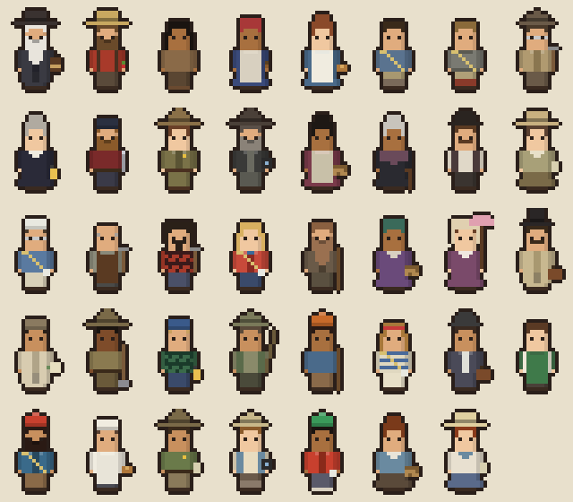

# Cast & Quest Chains

This is the full cast of people the player meets, where they live in the park, and the quest chains that trade stories, food, and materials for the climbing gear that opens the map. [STORY.md](../STORY.md) is the narrative frame, and [DESIGN.md](DESIGN.md) covers the mechanics.



*Left to right, top to bottom. Row 1: Clark, Lamon, Tenaya, Tabuce, Degnan, Leonard, Eichorn, Robinson. Row 2: J. Curry, Anderson, Hodges, Adams, Telles, Lebrado, McCauley, Michael. Row 3: Robbins, Salathé, Harding, Johnson, Muir, Bethel, then the stagecoach visitors. Row 4: the other visitors.*

## Art

- Every person has a 48×96 walking sheet in `assets/sprites/npcs/<id>.png`, laid out like the player's: 16×24 frames, with columns stand / step A / step B and rows down / up / left / right.
- The sheets are drawn in code by `tools/npcgen/npcgen.gd` from the looks in `tools/npcgen/looks.gd` (hair, hat, clothes, era props). To regenerate them:
  ```bash
  godot --headless --path . -s res://tools/npcgen/npcgen.gd
  godot --headless --path . --import
  ```
  You can replace any PNG with hand-drawn art in the same layout.
- Looks follow each person's era and period photographs. Native people are drawn in the everyday clothes they wore in photos from their time, **never regalia**. Their looks are placeholders pending tribal review, like their dialogue.
- Story item icons are in `assets/sprites/story_items.png`, drawn by the same tool. The sequoia cone and the flour sack are hand-drawn in `assets/sprites/side_quest_items.png`.

## Placing people

NPCs go in a hub's story overlay (`scenes/story/content/<hub>.tscn`). Each NPC has:

| Property | What it does |
|---|---|
| `character` | A `CharacterData` from `data/characters/` |
| `spot` | A marker name in the hub (`camp_4`, `curry_village`, …). They follow the marker if the map is regenerated. |
| `offset` | Offset from the spot, so several people can share one |
| `wander_radius` | How far they stroll from where they start. 0 means they stay put. They stop and face you when you talk. |

`tests/cast_test.tscn` checks that everyone stands on open ground.

## The cast

✦ = flagged `needs_tribal_review`. Their dialogue is marked **[Placeholder dialogue pending tribal review]** and must be written or approved with the associated tribes before release.

| Person | Years | Where | Gives |
|---|---|---|---|
| **Galen Clark** | 1814–1910 | Lamon Homestead gate | The Register (start), The Last Page (ending), pilot bread and apricots (The Big Trees) |
| **James Lamon** | 1817–1875 | Lamon Homestead | Lamon apples, dried apples |
| **Tenaya** ✦ | d. 1853 | Tenaya Creek, near Mirror Lake | A Register entry |
| **Tabuce (Maggie Howard)** ✦ | | The black oaks | Chuckah and acorn recipes |
| **Bridget Degnan** | | Degnan's Bakery | Bread, sourdough starter, apple bread pudding recipe (winter) |
| **Dick Leonard** | 1908–1993 | Swan Slab, Camp 4 | Rope, 2 cams |
| **Jules Eichorn** | 1912–2000 | Curry Village, foot of the Apron trail | 2 cams, 2 quickdraws |
| **Bestor Robinson** | 1898–1987 | Curry Village, foot of the Apron trail | Cheddar, dried apples (Royal Arches) |
| **Jennie Curry** | 1861–1948 | Camp Curry | Lamon apples |
| **James McCauley** | | Glacier Point | Bread, a Firefall entry |
| **Enid Michael** | 1883–1966 | Sentinel Dome | 4 cooking recipes |
| **Clare Marie Hodges** | 1890–1970 | Ranger station | 2 quickdraws, jerky (fall) |
| **Ansel Adams** | 1902–1984 | Best's Studio | 2 quickdraws |
| **George Anderson** | d. 1884 | Happy Isles | Anderson's eyebolt |
| **Royal Robbins** | 1935–2017 | The Ahwahnee | Belay device, 2 cams, 2 quickdraws |
| **Lucy Telles** ✦ | c. 1885–1955 | Yosemite Museum | Acorn cakes, a Register entry |
| **John Salathé** | 1899–1992 | Camp 4 | 2 cams (hard steel) |
| **Warren Harding** | 1924–2002 | El Capitan Meadow | Aiders, haul bag, the road to Tuolumne |
| **Beverly Johnson** | 1947–1994 | El Capitan Meadow | 2 ascenders, portaledge |
| **Maria Lebrado (Totuya)** ✦ | c. 1840–1931 | The meadow by the Ahwahnee | A Register entry |
| **John Muir** | 1838–1914 | Cathedral Lakes trailhead | Ice axe, crampons, pine nuts, dry crusts recipe |
| **Carrie Bethel** ✦ | 1898–1974 | Soda Springs | Pine nuts |

Dates marked blank are unconfirmed. Every character's `sources` field lists what to verify. Royal Robbins died recently (2017), so confirm his portrayal with his family, following the living and recently deceased rule in STORY.md.

### Mountain Shop staff

Two invented people work at the Curry Village Mountain Shop. They're not historical figures and never appear in the Register, but unlike visitors they give quests (`staff = true`, listed in `QuestLog.STAFF`, in `data/characters/staff/`):

- **Marty Kessler** runs the counter (the shop's Vendor; quests reach him through the shop's `talk_target`, `mountain_shop`). He trades you the guidebook and fits you with your first kit.
- **Wren Alvarez** started at the shop this week, doesn't know anyone in the Valley, and waits at the foot of Firefall Slab with a rope, looking for a partner.

**Firefall Slab** is an invented route too: a stand-in for the many bolted friction climbs on the lower Glacier Point Apron, named for the Firefall that poured from the cliff above.

### Visitors

Visitors are everyday people from each era who wander the trails and roads: a stagecoach couple at Wawona (1880s), a railroad passenger at El Portal (1910s), a motorist (1920s), a CCC worker and an angler (1930s), a camper (1950s), a Camp 4 climber, a climber in the Mountain Shop, and a backpacker (1970s), a landscape painter (1900s) at Glacier Point, and around Curry Village a tourist (1930s), a Pavilion cook, a ranger-naturalist, and a shopper in the store (1950s).

They're the **only** people in the game who aren't historical figures. So they:
- never give quests or appear in the Register (`visitor = true`),
- never stand in for a real person,
- are never Native. The game doesn't invent Native characters.

Talking to a visitor gets one random line.

## Places

| Place | Region · spot | Who's there |
|---|---|---|
| Lamon Homestead (your camp) | lamon_homestead · `gate`, `home` | Clark, Lamon (by your tent) |
| Camp 4 and Swan Slab | yosemite_village · `camp_4` | Leonard, Salathé, a Camp 4 climber; Swan Slab |
| Degnan's Bakery | yosemite_village · `degnans_bakery` | Bridget Degnan |
| Best's Studio | yosemite_village · `bests_studio` | Ansel Adams |
| Yosemite Museum | yosemite_village · `yosemite_museum` | Lucy Telles |
| Ranger station (Wilderness Center) | yosemite_village · `ranger_station` | Clare Hodges |
| Cook's Meadow | yosemite_village · `cooks_meadow` | a motorist |
| The black oaks | yosemite_valley | Tabuce |
| Camp Curry | curry_village · `registration_porch`, `apron_trailhead` | Jennie Curry, Jules Eichorn and Bestor Robinson (at the foot of the Apron trail), a camper, the Pavilion cook, a ranger-naturalist, a tourist; a shopper in the store and a climber in the Mountain Shop |
| El Capitan Meadow | yosemite_valley · `el_capitan_meadow` | Harding, Johnson; The Nose |
| Manure Pile Buttress | yosemite_valley, west of Camp 4 on the north side | Nutcracker |
| Sentinel Rock | yosemite_valley, up from the Four Mile trailhead | Steck-Salathé |
| Washington Column | yosemite_valley, east of the Royal Arches | Astroman |
| The west end | yosemite_valley, near Valley View | Separate Reality |
| Happy Isles | yosemite_valley · `happy_isles` | Anderson; Snake Dike |
| The Ahwahnee / Royal Arches | yosemite_valley · `the_ahwahnee` | Maria Lebrado; Royal Arches |
| The Ahwahnee grounds (walk north from the homestead: `ahwahnee_trail`, then `the_ahwahnee`) | the_ahwahnee · `front_door`, `rose_garden`, `tea_lawn`, `cascade`, `ahwahnee_meadow` | Royal Robbins and the Royal Arches start behind the hotel. The hotel's doors are still a sign, with no inside. |
| Mirror Lake | yosemite_valley · `mirror_lake` | Tenaya |
| Glacier Point Apron | yosemite_valley · `apron_base` | the Apron climb |
| Firefall Slab | curry_village · `apron_trailhead` | Wren Alvarez; the Firefall Slab climb. The lost rental shoes lie out front of the upper tent cabins. |
| Glacier Point | glacier_point | McCauley, Enid Michael, a painter |
| Tuolumne Meadows | tuolumne_meadows | Muir, Carrie Bethel, a backpacker; Cathedral Peak, Lyell Glacier |
| El Portal railyard | el_portal · `railroad` | The Model A axle and Degnan's sack of flour (pickups), a railroad passenger |
| Wawona Hotel | wawona · `wawona_hotel` | The stagecoach couple |
| Mariposa Grove | wawona · `grizzly_giant` | A sequoia cone at the foot of the Grizzly Giant (pickup, for Clark's *The Big Trees*) |

Yosemite Village is the hand-made hub you arrive at when you drive to the Valley. Its buildings, the Village Store clerk, and the Camp 4 traders come from `tools/hubs`. Rebuilding that hub never touches the story overlay, `scenes/story/content/yosemite_village.tscn`.

## Quest chains

### The main line: the guidebook and its tick list

The main storyline is one chain of quests (marked ★ in the Journal). Each one ends on a **tick**: a route topped out and logged in the climbing guidebook. The giver hands over the reward when you report back, so no main quest finishes without a climb. The only exceptions are the first (fetching the guidebook) and the last (the ending).

The main-line climbs climb the **Yosemite Decimal System** one grade at a time, from 5.5 on Firefall Slab to 5.13 on the Nose, climbed free. Marty explains the scale when he sells you the guidebook, Dick Leonard explains the Sierra Club's classes, and Robbins tells how the decimals were worked out at Tahquitz. The tick report and the journal show your hardest grade so far (`Guidebook.yds()` turns a grade into a number). `tests/cast_test.tscn` checks the ladder: one main-line climb per grade, each harder than the last.

Gear arrives in the order the routes need it, and a quest can hand over gear as each of its steps is finished (a step's `gear` key). `tests/cast_test.tscn` plays the chain and checks every climb's gear is in hand when it comes up.

```
★ 1  The Guidebook ........ Clark sends you to the Curry Village Mountain Shop.
★ 1a A Guidebook of Your Own  Marty Kessler (Mountain Shop) ... fetch the box from Jennie Curry, trade 20 energy of food → guidebook
                              Without it no route will start: you have no tick list to log it in.
★ 1b Fitted Out ............ Marty Kessler .................... lost rental shoes + 40 energy of food → climbing shoes,
                              chalk bag, harness, 5 quickdraws. Marty points you to Wren.
                                                                  grade
★ 1c Looking for a Partner . Wren Alvarez, foot of the Apron .. 5.5   food, then TICK Firefall Slab (Wren belays, brings the rope)
★ 2  Rock Climbing Section  Leonard, Swan Slab ................ 5.6   food, then TICK Swan Slab (top rope) → rope, 2 cams
★ 3  Up the Apron .......... Eichorn, at Curry Village ........ 5.7   TICK Glacier Point Apron (the Grack) → 2 cams, 2 quickdraws (opens Glacier Point)
★ 4  Clean Climbing ........ Robbins, at the Ahwahnee ......... 5.8   TICK Nutcracker, leaving no trace → belay device, 2 cams, 2 quickdraws
★ 5  The Cathedral Spires .. Eichorn; Robinson's story first .. 5.9   TICK Higher Cathedral Spire → 2 quickdraws
★ 6  Hard Steel ............ Salathé, Camp 4 ................. 5.10b Model A axle from El Portal, then TICK Steck-Salathé (Sentinel Rock) → 2 cams
★ 7  The East Face ......... Beverly Johnson, El Cap Meadow ... 5.11c food, then TICK Astroman (Washington Column) → 2 ascenders, portaledge
★ 8  Separate Reality ...... Robbins .......................... 5.12a TICK Separate Reality (the west-end roof crack) → 2 cams
★ 9  The Nose .............. Harding, El Capitan Meadow ....... 5.13  acorn cakes → aiders; food → haul bag; 30 acorns stored;
                              (free)  then TICK The Nose, free → the road to Tuolumne
★ 10 Cathedral Peak ........ Muir, Tuolumne ................... 5.6   TICK Cathedral Peak → ice axe, crampons
★ 11 Living Ice ............ Muir ............................ ice   TICK Lyell Glacier
★ 12 The Last Page ......... Clark: after Lucy Telles's and Maria Lebrado's stories → you write the last page
                              (pick one of four entries, or leave it blank; it's saved and shown in the journal)
```

After the Nose the scale stops mattering: the high country is alpine climbing, where the hard part is altitude, weather, and ice, not the grade. Cathedral Peak is only 5.6.

Geography is part of the progression. You leave the Lamon Homestead: south to Curry Village (guidebook, then the Apron behind it), north to the Ahwahnee (Robbins), then out across the Valley (Nutcracker near El Capitan, the Spire near Bridalveil, Sentinel Rock above the Four Mile Trail, Washington Column past the Royal Arches, the roof crack at the west end, El Capitan Meadow) and finally up the Tioga Road.

### Side stories

These stay available alongside the main line, and every chapter opens at least two (`tests/cast_test.tscn` checks this). The seasonal and hour-of-day ones are played through in `tests/side_quests_test.tscn`. The ones that start at the rim (McCauley, Enid Michael, Hodges) open after the Apron.

```
Clark's guidebook errand ─┬─ Lamon: Lamon's Garden ............ onions + berries → 4 apples
                          │     └─ (after the Apron) Lamon: Laying By ... yampah + manzanita → dried apples, apples
                          ├─ Tenaya: Ahwahnee ✦ ............... carry his account to Clark → Register entry
                          └─ Degnan: Bread for the Valley ...... deliver to Leonard + Curry → 3 bread, starter
                                └─ Curry: Let the Bread Rise ... starter → 6 apples
Tabuce: Acorns for the Winter → The Chuckah ✦ .................. acorns → chuckah + acorn recipes (needed for the Nose)
After Swan Slab:
  Wren Alvarez: The Rest of the Apron ... food, then climb the Apron with Wren → chocolate, apricots
                                          (pays off Wren's promise; the same tick finishes Eichorn's quest)
  Ansel Adams: Monolith ........... climb the Apron to the rim, report back → 2 quickdraws
  Anderson: Anderson's Iron ....... food worth 60 energy → Anderson's eyebolt (keepsake)
After the Apron:
  McCauley: The Fall of Fire ...... ask Curry about the Firefall → 2 bread, Register entry
  Enid Michael: Leave Some Behind . 2 yerba buena → elderberry sauce, toasted toyon, manzanita cider recipes
  Hodges: Mounted Patrol .......... check on Anderson and Michael → 2 quickdraws
After Nutcracker (the classics off the ladder):
  Bestor Robinson: The Long Way Up  food, climb the Royal Arches (5.7 A0, 16 pitches), tell him → cheese, dried apples
  Anderson: The Top of the Dome ... climb Snake Dike (5.7 R), tell him about the summit → pilot bread
  Robbins: Old Iron ............... show him Anderson's eyebolt, ask Harding about bolts, report back → wall food
After the Nose (Tuolumne open):
  Beverly Johnson: Ten Days Alone . 4 pine nuts from the high country, pack 60 energy → apricots, chocolate
  Ansel Adams: High Country Light . ask Muir, climb to the Lyell Glacier, report back → trail mix, cheese
After Tuolumne (Muir's glacier first):
  Muir: A Fire at Soda Springs .... supper for two (40 energy), then sit by his fire after dark
                                    (8 PM to 2 AM) → dry crusts recipe, 2 bread
The seasons, the hours, and the hubs past the Valley:
  Clark: The Big Trees ............ (after Swan Slab) a sequoia cone from the Grizzly Giant,
                                    Mariposa Grove at Wawona → pilot bread, apricots
  Enid Michael: The Dawn Chorus ... (after Leave Some Behind) count birds with her at Sentinel Dome
                                    between 6 and 10 AM, take the count to Hodges → spring greens recipe, strawberries
  Hodges: Bear Season ............. (fall only; after Mounted Patrol and The Chuckah) 20 acorns stored
                                    in your chuckah, warn Lamon about bears → 3 jerky
  Degnan: Snowbound ............... (winter only; after Bread for the Valley and Leave Some Behind)
                                    her flour from the El Portal railyard + toasted toyon → bread pudding recipe, 2 bread
Other:
  Lucy Telles: The Big Basket ✦ ... her name in the Register → 2 acorn cakes
  Carrie Bethel: Over the Crest ✦ . 4 acorn flour → 10 pine nuts
  Maria Lebrado: Where the Villages Were ✦ ... carry her account to Clark → Register entry
```

### Gear curve

| Route | Needs | Comes from |
|---|---|---|
| Firefall Slab (5.5) | climbing shoes, chalk bag, harness, 5 quickdraws (Wren brings the rope) | Marty Kessler (Mountain Shop) |
| Swan Slab (5.6) | nothing (top rope) | start |
| Glacier Point Apron (5.7) | rope, harness, 2 cams | + Leonard |
| Nutcracker (5.8) | rope, harness, 4 cams, 2 quickdraws | + Eichorn (Apron) |
| Higher Cathedral Spire (5.9) | rope, harness, 6 cams, 4 quickdraws, belay device | + Robbins (Nutcracker) |
| Steck-Salathé (5.10b) | rope, harness, 6 cams, 6 quickdraws, belay device | + Eichorn (Spires) |
| Astroman (5.11c) | rope, harness, 8 cams, 6 quickdraws, belay device | + Salathé |
| Separate Reality (5.12a) | rope, harness, chalk bag, 6 cams, 2 quickdraws | (already have) |
| The Nose (5.13) | 10 cams, 6 quickdraws, 2 aiders, 2 ascenders, haul bag, portaledge | + Johnson (Astroman), Robbins (Separate Reality), Harding |
| Royal Arches, Snake Dike (side) | 4 cams + 4 quickdraws; 2 cams + 6 quickdraws + belay device | (after Nutcracker) |
| Cathedral Peak | 4 cams, 4 quickdraws | (already have) |
| Lyell Glacier | + ice axe, crampons | + Muir |

The Mountain Shop and Camp 4 traders sell more of the same pieces for food (cams, quickdraws, and big-wall gear once you have aiders), but not the belay device, which opens the 5.9 tier and comes from Royal Robbins.

### Materials

| Item | From | Used for |
|---|---|---|
| Lamon apple | Lamon, Jennie Curry | Climbing food (12 energy, keeps 12 days) |
| Degnan's bread | Degnan, McCauley | Climbing food (25 energy, keeps 4 days) |
| Sourdough starter | Degnan | Jennie Curry's quest |
| Rental climbing shoes | Pickup by the Curry Village tent cabins | Marty Kessler's *Fitted Out* |
| Anderson's eyebolt | Anderson | Robbins's *Old Iron* (shown, not taken; a keepsake) |
| Model A axle | Pickup at the El Portal railyard | Salathé forges it into cams |
| Sack of flour | Pickup at the El Portal railyard | Degnan's *Snowbound* |
| Giant sequoia cone | Pickup at the Grizzly Giant, Mariposa Grove (Wawona) | Clark's *The Big Trees* |
| Spring greens | Campfire: 3 miner's lettuce + 1 wild onion (Enid Michael) | 36 energy, keeps 1 day |
| Apple bread pudding | Campfire: 1 bread + 2 apples → 2 (Degnan) | 30 energy each, keeps 6 days |
| Dry crusts | Campfire: 1 bread → 3 (Muir) | 9 energy each, keeps 30 days: bread for long trips |
| Pine nuts | Carrie Bethel, Muir | High-country food (20 energy, keeps 30 days) |

### New quest mechanics

- **Guidebook and ticks:** `Guidebook` (`scripts/story/guidebook.gd`) lists every route with its grade and gear. A step with `"unlock": "guidebook"` hands it over, and `ClimbStart` won't start a route without it. `QuestData.main_line` marks the main story. A step can also carry `gear`, `unlock`, or `items` to hand over when it's done. A shop's `talk_target` lets a quest send you to a shopkeeper.
- **`pay` step:** trade food worth `energy` when you turn it in (the soonest to spoil goes first). The Mountain Shop uses it to sell the guidebook and the starter kit.
- **Partners:** `RouteData.partner_quest` names a quest whose giver is your partner. The route only starts while that quest is underway or done (Firefall Slab: Wren's *Looking for a Partner*).
- **Bolted routes:** `RouteData.protection = "bolts"` puts a bolt every 2 moves on the line; each takes a quickdraw.
- **Seasonal quests:** `QuestData.offered_in` (season flags) limits when the giver offers a quest; none ticked means any season. Once started it can be finished in any season. Until its season comes round, the giver says the quest's `out_of_season` line instead of small talk ("Come and see me in the fall"). Hodges's *Bear Season* (fall) and Degnan's *Snowbound* (winter) use it.
- **`time` step:** talk to the giver between the hours `from` and `to` (the range wraps past midnight, so 20 to 2 is 8 PM to 2 AM). Enid Michael's dawn count and Muir's campfire use it.
- **Register notes:** a page in `RegisterPages.PAGES` can carry `history`, the Register's own note on what's documented and what the game dramatized. It shows under the page's margin notes. Every new page should have one.
- **`return` step:** done as soon as you talk to the quest giver again. It closes delivery rounds ("take bread to Leonard and Curry, then come back").
- **`hub:<id>` unlock reward:** opens a locked hub. Harding's *The Nose* uses `hub:tuolumne_meadows`.
- **Story pickups** (`scenes/story/pickup.tscn`): a one-of-a-kind item lying in the park, picked up once and remembered in the save. Give each one a unique node name.

## Before release

- **Tribal review** for Tenaya, Tabuce, Lucy Telles, Maria Lebrado, and Carrie Bethel: their looks, dialogue, the acorn and pine nut practices, and the Register entries about Ahwahnee and the village sites. It covers whether each person appears at all.
- **Tribal review, side stories:** Hodges's *Bear Season* speaks of storing acorns in a chuckah (part of the acorn-practice review), and Muir's *A Fire at Soda Springs* and its Register note say the 1890 park was drawn without asking the Native people who lived there. Neither puts words in a Native person's mouth, but both describe Native life and should go through the same review.
- **Verify** every character's `sources`, and fill in the blank dates (Degnan, McCauley, Tabuce).
- **Verify the side-story Register notes:** Clark in the Mariposa Grove (1857) and the start of prescribed fire in the groves (early 1970s); Enid Michael's start as a ranger-naturalist (1921) and her Yosemite Nature Notes; bear feeding shows (1920s to 1940) and the date of the last Yosemite grizzly (usually given as 1895); the Yosemite Valley Railroad (1907 to 1945, year-round to El Portal); Muir and Robert Underwood Johnson at Soda Springs (1889); the tin cup, tea, and dried bread Muir is said to have carried.
- **Permission:** Royal Robbins's family (he died in 2017).
- **Confirm** the Firefall's origin story (McCauley's family is the usual account, and it's told several ways).
